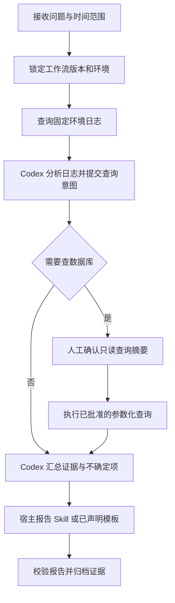
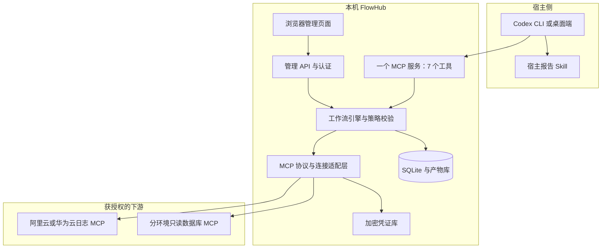

# MCP FlowHub 1.0：产品与架构设计

版本：1.0 设计基线 · 日期：2026-10-29 · 状态：待实施方案，非已完成产品

## 1. 结论与产品定位

建议开发一个**本地优先、可视化配置、对外只有一个 MCP 服务的工作流管理器**，工作名为 MCP FlowHub。名称尚未进行商标或同名项目排查。

它不是另一个聊天客户端，也不是重做 Dify/n8n。它把已经存在的 MCP 能力、环境约束、人工检查点和报告要求组织成可版本化、可复用、可追踪的执行方案。Codex 继续承担理解问题、推理和使用宿主 Skill 的工作；FlowHub 负责选择后的流程约束、工具调用、状态保存和证据归档。

**一个 MCP 服务 ≠ 一个工具。** Codex 只配置一次 FlowHub。该服务固定提供 7 个通用工具；生产排查、试运行排查等都是目录里的工作流数据。新增 100 条工作流，服务配置仍为 1 个，工具数量仍为 7 个。

### 1.1 用户需要的最终体验

1. 在浏览器打开本机管理页面，登记阿里云日志、华为云日志和数据库 MCP。
2. 系统读取工具目录及参数结构；用户在画布选择需要的具体工具，而不是笼统拖一个“MCP”图标。
3. 发布“生产问题排查与报告”：固定阿里云生产日志、数据库生产只读档案和报告契约。
4. 发布“试运行问题排查与报告”：固定华为云试运行日志、数据库试运行只读档案；复用相同图模板。
5. 对 Codex 说“排查生产环境这个订单的问题并生成报告”。Codex 查询 FlowHub 目录、取得方案、补齐时间范围等必要信息，再启动引导执行。
6. 工具证据由 Hub 收集，分析检查点交给 Codex，敏感读取由用户在管理页批准，最终生成带证据索引的报告。

自然语言自动选中是宿主模型行为，不是 MCP 协议的保证。因此提供精确名称/ID调用兜底；环境不明或匹配多个方案时必须确认，不默认选生产。

### 1.2 与几个相近概念的区别

| 概念 | 管理对象 | 本项目的处理方式 |
|---|---|---|
| MCP 聚合网关 | 多个服务的工具集中暴露 | 内部管理连接，但不把所有原始工具透传给 Codex |
| 工作流引擎 | 节点、边、状态与执行 | 是核心；增加环境锁定、检查点和版本快照 |
| Prompt/Skill 管理器 | 指令与知识 | 可挂载报告契约；不把文字指令当强制安全规则 |
| 通用自动化平台 | 各类触发器、连接器、执行服务 | V1 不做市场、定时器、任意代码和多租户 |
| MCP Server 工厂 | 每个工作流生成新服务 | 明确不采用；工作流永远是数据记录 |

### 1.3 现有 MCP、插件和 Skills 如何接入

| 来源 | V1接入方式 | 不能自动做到的事 |
|---|---|---|
| 标准MCP服务 | 用户登记独立stdio/HTTP配置，由Hub作为Client发现和调用 | 不复用宿主已建立会话或偷偷提取宿主凭证 |
| 已安装宿主Skill | 手动登记Skill标识与输出契约，运行时交给Codex | Hub不能保证任意Skill已安装，也不能把Skill当RPC |
| 只有宿主内可用的插件 | 若插件提供获授权的MCP/API，单独适配；否则仅作host任务交接 | 不承诺枚举或控制Codex所有插件内部能力 |
| 不可公开的企业工具 | 公司本地登记与验证；云端只用Mock接口 | 不要求上传私有代码、凭证或内部Schema |

“已经在Codex安装”不代表“Hub天然能调用”。阶段0应优先选一个实际MCP证明独立接入，而不是先做一键扫描所有插件的承诺。

## 2. 范围和优先级

### 2.1 1.0 必须完成的功能

| ID | 模块 | 具体交付 | 验收判定 |
|---|---|---|---|
| F01 | 单入口 | 固定 7 工具、stdio 接入优先、HTTP 可选 | 发布更多流程不修改宿主配置 |
| F02 | 连接目录 | stdio/Streamable HTTP、连接检测、能力发现、分页 | 展示真实 tools/list，不是手填假目录 |
| F03 | 环境档案 | 生产/试运行/测试、独立凭证引用、资源白名单 | 跨环境覆盖被拒，且下游零调用 |
| F04 | 图编辑 | 开始、MCP工具、Codex任务、条件、审批、模板报告、结束 | 可保存、校验、发布、导入导出 |
| F05 | 参数映射 | 表单/JSON Schema、变量选择器、锁定字段 | 不需要手写 JS；引用与类型检查通过 |
| F06 | 版本管理 | 草稿、不可变发布版本、差异、停用、回滚指针 | 正在运行的版本不随草稿改变 |
| F07 | 引导执行 | 搜索、详情、启动、检查点提交、状态、取消 | Codex 能完成一次真实闭环 |
| F08 | 持久化 | SQLite、运行快照、节点状态、命令去重 | 重启后可解释地恢复或阻塞 |
| F09 | 人工审批 | 独立 UI 会话、动作摘要、参数绑定 | MCP execution token 无法自行批准 |
| F10 | 报告证据 | MD/HTML、章节契约、证据索引、可信度分级 | 不把推测写成已证实结论 |
| F11 | 安全边界 | 默认只读、凭证库、输出脱敏、Origin/CSRF保护 | 负向安全用例全部通过 |
| F12 | 交付闭环 | GitHub CI、Mock MCP、Windows离线包、升级回滚 | 无公司凭证可完成云端测试 |

### 2.2 V1.0 与后续的边界

- **V1.0**：单用户、同机部署；串行与条件分支；条件采用有限表达式；一次只有一个活跃的 Agent 检查点；固定七工具；生产只读；Markdown/HTML报告；宿主 Skill handoff。
- **V1.1**：结构化并行/汇合、可控的有限次数重试分支、更丰富报告格式、更多宿主适配、经过实际客户端核验的 Skills over MCP。
- **以后再评估**：多用户/RBAC、远程部署、定时触发、插件市场、自动部署修复、任意代码、支付和商业托管。
- **不做**：读取/解密公司受控文件、复用未授权的宿主令牌、把生产数据库暴露公网、自动修改生产数据、承诺完全替代人工排障。

画布可以展示未来节点但必须清楚标为“未支持”；不得让未实现节点通过发布校验。V1.0 不接受图中回边、循环或并行分叉；条件的互斥分支可在普通节点汇合，按实际选中的路径继续。

## 3. 原始场景的准确建模

| 工作流 | 环境固定值 | 日志绑定 | 数据库绑定 | 报告方式 |
|---|---|---|---|---|
| incident-production | production | aliyun-log-prod | shared-db-prod-readonly | 宿主 incident-report Skill，或预先声明的模板降级 |
| incident-staging | staging | huawei-log-staging | shared-db-staging-readonly | 同一报告契约 |
| incident-test（可选） | test | test-log（若有） | test-db-readonly | 同一报告契约 |

这里“共享数据库 MCP”是实现/地址可共享，不是授权和参数任意共享。生产和试运行必须拥有独立绑定档案和明确资源标识，优先独立只读凭证。若该 MCP 允许模型任意指定 DSN、任意连接或者写 SQL，不能仅锁定 `environment` 字段就宣称安全。

### 3.1 推荐的排查链路

人工确认拒绝时不查询数据库，运行结束为 `REJECTED`；用户可另开仅日志方案。数据库返回空结果不等于成功排除问题，报告必须说明“在给定条件下未查到记录”。

### 3.2 查询意图，不是任意 SQL

Codex 在日志分析节点输出诸如 `queryNeeded=true`、`orderNo=DEMO-1001`、`reason` 和证据引用。示例中的 `order-by-number-v1` 模板固定在数据库节点，不能由 Agent 改成另一个查询。引擎校验业务参数，下游适配层将其转为工具的真实输入。

若现有 MCP 只接受 SQL：在 Hub 的受审查适配器中渲染预先批准的查询模板，使用该 MCP 支持的绑定参数；若它不支持参数化，生产接入验收必须额外评估，不能用模型拼接 SQL 直接替代。实际 SQL 模板由公司内网管理员根据真实表结构创建，不把公司结构或凭证放进公开示例。

## 4. 执行模式与职责

### 4.1 为什么选择混合引导模式

| 模式 | 谁推理 | 谁调用下游 | 优点 | 局限 |
|---|---|---|---|---|
| 只给说明书 | Codex | Codex 直接调用原 MCP | 实现简单 | Hub 无法强制流程、记录真实调用和环境 |
| 完全独立智能引擎 | Hub 内另一模型 | Hub | 可脱离宿主 | 需要模型供应商、费用、会话及新安全面 |
| **本方案：guided** | Codex | Hub | 使用已有宿主能力，调用受流程约束 | 依赖宿主持续推进检查点 |
| deterministic auto | 无模型推理 | Hub | 可靠重放固定流程 | 不能自动完成需要语义分析的节点 |

V1 不需要配置新的 OpenAI API Key，也不假设能够把 ChatGPT/Codex 订阅额度当作自建服务 API 使用。它由正在运行的 Codex 会话通过 MCP 推进，不是后台偷偷再启动一个聊天代理。

`auto` 仅允许全部为确定性节点的流程；含 `agent_task` 的工作流启动 auto 时返回 `MODE_NOT_SUPPORTED`。人类审批仍可能使确定性运行暂停。UI 必须分别显示执行模式与当前状态。

### 4.2 任务与 Skill 的区别

MCP 工具是可调用能力；Agent Skill 是由宿主加载的指令与支持文件，不能一概看成远程函数。当前已有官方 Skills over MCP 扩展，用于发现和读取 Skill 内容，但这不等于 FlowHub 可以自动调用用户机器上任意 Codex Skill。[S4]

V1 报告节点返回 `skillRef`、`reportContract`、证据引用和输出 JSON Schema。Codex 使用本地已安装且获得授权的 Skill，并提交报告内容。Hub 可验证字节、格式、章节、引用完整性，**不能凭提交结果证明 Skill 确实执行，也不能凭 hash 证明结论正确**。

若 Skill 不存在：返回明确的 `HOST_SKILL_UNAVAILABLE`。只有工作流预先配置模板降级且调用者明确选择时才降级；不能悄悄生成另一种报告后声称已使用该 Skill。V1 首发保证 MD/HTML；DOCX/PDF 等可以由宿主 Skill 额外生成，但不得在未导入实际文件时显示“已验证”。

## 5. 总体架构

### 5.1 进程与接入

- `flowhub serve`：唯一业务守护进程；持有 DB、凭证解锁状态、工作流调度器、HTTP管理服务。
- 本机管理页默认 `http://127.0.0.1:18473`，端口可配置；只监听 loopback。端口冲突明确报错，不随机开放公网。
- `flowhub mcp --stdio`：薄桥接进程，将固定工具请求传给守护进程；不直接写 SQLite，不持有第二套引擎。若主服务未运行，给出启动提示，不擅自开多个实例。
- `/mcp`：可选 Streamable HTTP 接入，同一个工具集合和引擎；不是第二套独立 MCP 业务。
- 管理 UI 会话与 MCP execution token 分开。stdio 桥可以从当前用户受限配置读取其自己的 execution token；禁止把管理凭证放进宿主可见参数或日志。
- 若使用 IPC，Windows 命名管道 ACL 与用户身份校验纳入 PoC；V1 基线可以使用 loopback + execution token，避免跨平台 IPC 开发阻塞核心。

本地服务仍需认证与 Origin/Host 校验；`127.0.0.1` 不是免认证理由。OAuth 和上游/下游 token 分离，不做 token passthrough。[S5][S6]

### 5.2 逻辑包划分

| 包 | 职责 | 禁止依赖 |
|---|---|---|
| contracts | DSL、领域 DTO、JSON Schema、错误码 | 不依赖 UI、数据库或 SDK |
| workflow-core | 图校验、状态机、映射、预算、审批规则 | 不直接发网络请求或读明文密钥 |
| persistence | SQLite事务、事件与产物索引 | 不做模型推理 |
| mcp-connectors | 下游协议、重连、工具发现、错误归一 | 不选择工作流或覆盖环境 |
| mcp-server | 固定7工具、身份与输入封装 | 不允许管理/修改流程或批准 |
| admin-api | 草稿/发布/连接/审批/导出等管理操作 | 不绕过领域校验 |
| web | 画布、运行台、目录、设置 | 不持有下游密钥明文 |
| mock-mcps | 合成日志、DB、协议故障 | 不访问公司网络 |

## 6. 技术选型与取舍

| 层 | 建议 | 原因与替代判断 |
|---|---|---|
| 前后端语言 | TypeScript，strict | MCP SDK 和画布生态更直接；减少跨语言 DTO 漂移 |
| 运行时 | Node.js 24 LTS 目标，PoC锁定补丁版 | 不是跟随 latest；实际支持看SDK与原生依赖验证 |
| 前端 | React、Vite、@xyflow/react | 拖拽、节点、边、viewport 复用成熟基础；不使用未获授权的 Pro 示例 [S7] |
| UI基础 | 自有设计tokens + 无障碍组件 | 冰蓝白与精致层次，不让后台模板决定视觉 |
| 服务端 | Fastify + 独立领域核心 | 路由/校验/日志清楚；MCP按官方SDK适配Web Request，PoC验证集成 |
| MCP | 官方 TS SDK v2，锁定具体版本 | 当前稳定主线；使用原生现代/legacy兼容，不手写协议解析 [S1][S2][S3] |
| Schema | JSON Schema + AJV，受限内置引用 | 输入/输出双向校验；拒绝远程 $ref、无限递归和超复杂schema |
| 数据 | SQLite WAL + better-sqlite3 | 单机无需Redis/MySQL；原生模块需Windows CI真实打包验证 |
| 密钥 | AES-256-GCM + scrypt派生的主密钥 | 用户口令解锁；盐/nonce随机；不把默认密钥写进源码 |
| 测试 | Vitest、真实协议Mock、Playwright、Windows CI | 浏览器UI、协议和恢复分别验证；不是只测静态函数 |
| 分发 | Windows离线ZIP + 校验和 + SBOM | 不依赖公司电脑在线npm install；后续再做签名安装器 |

考虑到你熟悉 Java/Spring Boot，Java 后端也可实现，但本项目优先目标是本地运行和快速适配 MCP。V1 不建议为了熟悉度同时维护 Java引擎、Node桥和前端三套核心。若团队要求 Java，先做同样的协议/打包 PoC，再替换后端，不能同时开发两种主线。

所有具体依赖版本在阶段0生成 `DEPENDENCY_BASELINE.md` 和 lockfile；本文不虚构尚未安装验证的版本组合。第三方许可证必须按**实际锁定版本与所复制文件**审核，不能简单认为“GitHub公开=MIT”。SDK当前包含不同来源的许可说明，应保留对应LICENSE/NOTICE。[S1]

## 7. 协议兼容，不假设所有客户端相同

截至设计核验日，官方 SDK v2 主线支持 2026-07-28 现代协议及 legacy 兼容。现代行为与2025初始化模型不同，业务流程图统一写“协议适配层连接”，不要手写固定 initialize 序列。[S1][S2]

实现要求：

1. 对外 stdio 先完成当前实际 Codex 版本的真实冒烟；记录宿主版本、协议时代、transport和OS。
2. 下游注册/检测时确定 `protocolEra` 与时间；缓存有有效期，连接配置或SDK变更后重验。不要每个步骤重新启动探测子进程。
3. SDK Client 的默认 legacy 行为不能误当自动探测；具体初始化以官方当前API和集成测试为准。
4. 401/403 是认证/授权问题，不能通过无凭证重试或协议降级绕过。
5. HTTP默认 legacy 无会话兼容不意味着所有旧GET/DELETE会话客户端都可用；有需要时用官方路由兼容方案，先测后宣称支持。
6. 旧 HTTP+SSE、Skills、Tasks、Sampling等不作为V1最低依赖。可列出扩展支持能力，但不能未经测试标绿。

## 8. 环境、权限与安全设计

### 8.1 绑定强度

| 等级 | 含义 | 是否可发布生产工作流 |
|---|---|---|
| UNVERIFIED | 手填标签/仅提示词/未联调 | 否 |
| MOCK_VERIFIED | 合成环境验证通过 | 只能发布为模拟流程 |
| BINDING_VERIFIED | 真实端点、资源、凭证和否定测试已核验 | 可以，但仍需生产读取批准 |
| REVOKED | 连接/凭证/策略被撤销 | 否；阻止未执行的后续节点 |

`BINDING_VERIFIED` 是一次有范围、有时间、有责任人的验证记录，不是永久安全认证。更换凭证、端点、工具schema、资源白名单后必须失效重验。数据库只读能力来自真实数据库权限，不来自 `readOnlyHint` 或 SQL 字符串前缀。

### 8.2 必须实施的约束

- 每节点允许的 serverRef、toolName、environment、resourceId 来自发布版本；来自用户输入、日志、Agent输出的同名字段一律不能覆盖。
- 凭证只在本机受控目录保存引用和密文，运行快照不保存密钥。不得导入整个 Codex 凭证缓存，登记连接必须由用户授权。
- stdio `spawn(executable,args,{shell:false})`、显式环境变量白名单、固定版本。完整命令由管理UI确认。`shell:false` 不是进程沙箱，不可信程序仍有当前账户权限。
- HTTP目标采用显式端点/主机白名单；企业内网是合法目标，允许经管理员批准的私网端点，其余拒绝。校验重定向、OAuth discovery和DNS变化风险。
- 工具描述、日志、Markdown均视为不可信文本；禁用原始HTML、脚本、危险链接与自动跳转；它们不能修改策略。
- 生产查询限制模板、库表范围、时间窗、最大行数、超时、并发、输出大小；输出PII脱敏；密钥字段在记录前去除。
- Hub MCP execution token只能运行被授权流程、读取本人产物，不能创建连接、修改流程、解锁凭证库或批准生产操作。
- 管理页需要独立登录；SameSite Cookie、CSRF token、Host/Origin校验、CORS同源；无默认密码、无token进URL。
- 固定保留策略：运行元数据默认30天、原始结果默认7天，可配置且遵守公司要求；删除前展示范围，支持导出脱敏元数据。

### 8.3 不能承诺的安全范围

FlowHub只能约束**经过它的调用**。如果同一个 Codex 同时配置了可直接访问生产的原始数据库 MCP，或者有读取本机全部文件的shell权限，本项目不能阻止宿主绕过Hub。严格场景应在经批准的专用宿主配置中只开放FlowHub及必要工具；更强隔离需要操作系统/网络/组织策略配合。

独立管理权限能保证七个MCP工具不能自我批准，但不能凭网页按钮证明操作者一定是真人。如果Agent还能控制已经登录管理页的浏览器，仍可能操作按钮；审批应使用不交给Agent控制的管理会话/独立设备，或组织认可的用户在场认证。V1不声称抵御同一OS账户已被完全控制的威胁。

本机持久化不是数据不出网保证：Codex分析收到的日志时，相关内容通常进入宿主的模型处理路径。实际生产数据是否可进入该服务，必须遵守公司批准的产品、账号、数据政策与脱敏要求；未经授权时只使用合成数据或获准的本地模型宿主。

## 9. 运行时可靠性

- 发布版本内容不可变，以版本号和规范化JSON SHA-256标识；启动绑定完整版本和schema摘要。
- 每个run持久化快照、节点attempt、checkpoint、revision和command幂等键。
- 一个业务守护进程；DB transaction/CAS防止两个客户端同时推进。
- 下游调用前先记录dispatch intent，结果持久化后才推进。进程崩溃发生在外部调用与记录之间时标记不确定，不能宣称 exactly-once。
- 默认只对经过确认的安全只读调用自动重试，最多2次、指数退避与总时间预算。生产同一查询重复也有负载/审计成本，按节点可禁重试。
- 超时、取消、网络断连不等于下游未执行；不能确定时用 `OUTCOME_UNKNOWN`，需要人工检查。
- 工具schema变更 fail closed：新运行阻止，运行中受影响的尚未执行节点进入 `BLOCKED`；重新校验并新开版本，不偷偷改运行快照。
- 恢复/重试创建新attempt并保留原证据。V1不提供“任意跳过安全节点”功能。

## 10. 可衡量的成功标准

目标是可验收的工程预算，非未测的性能承诺：

| 指标 | V1目标与条件 |
|---|---|
| 服务/工具膨胀 | 100条流程后对外仍1服务、7工具 |
| 注册可用性 | 支持清单内的stdio与HTTP Mock和真实试运行MCP均能发现工具 |
| 环境约束 | 所有跨环境、参数覆盖、凭证越权负例均无下游调用 |
| 可恢复性 | 检查点等待时重启不丢失；在途不明调用准确标注 |
| 可追溯性 | 每个结论能引用run内实际证据，缺证据明确标为假设 |
| UI | 桌面1440×900无主要操作遮挡；键盘可操作主流程；100节点画布可用 |
| 性能预算 | 本机目录搜索100流程 p95<300ms；启动返回run handle p95<1s，不含连接与外部执行 |
| 云端可测 | 无企业网络/密钥时，核心协议+引擎+UI+Windows打包测试可通过 |
| 真实完成 | 公司获准设备至少完成生产只读/试运行各一次端到端核验；模拟通过不能替代 |

## 11. 开发价值判断

有开发价值的部分是“**宿主继续推理 + 固定少量工具 + 可视化runbook + 真正的环境绑定 + 可审计检查点**”这一组合，而不是再做一张通用拖拽画布。先服务你自己的生产/试运行排查，再验证是否能被第二位使用者无代码配置使用。

阶段0必须先证明三个前提：实际现有MCP可被Hub独立连接；环境约束可被验证；公司批准的运行目录/分发方式可以正常加载程序与数据库。如果这些不成立，应调整接入方案或暂停，而不是先投入大规模UI开发。

## 12. 本方案依据的官方资料

下列资料核验于2026-10-29；实现时仍需核验锁定版本。第三方项目的README研究不等于源代码审计。

- [S1：MCP TypeScript SDK官方主仓库](https://github.com/modelcontextprotocol/typescript-sdk/blob/main/README.md)
- [S2：SDK协议版本与现代/legacy行为](https://ts.sdk.modelcontextprotocol.io/v2/protocol-versions)
- [S3：SDK legacy客户端兼容](https://ts.sdk.modelcontextprotocol.io/v2/serving/legacy-clients)
- [S4：官方Skills over MCP扩展](https://modelcontextprotocol.io/extensions/skills/overview)
- [S5：MCP授权安全](https://modelcontextprotocol.io/specification/2026-07-28/basic/authorization/security-considerations)
- [S6：MCP安全最佳实践](https://modelcontextprotocol.io/docs/2026-07-28/tutorials/security/security_best_practices)
- [S7：React Flow官方文档](https://reactflow.dev/learn)
- [S8：MCP工具发现与调用](https://modelcontextprotocol.io/specification/2026-07-28/server/tools)
- [S9：Codex云端环境](https://learn.chatgpt.com/docs/environments/cloud-environments)
- [S10：Codex MCP接入](https://learn.chatgpt.com/docs/extend/mcp)
- [S11：Codex Skills](https://learn.chatgpt.com/docs/build-skills)

本方案的状态机、接口名、数据表、限额与UI是本项目的设计选择，不是声称由MCP标准规定。
