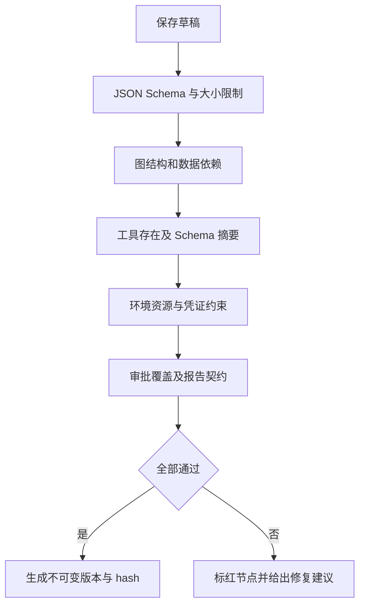
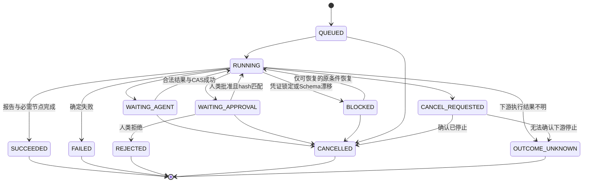
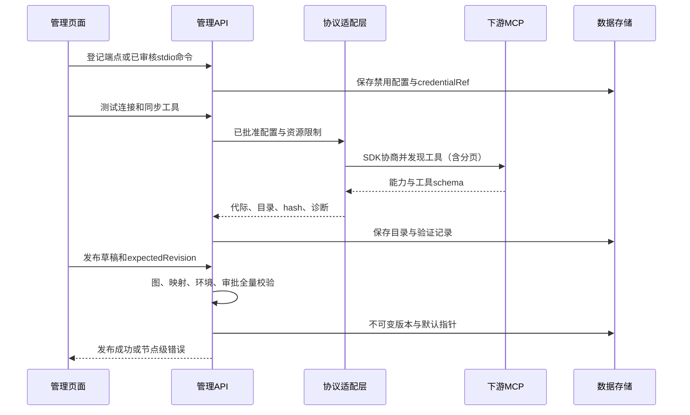
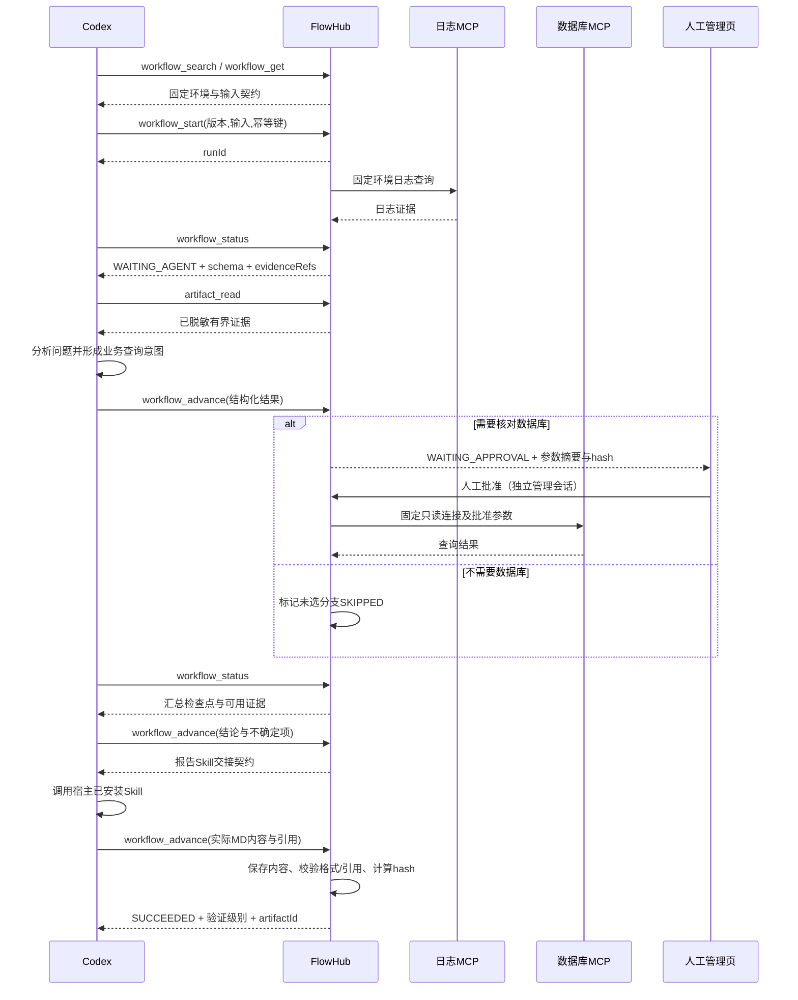
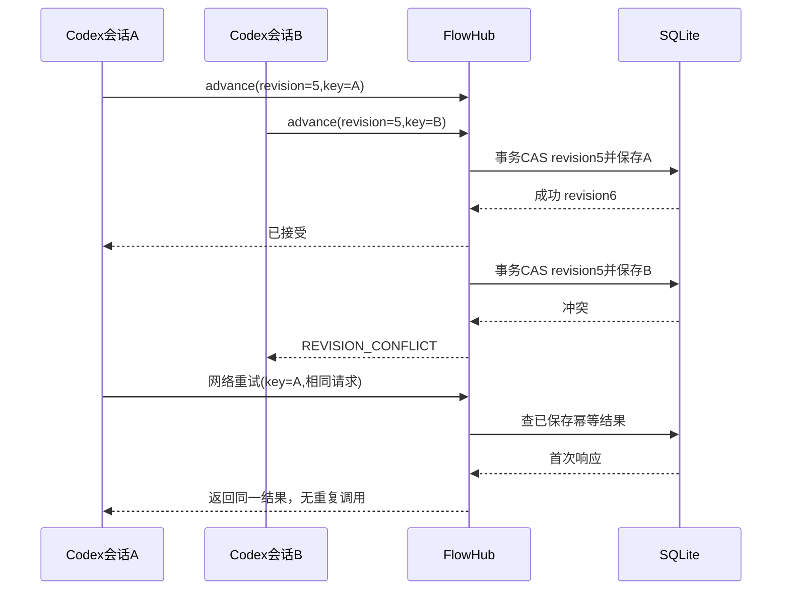
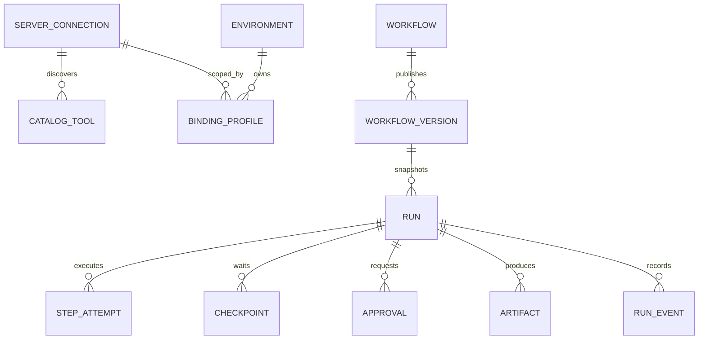

# MCP FlowHub 1.0：协议、执行引擎与数据设计

版本：1.0 设计基线 · 日期：2026-10-29

本章是待开发的应用层契约。接口示例是 **MCP tool arguments / 应用返回数据**，不是完整JSON-RPC线协议；2026/legacy的协商、元数据和结果封装交给锁定版本的官方SDK。HTTP管理接口不是对Codex增加的MCP工具。

## 1. 领域词汇与身份

| 对象 | 含义 | 身份/版本 |
|---|---|---|
| ServerConnection | 一个下游MCP端点或本地启动配置 | 不可猜测connectionId + revision |
| CatalogTool | 某连接中一个实际工具及schema | connectionId + toolName + schemaHash |
| Environment | production/staging/test语义空间 | 环境ID，不能由日志改写 |
| BindingProfile | 工具、环境、资源、凭证和策略的绑定 | bindingId + revision + validationRecord |
| Workflow | 可发现的业务方案 | workflowId，稳定可读slug |
| WorkflowVersion | 不可变发布内容 | workflowId + version + contentHash |
| Run | 一次执行与完整快照 | 随机runId + ownerSubject + revision |
| StepAttempt | 某节点的一次派发 | runId + nodeId + attempt |
| Checkpoint | 需要Codex或人类输入的暂停点 | checkpointId + revision + tokenHash |
| Artifact | 日志、查询结果或报告的实际内容 | artifactId + owner/run + sha256 |

ID不是授权凭证；所有读写都校验subject/scopes与所属关系。V1单用户仍给每个宿主连接独立client identity，便于撤销和审计；不声称能够隔离同一OS账户下已经完全控制机器的恶意进程。

## 2. 对外固定七个 MCP 工具

| 工具 | 输入核心字段 | 返回 | 读/写边界 |
|---|---|---|---|
| `workflow_search` | query、environment?、tags?、cursor?、limit? | 已发布/有权限的候选及匹配原因 | 不返回密钥或完整执行记录 |
| `workflow_get` | workflowId、version? | 固定环境、输入schema、节点摘要、报告契约、风险 | 不返回凭证明文和内部启动命令 |
| `workflow_start` | workflowId、version、inputs、mode、idempotencyKey | runId、snapshotHash、state、revision | 不接受environment/connection覆盖 |
| `workflow_advance` | runId、checkpointId、checkpointToken、expectedRevision、idempotencyKey、submission | 当前状态、新revision或下一检查点 | 仅Agent结果；无人工批准能力 |
| `workflow_status` | runId、afterEventSeq?、limit? | 状态、增量事件、可访问证据、待办 | 校验owner；不能读取其他run |
| `workflow_cancel` | runId、expectedRevision、reason、idempotencyKey | 取消请求及是否仍有在途调用 | 不代表下游回滚 |
| `artifact_read` | runId、artifactId、offset?、maxBytes? | 有界内容分块、hash、媒体类型、下一偏移 | 不接受任意文件路径或URL |

没有 `execute_any_tool`、`approve`、`run_shell`、`change_environment` 这样的通用逃生工具。管理能力不暴露给宿主模型。MCP descriptions强调：先搜索/读方案，补齐输入，不猜生产环境，在 `WAITING_AGENT` 提交结构化结果，在 `WAITING_APPROVAL` 提醒人类处理。

### 2.1 检索与稳定发现

V1采用SQLite全文/词项与标签组合，不依赖embedding服务。排序参考：workflowId/精确名、环境匹配、业务标签、description关键词；仅作为可解释排序，不显示伪精确的“AI正确率”。`query`最长500字符，`limit`默认10、最大50，游标不暴露数据库offset和内部结构。

候选示例：

```json
{
  "items": [{
    "workflowId": "incident-production",
    "name": "生产问题排查与报告",
    "version": "1.0.0",
    "environment": "production",
    "mode": "guided",
    "matchedBy": ["environment", "keyword:排查"],
    "requires": ["question", "orderNo", "from", "to"],
    "riskSummary": "固定生产只读连接；数据库查询需人工确认",
    "validationStatus": "MOCK_VERIFIED",
    "demoOnly": true
  }],
  "nextCursor": null
}
```

实际生产方案必须达到BINDING_VERIFIED；此例只是设计包中的合成场景。授权失败不返回候选是否真实存在，避免目录枚举。

### 2.2 启动示例

```json
{
  "workflowId": "incident-production",
  "version": "1.0.0",
  "mode": "guided",
  "inputs": {
    "question": "演示订单支付后状态异常",
    "from": "2026-10-29T00:00:00Z",
    "to": "2026-10-29T00:30:00Z",
    "orderNo": "DEMO-1001"
  },
  "idempotencyKey": "demo-start-20261029-001"
}
```

运行前按所选版本的`inputSchema`再次验证（包括additionalProperties=false、时间顺序、最长时间窗、业务scope），不能只依赖七工具的通用schema。流程固定environment在版本中，不从inputs中取。指定版本已停用/绑定撤销/目录漂移时拒绝，不静默改用最新版。

成功立即返回运行句柄：

```json
{
  "ok": true,
  "runId": "run_DEMO_RANDOM_001",
  "workflowId": "incident-production",
  "version": "1.0.0",
  "state": "RUNNING",
  "revision": 1,
  "snapshotHash": "sha256:DEMO_PLACEHOLDER",
  "pollAfterMs": 1000
}
```

不要把整个排障过程塞进一个几十分钟的MCP请求。长任务由应用run状态承载，V1不强制依赖Tasks扩展。

### 2.3 Agent检查点与回传

```json
{
  "state": "WAITING_AGENT",
  "revision": 5,
  "checkpoint": {
    "id": "cp_DEMO_02",
    "token": "DEMO_EPHEMERAL_TOKEN",
    "nodeId": "plan",
    "kind": "analysis",
    "instruction": "分析现有日志，判断是否需要按订单号核对数据库；不要输出SQL或改环境。",
    "environment": "production",
    "availableEvidence": [
      {"artifactId": "art_DEMO_LOG", "nodeId": "log", "mimeType": "application/json", "truncated": false}
    ],
    "nodeOutcomes": {"log": "SUCCEEDED", "db": "NOT_STARTED"},
    "requiredOutputSchema": {
      "type": "object",
      "properties": {
        "queryNeeded": {"type": "boolean"},
        "orderNo": {"type": "string", "maxLength": 64},
        "reason": {"type": "string", "maxLength": 2000},
        "evidenceRefs": {"type": "array", "items": {"type": "string"}}
      },
      "required": ["queryNeeded", "orderNo", "reason", "evidenceRefs"],
      "additionalProperties": false
    }
  }
}
```

上述ID、token、hash都是示例，非可用凭证。真实checkpoint token随机，以hash校验并记录有效期，日志脱敏；它绑定owner/run/node/revision，不替代execution token。为支持断线/重启后由授权status重新取得token，另保存受凭证库密钥保护的AES-GCM交付副本（独立nonce/AAD绑定run与checkpoint），不保存明文。凭证库锁定时只能查看脱敏状态，不能取回token或推进；解锁后在原有效期内恢复。密钥撤销/副本损坏时废弃旧检查点，通过显式恢复操作创建新checkpoint/revision，不从hash猜测还原。

```json
{
  "runId": "run_DEMO_RANDOM_001",
  "checkpointId": "cp_DEMO_02",
  "checkpointToken": "DEMO_EPHEMERAL_TOKEN",
  "expectedRevision": 5,
  "idempotencyKey": "demo-advance-plan-001",
  "submission": {
    "type": "agent_result",
    "payload": {
      "queryNeeded": true,
      "orderNo": "DEMO-1001",
      "reason": "日志中记录到状态回写失败，需要核对订单当前状态。",
      "evidenceRefs": ["art_DEMO_LOG"]
    }
  }
}
```

只允许当前节点声明的schema。证据ID必须存在且属于此run，不能引用其他运行或任意本地路径。`availableEvidence`由引擎附加给Agent，不通过任意DSL表达式开放整个数据库。合流后的Agent检查点同时给出实际执行/跳过节点状态，解决可选DB分支未执行时的空引用问题。

示例的查询scope是用户输入的单个orderNo，plan输出的orderNo必须与该输入一致，不能因为符合字符串格式就查询另一个订单。更一般的业务范围由绑定和输入scope共同限定；若要扩展范围，应另行征求用户确认并启动获准流程，而不是将模型推断当授权。

仅在`kind=host_skill`检查点允许第二种submission：`{"type":"host_skill_unavailable","useDeclaredFallback":true}`。引擎必须检查发布版本预声明的`fallbackTemplateRef`，记录未使用宿主Skill，并由Hub渲染该版本模板；不能让模型回传新模板或可执行代码。没有预声明fallback，或`useDeclaredFallback=false`，则返回`HOST_SKILL_UNAVAILABLE`并保持WAITING_AGENT，等待宿主安装/恢复Skill或取消；不能假装报告完成。此分支不是人工批准通道。

### 2.4 `advance` 的事务与并发

成功提交（合法agent_result或已接受的预声明fallback）在一个事务中完成：验证身份 → 查询幂等记录 → 验证run当前状态、revision、token和节点 → 校验payload及引用 → 插入submission与后继动作intent → 消耗checkpoint → 增revision → 持久化结果。事务提交后调度器才派发外部请求。`host_skill_unavailable`且未使用可用降级的分支只记录错误事件与幂等错误结果，不消费checkpoint、不进行业务推进；在有效期内可使用新请求键提交修复后的结果。

- 相同 `(subject,operation,idempotencyKey)` + 相同规范化请求hash：返回首次结果，不再次推进。
- 相同键但不同请求hash：`IDEMPOTENCY_CONFLICT`。
- 不同键抢同一revision/checkpoint：只有一个成功，另一个`REVISION_CONFLICT`。
- checkpoint被撤销/超时：`CHECKPOINT_EXPIRED`；只能通过新检查点/重新运行恢复，不复活旧token。
- 重复成功请求优先查幂等结果，不能因checkpoint已消耗让正常网络重试变成失败。

`commands.response_json`只保存脱敏安全摘要与引用，不保存checkpoint token明文。响应若需token，通过身份校验后从仍有效的加密交付副本重组；已经消费/过期时不重发旧能力，只返回首次接受的结果与当前状态入口。

### 2.5 状态与事件

`workflow_status`返回`events`（seq递增）、当前节点、脱敏参数摘要、waitingReason、可用artifacts、是否truncated。`afterEventSeq`支持增量读取；客户端指数退避1s→2s→5s，等待Agent/审批时不忙轮询。事件不是原始日志全文，原文按权限通过`artifact_read`分块读取。

`artifact_read`默认最大64 KiB，硬上限256 KiB，offset为字节偏移；文本分块避免切断UTF-8字符并返回实际nextOffset。二进制只返回受控格式的块或下载提示；V1默认只提供UTF-8 MD/HTML/JSON/TXT。禁止 `../../`、绝对路径、符号链接逃逸和跨run读取。

## 3. UI 管理 API

前缀 `/api/v1`，独立admin身份。返回统一 `{data,requestId}` 或 `{error:{code,message,details},requestId}`。输入额外字段默认拒绝；草稿/配置修改使用`If-Match` revision防丢失更新。导出不带secret，导入默认禁用。

| 方法与路径 | 功能 | 特殊约束 |
|---|---|---|
| GET /health | 最小存活状态 | 不暴露连接名、环境、版本外的敏感数据 |
| POST /auth/session | 管理登录 | 防暴力尝试；无默认密码 |
| DELETE /auth/session | 注销 | 失效会话，不代表取消已运行任务 |
| GET/POST /connections | 列表/创建连接 | 新stdio命令需人工审核 |
| PATCH /connections/:id | 修改端点/参数 | revision变更，使相关验证过期 |
| POST /connections/:id/test | 探测协议与权限 | 不自动扩大scope或切换凭证 |
| POST /connections/:id/sync-tools | 拉取完整工具目录 | 分页、超时、数量上限、差异摘要 |
| GET /tools | 工具检索 | connection/env过滤，纯文本描述 |
| GET/POST /bindings | 绑定与只读策略 | 凭证只接受secretRef |
| GET /bindings/:id/impact | 修改/撤销前的只读影响预览 | 引用草稿、冻结发布版本、活跃run；不代替修改时的CAS |
| POST /bindings/:id/verify | 记录实际验证 | 仅经过完整检查后升级等级 |
| GET/POST /workflows | 列表/草稿创建 | workflowId唯一，不自动发布 |
| GET/PUT /workflows/:id/draft | 获取/保存图 | 乐观锁、大小上限、校验摘要 |
| POST /workflows/:id/validate | 语法+图+策略预检 | 无隐含工具执行；连通检测独立按钮 |
| POST /workflows/:id/publish | 发布不可变版本 | 服务端再次全量验证，版本号唯一 |
| POST /workflows/:id/disable | 禁止新启动 | 活跃run按安全策略决定阻止后续 |
| GET /workflows/:id/versions | 列版本、差异 | 敏感字段不返回 |
| POST /workflows/:id/select-version | 切换默认版本指针 | 不修改已存在版本，不改变run快照 |
| POST /workflow-imports/preview | 检查导入包 | ZIP限制、防路径穿越；不执行stdio |
| POST /workflow-imports/commit | 导入为禁用草稿 | 用户确认连接与环境后才可发布 |
| GET /runs、/runs/:id | 运行列表与详情 | 主体权限、分页、状态过滤 |
| GET /runs/:id/events | UI SSE事件流 | 与MCP transport SSE不同；鉴权、断线游标 |
| POST /approvals/:id/decision | 人工批准/拒绝 | admin+CSRF+快照hash+过期校验 |
| POST /runs/:id/review | 处理BLOCKED/UNKNOWN | 记录原因；新run/attempt，不伪改历史成功 |
| POST /secrets | 添加凭证 | 响应只返回ref，原文不回显 |
| POST /vault/unlock、/vault/lock | 密钥库解锁/锁定 | 仅管理通道，限速，日志不可见口令 |
| POST /support-bundles/preview | 预览脱敏支持包 | 白名单字段，不默认采集全配置 |
| POST /support-bundles/export | 确认导出 | 不自动上传GitHub或外部服务 |

正式开发需生成 OpenAPI 并为每路由写401/403/409/422测试；本表不是允许忽略任何server-side约束的简化实现。

`GET /runs` 保留 `data` 数组，另返回 `meta:{nextCursor,hasMore,limit,total}`；支持精确 `state`、`workflowId`、`environment` 过滤，`limit` 默认50、范围1–200。下一页携带返回的 `cursor` 和相同过滤条件；游标签名并固定本轮历史上界，新插入运行不使旧页重复。切换过滤条件或守护进程重启后应从首屏重新读取；无效、篡改或跨过滤条件的游标返回422。

`GET /runs/:id` 接受 `after`（非负安全整数，默认0）与 `limit`（默认200、范围1–500），返回 `events` 及 `eventCursor:{after,nextAfter,hasMore,limit}`。客户端按事件seq去重合并，`hasMore` 为真时继续读取 `after=nextAfter`，切换run时清空游标。SSE接口支持相同的 `after`/`limit`；未传 `after` 时可使用 `Last-Event-ID` 恢复。

绑定影响预览返回 `bindingId`、当前 `revision`、`validationStatus`、`draftWorkflows`、`publishedVersions`、`activeRuns` 及三类数量 `summary`。发布引用来自各版本不可变快照，活跃运行引用来自各run不可变快照，不以当前草稿替代历史引用。修改或撤销增加绑定revision，引用旧revision的发布版本需重新发布；活跃运行在下一次执行准入时阻塞，在途外部调用不能据此声称已取消。预览只列安全身份和节点摘要，不返回参数、密钥或凭证内容；真正修改仍验证 `If-Match`。

## 4. DSL、映射与发布校验

### 4.1 基本结构

机器可读文件见 `contracts/workflow.schema.json` 以及两个 `examples/incident-*.json`。canonical保存JSON；YAML只是输入格式，拒绝自定义tag/alias炸弹，转换成同一JSON结构。UI位置放在独立`draft_layout`，不参与执行语义hash，避免拖动节点造成无意义安全版本变化。

```json
{
  "schemaVersion": "flowhub.workflow/v1",
  "workflowId": "incident-production",
  "name": "生产问题排查与报告",
  "description": "固定生产只读资源的引导式排查",
  "version": "1.0.0",
  "environment": "production",
  "mode": "guided",
  "tags": ["排查", "日志", "报告"],
  "inputSchema": {"type": "object", "properties": {}, "additionalProperties": false},
  "bindings": {"log": "aliyun-log-prod", "db": "shared-db-prod-readonly"},
  "nodes": [],
  "edges": [],
  "budgets": {
    "maxRunSeconds": 1800,
    "maxToolCalls": 8,
    "maxNodeExecutions": 32,
    "maxAgentCheckpoints": 5,
    "maxOutputBytes": 262144,
    "maxRows": 100,
    "maxToolSeconds": 30,
    "maxRetries": 0
  }
}
```

此段只解释顶层，不是可发布流程。附录示例提供完整节点；schema hash等占位内容必须替换为实际发现结果，并重新验证才允许非模拟发布。

### 4.2 节点契约

| type | config核心 | 输出 | 约束 |
|---|---|---|---|
| input | 输入schema由顶层定义 | 已校验inputs | 唯一开始节点 |
| mcp_tool | bindingKey、toolName、toolSchemaHash、argumentsMappings | 结构化结果+artifactRefs | 绑定必须属工作流环境；安全字段固定注入 |
| agent_task | kind、instructions、outputSchema、inputMappings、skillRef? | 校验后结构化结果 | 不自动向任意模型API发请求；checkpoint响应的instruction由此生成 |
| condition | expression有限AST | true/false | 只能读已完成必经节点；恰好两个标记出口 |
| approval | actionNodeId、summary、expiresAfterSeconds、approvalChannel | 决策记录 | 批准绑定目标实际解析参数，不是泛泛批准整条链 |
| report_template | templateRef、inputMappings | MD/HTML artifact | 无脚本模板引擎、HTML转义 |
| end | resultRef | 运行完成摘要 | 校验报告契约与实际产物；不能留下未消费必需任务 |

示例中数据库审批的解析输入在批准前计算并hash；如果Agent回传、更换绑定或任何参数变化使hash不同，旧批准无效。不是“曾经点过一次同意就全放行”。

### 4.3 参数映射

```json
{
  "/parameters/orderNo": {"ref": {"source": "node", "nodeId": "plan", "pointer": "/orderNo"}},
  "/templateId": {"value": "order-by-number-v1"},
  "/maxRows": {"value": 100}
}
```

映射对象的key是目标JSON Pointer，value只支持literal和JSON Pointer引用；同一目标父子路径不得同时写入，拒绝prototype相关路径。边采用`{source,target,port}`，port为`next`或条件的`true/false`。不得 `eval`、JavaScript函数、动态对象prototype、文件读取、网络读取或任意模板执行。缺失与null严格区分，类型不隐式转换；V1的工作流dataSchema不自动补默认值，如需常量必须显式常量映射并在UI展示，不悄悄把空订单号变成查全库。七工具分页limit等协议级默认值与业务输入默认值是两回事。

合流后可选分支输出不可当必填ref；静态校验进行支配/路径可达分析。Agent检查点的`availableEvidence`附带实际已取得的可见证据，不要求可选节点一定有输出。

### 4.4 发布校验顺序



必须检查：唯一开始、可达结束、孤立节点、重复ID、环、非法分叉、条件出口完整、无循环/并行、引用节点与类型、跨分支引用、过大schema、工具漂移、环境一致性、生产绑定验证、只读保证、审批覆盖、max budgets、Skill降级规则。前端检查帮助体验，后端必须全部重做。

### 4.5 执行快照与热更新

启动时冻结DSL、版本hash、tool schema、binding revision、policy version、模板版本、报告契约与预算；凭证存ref而非明文。凭证轮换在同等权限下可解析新密钥，但若权限、资源、端点改变，绑定验证失效。即时撤销优先，旧run不能以“版本已冻结”为由继续访问被撤销资源。

## 5. 状态机与调度



`OUTCOME_UNKNOWN` 是此次执行的终态，必须人工复核后**创建新运行**并记录`retryOfRunId`，不把原run改成成功。`BLOCKED`仅在未改变快照的外部条件恢复（例如凭证库重新解锁）后可继续；schema/权限/环境需要修改则必须新版本新run。图中未展示的等待超时按错误策略变为FAILED/EXPIRED（V1统一FAILED + CHECKPOINT_EXPIRED错误码），不新增含糊的状态别名。

节点状态：`PENDING / READY / RUNNING / WAITING_AGENT / WAITING_APPROVAL / SUCCEEDED / SKIPPED / FAILED / CANCELLED / OUTCOME_UNKNOWN`。分支未选中的节点标SKIPPED，合流节点沿选中路径继续一次；不等待所有入边都SUCCEEDED，否则互斥分支会死锁。

### 5.1 调度与预算

- 单run串行推进；V1默认最大同时活跃run为3，生产DB连接并发默认1，可降低，不允许Agent提升。
- 单次工具默认超时30s、最大120s；run默认30min，可按发布策略调整。
- 等待用户/Agent时间独立统计，不能把人工思考时间算作数据库超时；run等待24h默认过期，可配更短。
- 同步result默认256KiB，raw artifact默认10MiB/run；日志大结果分页或明确truncated，禁止静默删行后得出完整结论。
- 执行预算到达则停止新调用，保留已有证据并返回明确错误。
- 只读工具重试最多2次；无幂等/只读保障则0次。重试保留attempt、错误和退避事件。

示例DSL可比全局上限更严格（例如maxRetries=0）；有效上限取系统策略、环境绑定与工作流三者的最小值。`maxRunSeconds`是活跃执行预算，等待期限另由系统检查点策略控制；`maxOutputBytes`是单节点输出预算，run产物总预算默认10MiB在系统策略控制。生产管理员可以进一步收紧，Agent不能提高任何预算。

### 5.2 崩溃恢复

启动扫描未终态run与未完成attempt。等待Agent/审批恢复原检查点，批准token按过期规则失效。READY但未dispatch可继续；已记录外部dispatch而没有可信完成记录，默认OUTCOME_UNKNOWN，不凭内存推测“应该没执行”。

SQLite事务不能包住整个网络调用来获得跨系统原子性。正确做法是持久化intent、外部执行、持久化结果与下一步，承认中间窗口；后续若下游支持请求ID查询/幂等键，可在适配器中增加可验证恢复能力。

## 6. 核心时序图

### 6.1 登记连接与发布



### 6.2 Codex 引导排查的完整时序



Agent回传的工具结果和报告内容仍不可信；引擎只接受schema规定的字段。宿主真正调用Skill的过程发生在宿主，不是Hub发远程RPC。

### 6.3 两个客户端重复推进



## 7. 数据模型与约束

使用SQLite，所有时间UTC ISO8601或统一epoch毫秒，禁止两种混用；UI按显式timezone显示。API使用camelCase，DB列snake_case。所有JSON列写入前schema验证，查询条件尽量用正规列及索引。V1不存原始敏感payload到普通audit表。

| 表 | 核心字段 | 约束/索引 |
|---|---|---|
| `server_connections` | id,name,transport,config_json,credential_ref,revision,protocol_era,verified_at,status | config不含密钥；revision变化重验 |
| `catalog_tools` | id,connection_id,name,input_schema_json,output_schema_json,schema_hash,discovered_at | unique(connection_id,name,schema_hash)；保存历史版本 |
| `environments` | id,label,kind,policy_json,status | kind production/staging/test |
| `binding_profiles` | id,environment_id,connection_id,resource_json,policy_json,secret_ref,revision,validation_status,validation_record_json | 凭证/资源变更使验证失效 |
| `workflows` | id,name,description,tags_json,default_version,enabled,created_at | id唯一；软删除 |
| `workflow_drafts` | workflow_id,dsl_json,layout_json,revision,updated_at | 一工作流一草稿；CAS |
| `workflow_versions` | id,workflow_id,version,content_hash,dsl_json,published_at,published_by | unique(workflow_id,version)，不可UPDATE内容 |
| `runs` | id,owner_subject,workflow_version_id,snapshot_json,snapshot_hash,state,revision,error_code,retry_of_run_id,created_at,updated_at | idx(owner_subject,state,created_at) |
| `step_attempts` | id,run_id,node_id,attempt,state,input_hash,dispatch_id,started_at,finished_at,error_json | unique(run_id,node_id,attempt) |
| `checkpoints` | id,run_id,node_id,kind,token_hash,delivery_ciphertext,delivery_nonce,delivery_tag,key_version,output_schema_json,expected_revision,state,expires_at | run最多一个活跃Agent checkpoint；加密交付副本支持授权恢复，明文不落盘 |
| `commands` | id,owner_subject,operation,idempotency_key,request_hash,response_json,run_id,created_at | unique(owner_subject,operation,idempotency_key) |
| `approvals` | id,run_id,node_id,target_node_id,action_hash,decision,decided_by,expires_at,decided_at | action_hash绑定环境/版本/参数；只消费一次 |
| `artifacts` | id,run_id,node_id,kind,mime_type,storage_key,sha256,byte_length,redaction_json,verification_json,expires_at | idx(run_id,node_id)；storage_key不是用户输入路径 |
| `run_events` | run_id,seq,type,node_id,payload_json,created_at | primary(run_id,seq)，payload脱敏 |
| `audit_events` | id,actor,action,target_id,outcome,request_id,summary_json,created_at | 只追加；不储存token/口令/原始SQL结果 |
| `client_tokens` | id,label,token_hash,scopes_json,workflow_allowlist_json,revoked_at | 只存hash，分别撤销 |
| `secret_records` | id,ciphertext,nonce,auth_tag,key_version,metadata_json,updated_at | 明文不出vault；metadata不含密钥值 |
| `schema_migrations` | version,checksum,applied_at | 启动前事务迁移；备份恢复验证 |

### 7.1 实体关系



关系图不表示运行时从最新版binding取策略：run用快照，另外实时检查撤销。删除工作流不能级联删审计或已执行证据，需独立保留策略。SQLite WAL模式下备份使用官方backup接口/一致性机制，不能运行中只复制`.db`忽略WAL。

### 7.2 产物与凭证

产物存受控数据目录，如 `artifacts/<runId>/<randomId>.json`，服务生成路径且检查真实path仍在根目录。密钥库与产物目录分开；日志证据可按公司策略另行加密。使用文件原子写入+临时文件校验+数据库登记，处理磁盘不足/崩溃遗留文件；清理任务只删除已登记且过期的具体目标。

口令派生参数、盐、算法版本存vault元数据，主密钥不保存明文。改口令需全部重包/校验的事务式过程；丢失口令无法恢复的事实要明确告知。不以硬编码机器ID或仓库中的.env默认值充当密钥。

## 8. 错误分类与用户处理

| code | 语义 | 自动重试 | UI建议 |
|---|---|---|---|
| INPUT_INVALID | schema/业务输入错误 | 否 | 定位字段 |
| WORKFLOW_NOT_AVAILABLE | 无权限、停用或不存在 | 否 | 重新搜索获准方案 |
| VERSION_MISMATCH | 已发布版本不符合请求 | 否 | 重新get并确认版本 |
| BINDING_UNVERIFIED | 实际环境未验证 | 否 | 管理员检查，不能点“忽略” |
| ENVIRONMENT_OVERRIDE_DENIED | 尝试覆盖环境/资源 | 否 | 明确阻断，审计 |
| CREDENTIAL_LOCKED / AUTH_REQUIRED | vault未解锁/授权失效 | 否 | 人类处理认证 |
| TOOL_SCHEMA_DRIFT | 与发布摘要不一致 | 否 | 差异检查、新版本 |
| TOOL_TIMEOUT | 超时且已确认安全语义 | 有条件 | 显示attempt与预算 |
| OUTCOME_UNKNOWN | 可能执行但无可靠结果 | 否 | 人工复核，新run |
| REVISION_CONFLICT | 陈旧状态或并发推进 | 否 | 重新status，不盲重放 |
| IDEMPOTENCY_CONFLICT | 相同键不同请求 | 否 | 客户端修正 |
| CHECKPOINT_EXPIRED | 等待token失效 | 否 | 新检查点或新运行 |
| APPROVAL_REQUIRED | 等待独立批准 | 否 | 打开管理页 |
| APPROVAL_STALE | 参数变化/审批过期 | 否 | 重新确认实际动作 |
| HOST_SKILL_UNAVAILABLE | 宿主未安装/不能使用Skill | 否 | 声明式降级或停止 |
| ARTIFACT_INVALID | 内容/引用/格式不合法 | 否 | 返回具体缺失项 |
| BUDGET_EXCEEDED | 时间/行数/大小/调用量限额 | 否 | 明确证据不完整 |

工具执行错误放MCP标准错误封装与`isError`，内部应用code保持稳定。不要把所有失败包成HTTP200+success，或把403当“查不到数据”。详细stack只进入脱敏诊断，给模型/页面的是可操作摘要。

## 9. 报告契约

必需章节：问题摘要、环境与范围、时间线、日志证据、数据库核对（含未查询原因）、判断与置信依据、尚未验证的假设、建议下一步、证据索引、运行版本与限制。

综合节点每条判断使用 `statement / kind(confirmed|hypothesis|unknown) / evidenceRefs`，建议单列`nextActions`；报告渲染可以生成稳定的claimId方便定位，但不改变原始schema。`confirmed`必须有对应证据，仍需区分观察事实和推理，不要求无根据的百分比置信度。报告中原始敏感字段脱敏，日期包含时区。存在truncated/查询失败/未执行DB时，报告必须显示全局限制与各结论的证据缺口。

验证等级分开存储：

- `contentStored=true`：实际内容已进入Hub并由Hub计算hash。
- `formatValidated=true`：符合格式和必填章节。
- `evidenceReferencesValidated=true`：引用存在且权限正确；不代表推理一定正确。
- `skillExecution=host_reported`：宿主声明使用Skill，Hub未独立证实执行过程。
- `factualReview=not_performed|human_reviewed`：人工审查另行记录，不能从hash推导。

只有路径或客户端checksum、没有实际字节，不创建“已验证报告”；显示`host_reported_only`并保持报告节点未完成或进入待导入状态。V1标准链路要求提交实际MD内容，解决空壳产物问题。
