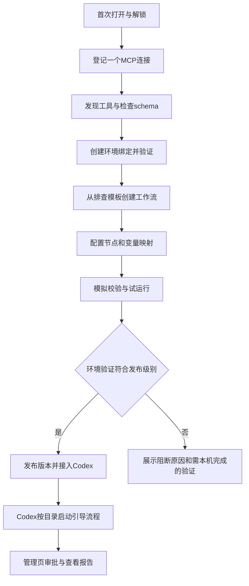

# MCP FlowHub 1.0：UI 原型与交互规格

版本：1.0 设计基线 · 日期：2026-10-29

本设计包同时提供可点击的六页面高保真原型，访问入口见根目录README。它是模拟交互，不连接真实MCP、不查询公司数据、不调用大模型；画布与模拟报告为精简演示，正式图结构、十章报告契约、API与状态约束以架构/协议章节为准。原型中的版本、订单、证据、成功状态均为演示数据。

## 1. 设计目标

以“冰蓝＋白色、精致层次、轻量科技感”为视觉基调。重点不是卡片数量，而是用户能迅速看懂：**正在配置哪个环境、每步调用什么工具、什么不能更改、当前等待谁、结论来自哪里**。

不采用暗色画布、大面积石墨面板或密集彩色仪表盘。避免把极简理解成全白线框：保留柔和蓝色工作区、清晰分组、精细边框、轻微浮层与高对比交互焦点。生产警示使用小面积橙色/红色标签，不把整页染红。

### 1.1 视觉token

下列为正式实现的建议基线，最终需通过可访问性对比检查，不以原型屏幕截图代替检测。

| token | 值/规则 | 用途 |
|---|---|---|
| `canvas.bg` | `#F2F7FF` | 画布/主工作区浅冰蓝 |
| `surface.base` | `#FFFFFF` | 节点、表单、卡片 |
| `surface.subtle` | `#F8FAFD` | 次级输入区 |
| `brand.primary` | `#2474EB` | 主按钮、选中连线、焦点 |
| `brand.tint` | `#E9F2FF` | 当前导航、选择高亮 |
| `text.primary` | `#172B46` | 标题/正文 |
| `text.secondary` | `#52667F` | 说明与次级数据 |
| `border.default` | `#DCE6F3` | 输入/面板边框 |
| `status.success` | `#13866D` | 确认成功与只读徽标 |
| `status.waiting` | `#B76D14` | 人工等待/风险提醒 |
| `status.error` | `#C53B4A` | 错误与阻断 |
| 字体 | 系统中文字体 + system-ui；mono用于ID/JSON | 不依赖外网字体 |
| 字号 | 页面标题26–30；分组16；正文14；辅助12–13 | 不用10px承载关键约束 |
| 间距 | 4/8/12/16/24/32px | 对齐与节奏 |
| 圆角 | 控件8；节点12；面板16 | 不使用全屏胶囊化风格 |
| 动效 | 120–180ms；支持prefers-reduced-motion | 无循环炫光遮挡状态 |

### 1.2 布局规则

- 桌面主规格：1440×900、1600×1000；建议编排时宽度≥1280。
- 左主导航约200px，顶栏64px；内容边距24–32px。
- 画布页面左工具栏约180px，右属性面板300–340px，中间画布自适应，可折叠两侧栏。
- 1280以下右栏变抽屉，工具栏可收起；不强行压缩画布到每个节点都难以点击。
- 移动端首先满足查运行、查证据、人工审批；图编辑为受限浏览/属性编辑，不能声称触屏已有桌面同等连线能力。
- 页头固定显示当前工作流、版本状态和环境；run详情显示不可变版本，不能被全局筛选改变。

## 2. 信息架构与页面路由

| 页面 | 正式路由 | 用户要完成的事 | 优先级 |
|---|---|---|---|
| 工作流库 | `/workflows` | 搜索、区分生产/试运行、建草稿、查看发布版本 | P0 |
| 流程编排 | `/workflows/:id/editor` | 选工具、连线、映射、验证、发布 | P0最高 |
| MCP工具库 | `/connections`、`/tools` | 登记连接、真实发现、浏览schema与变更 | P0 |
| 环境与权限 | `/bindings` | 配置只读连接、资源限制、验证等级 | P0 |
| 运行记录 | `/runs`、`/runs/:id` | 追踪状态、提交人工审批、查看证据和报告 | P0 |
| 接入设置 | `/settings` | 配置单入口、凭证库、数据目录、更新 | P0 |

原型使用同页导航模拟上述结构，未实现真实路由鉴权。正式实现每个深链接刷新可恢复，禁止只在React内存保存主业务状态。

## 3. 用户旅程

首次使用向导只收必要信息；没有公司MCP也能一键启动纯合成演示。演示模式和真实模式视觉区分，真实模式不能自动继承示例凭据或“模拟已验证”状态。

## 4. 页面一：工作流库

### 4.1 内容结构

页头标题“工作流”，副标题“一个 MCP 入口，多条可复用的执行方案”；主操作“新建工作流”，次操作“导入”。搜索支持名称、业务标签、工具名；环境筛选生产/试运行/测试；状态筛选草稿/已发布/已禁用/需重新验证。

每条卡片展示：名称、环境、运行模式、版本、工具摘要、验证状态、上次运行状态/时间、维护状态。卡片摘要如“阿里云日志 → Codex分析 → 生产只读DB → 报告”，不只写“4节点”。密钥和内部地址不在卡片出现。

操作：打开编辑、查看已发布版本、模拟运行、复制为新环境、禁用；删除仅软删除草稿。复制生产→试运行时**不复制凭证和验证通过标记**，需要重新绑定并发布。

### 4.2 新建弹窗

字段：名称（必填）、稳定ID（自动建议可改）、环境（必须显式选择）、描述、模板（空白/问题排查/确定性采集）。选择生产显示只读边界与真实验证门槛。提交创建草稿，不直接运行。重复ID、名称空、无环境就地报错。

### 4.3 关键状态

空态提供“体验模拟链路”和“登记真实MCP”；没有搜索结果显示当前筛选与重置；服务离线显示重试而非伪造0个工作流；版本停用后卡片不消失，显示为什么不可启动。

## 5. 页面二：流程编排（重点）

### 5.1 顶部动作

- 标题、环境锁、版本/草稿标签、保存时间、dirty状态。
- “校验”只做静态与已登记信息检查；“连接检测”显式单独触发，避免用户不知道已访问真实服务。
- “模拟运行”使用Mock；“真实试运行”必须弹出环境/输入/资源范围，不与模拟共用一个模糊按钮。
- “发布”展示差异和验证结果；发布新不可变版本；不能把保存当发布。
- “定义”显示只读或受控编辑JSON，和可视化共用一份DSL，不能两份各自保存。

### 5.2 左侧节点与工具

基础节点：输入、MCP工具、Codex任务、互斥条件、人工确认、模板报告、结束。并行/循环如果展示，必须禁用并写“V1.1计划”，不让用户拖入后才发现不支持。

工具库按连接分组，显示真实工具名+友好说明、输入必填数、验证状态、只读提示来源。搜索能找到具体能力，不让用户面对“服务器有哪些技能”却看不到参数。未知来源的工具description作为文本显示，并提示未验证，不渲染其中HTML。

### 5.3 节点卡片

每张卡片展示：类型图标、用户标题、真实tool/skill名、环境徽章、关键锁定参数摘要、错误数量。选中节点是蓝边和轻阴影；错误是红色角标，不覆盖正文。

节点控制：选择、拖动、复制、删除、按键移动、撤销/重做；复制节点不生成重复ID。开始/结束数量受规则约束。连线指示数据/控制关系，条件边显示“需要查询 / 无需查询”，不只显示true/false。悬停高亮上游依赖。

### 5.4 右侧属性面板

| 节点 | 页签/字段 | 关键行为 |
|---|---|---|
| MCP工具 | 连接、工具、环境、输入、输出、安全 | 真实schema生成表单；环境/资源字段锁定 |
| Codex任务 | 任务说明、可用证据、输出schema、超时 | 明确“由宿主执行”，不显示假模型选择器 |
| Host Skill | Skill标识、报告章节、产物格式、降级策略 | 显示“宿主需安装，状态未知/已自报”，不冒充检测 |
| 条件 | 字段选择器、比较符、常量、两出口 | 生成有限AST，无任意JS编辑器 |
| 审批 | 目标动作、显示摘要、过期时间 | 指定真正受批准的MCP节点与参数hash |
| 模板报告 | 模板版本、章节输入、证据策略 | 预览纯文本，禁执行脚本 |
| 输入 | 字段名、类型、必填、范围 | 环境不是可随意覆写的业务输入 |

映射编辑提供“常量 / 输入字段 / 前序节点输出”三选一；选字段后显示类型、样例、是否可能缺失、敏感级别。JSON Pointer只是底层表达，不强迫日常用户手写路径。锁定参数在单独区展示“来自环境绑定，不接受运行覆盖”。

数据库节点默认展示：资源ID、只读身份摘要、查询模板ID、最大100行、超时、人工批准策略。不能用一个“只读查询”开关代替实际权限验证；已发布生产版本中该开关不可关闭。

### 5.5 校验与发布

底部校验面板按严重度分组：阻断错误、警告、信息。每条有节点名、规则代码、说明和“定位节点”。例如：

- `ENVIRONMENT_MISMATCH`：本流程生产，节点绑定试运行；请替换绑定。
- `OPTIONAL_REF_REQUIRED`：引用了可能被跳过的DB输出；改用检查点可用证据集合或调整路径。
- `TOOL_SCHEMA_DRIFT`：工具必填参数新增；对比后重新映射。
- `BINDING_UNVERIFIED`：只做过Mock验证，不能发布真实生产版本。

发布弹窗显示：版本号、变更说明、环境、受影响工具、权限/参数变化、验证结果。正式生产发布不能被“忽略全部警告”绕过阻断项。发布后继续编辑产生新草稿；运行不追随草稿。

### 5.6 离开与冲突

自动保存草稿采用debounce与revision，失败明确显示“未保存”。离开有dirty数据提示。多人不是V1目标，但两个浏览器标签页同样会冲突：收到409提供比较/另存，不用最后写入覆盖。

## 6. 页面三：MCP 工具库

左列连接列表，右侧工具与详情；连接状态区分：未配置、连接中、已连接、授权过期、协议不兼容、禁用。工具数量来自实际分页发现，无法连接显示上次同步时间，不把缓存当实时在线。

新连接向导：

1. 选择stdio/HTTP；填写标签和环境用途。
2. stdio展示绝对可执行路径、args数组、工作目录和允许env变量；HTTP填写精确endpoint与认证方式。
3. 凭证写入本机vault，UI回显只显示已配置与最后几位安全摘要（不默认暴露原文）。
4. 展示完整命令/端点与风险，由人类确认后测试。
5. 同步schema，显示protocolEra、版本、工具摘要；建立环境绑定是后续独立步骤。

工具详情：name、description、安全提示、输入schema、输出schema、样例、schemaHash、被哪些流程引用、最近变更。schema差异视图突出必填/类型/枚举/工具删除，提醒受影响发布版本数量。真正的删除先停用，展示依赖，不能造成运行中静默换工具。

## 7. 页面四：环境与权限

环境卡以业务用途为主，生产与试运行都可引用同一个数据库实现，但展现两张独立的只读绑定卡。关键字段：environment、connectionRef、resource IDs、credentialRef（非密钥）、允许工具/模板、行数/时限、验证等级、验证时间/操作者、引用工作流。

四种等级使用文本+图标，不能只靠颜色：

| 等级 | 文案 | 可操作项 |
|---|---|---|
| UNVERIFIED | 未核验，不能用于真实生产 | 检测、查看缺项 |
| MOCK_VERIFIED | 模拟已验证，非真实联调 | 演示、安排本机验证 |
| BINDING_VERIFIED | 此绑定已核验，查看范围和时间 | 查看记录、撤销、重新核验 |
| REVOKED | 已撤销，后续调用被阻止 | 查看原因、创建新修订 |

“验证”不是只点一下工具就变绿。结果页面必须列出：正确环境哨兵、错误环境拒绝、资源限制、只读依据、输出上限、schema版本、认证范围；实际生产不为测试去执行危险写入。无法证明时保留UNVERIFIED。

环境修改会弹出影响预览：哪些流程需重新发布，哪些运行后续节点将阻塞；不能在用户不知情时热切换连接。

## 8. 页面五：运行详情与证据

### 8.1 布局

顶栏：runId、工作流/版本、固定环境、执行模式、状态、开始时间、取消。左侧时间线展示每步耗时、attempt和状态；中央是选中步骤的证据/输出；右侧或顶部固定下一步行动。

等待与失败的动作必须明确：

| 状态 | 主文案 | 主操作 | 不能做 |
|---|---|---|---|
| RUNNING | 正在读取指定环境日志 | 查看证据/请求取消 | 修改当前环境 |
| WAITING_AGENT | 等待Codex提交结构化分析 | 查看交接说明/复制runId | 人工按钮假装Agent已执行 |
| WAITING_APPROVAL | 等待你批准此只读查询 | 批准 / 拒绝 | Agent token自行批准 |
| BLOCKED | 连接锁定或配置需要处理 | 查看阻断原因 | 一键跳过策略 |
| OUTCOME_UNKNOWN | 无法确认下游是否完成 | 标记已复核/新开运行 | 显示“已撤销”或自动重放 |
| SUCCEEDED | 已完成，查看验证等级 | 报告/证据/导出 | 只展示绿色不展示限制 |
| FAILED / REJECTED | 失败或人工拒绝 | 查看原因/新建运行 | 隐藏失败步骤 |
| CANCEL_REQUESTED | 正在尝试停止 | 查看在途状态 | 当作已经取消 |

### 8.2 人工批准面板

展示绑定版本、实际环境、目标工具、只读账号/资源摘要、查询模板和脱敏参数、最大行数、超时、批准过期时间、动作hash短摘要。按钮“批准本次查询”与“拒绝”；默认焦点不落在批准。按参数变化重新确认，审批过期不能继续。

此面板是可信管理会话中的动作。MCP/Agent只收到待批准状态；管理会话不能同时交给Agent的浏览器自动化工具控制，或应由组织的用户在场机制保护，单独一个网页按钮不证明真人在场。原型里的“模拟Agent回传”按钮是为了演示状态切换，**正式版不在管理UI提供伪造Agent执行证明的快捷按钮**。

### 8.3 证据浏览

以artifactRef索引展示来源、节点、时间范围、大小、hash、是否脱敏、是否截断。默认摘要与可分页内容；不一次向浏览器灌入几十MB日志。引用点击定位到同一run的证据。权限失败与证据已过期分开提示。

报告顶部显示验证分层：“内容已保存 / 结构已校验 / 引用已校验 / Skill执行由宿主声明 / 事实未人工审查”。文件下载名字包含workflowId、runId和日期，不含客户姓名、密钥或任意路径。

## 9. 页面六：接入设置

- “一个MCP入口”：展示当前stdio配置示例与可选HTTP endpoint；只在用户主动操作时生成execution token，一次性显示后保存安全引用。
- “固定7工具”：列明每个工具用途，不随着流程数增加。
- “连接自检”：宿主版本/协议/transport测试结果；未做真实Codex测试时显示未验证。
- “凭证库”：锁定状态、解锁、锁定、更换口令；不能提供一键导出明文密码。
- “数据与备份”：数据路径、保留策略、大小、备份、恢复预检；不自动上传。
- “更新”：版本、安装包来源、校验、迁移状态、回滚说明；不会关闭企业安全软件。
- “诊断”：白名单支持包预览、脱敏字段说明、用户确认导出。

Codex配置示例必须使用该机器实际安装路径与官方当前格式；不能把云端路径直接复制给公司电脑。默认建议stdio薄桥，避免本地HTTP token手动配置复杂度，但仍需内部execution鉴权。

## 10. 原型导览与覆盖边界

建议验收原型顺序：

1. 初始页点击数据库节点，查看固定生产环境、只读和审批配置。
2. 顶部选择“试运行工作流”，日志切换为华为云、数据库绑定切换为试运行；这是打开另一份流程，不是覆盖运行中的环境。
3. 点击“模拟运行”并提交DEMO订单，观察等待Agent。
4. 点击模拟Agent回传，观察进入独立人工批准；批准后查看示例证据与报告。
5. 打开工具库搜索工具；打开环境页查看MOCK_VERIFIED。
6. 打开接入设置核对固定7工具；新建一个模拟方案观察入口不增多。

| 已提供的原型体验 | 仍须实际开发 |
|---|---|
| 六页导航、布局、选中节点、环境切换 | React组件化、真正路由与持久化 |
| 模拟搜索/新建/校验/发布弹窗 | 后端目录、图校验和不可变版本 |
| 模拟运行时间线、检查点与审批 | 事务、真正权限检查与下游执行 |
| 演示证据/报告与下载 | 真实artifact存储、脱敏与引用验证 |
| 精简静态拓扑、缩放按钮 | React Flow自由拖拽、连线、撤销重做、完整条件路径 |
| 模拟环境验证徽章 | 公司授权真实联调、权限证明与撤销 |

不要将原型按钮的toast当业务实现。正式开发按功能验收表逐条替换Mock，不能直接把此HTML改个标题就交付1.0。

## 11. 无障碍与前端验收

- 主文本/控件对比度按WCAG AA目标检测；状态不能仅依赖颜色。
- 每个输入有label；弹窗焦点圈定、Escape关闭非危险弹窗、关闭后还原焦点。
- 键盘能遍历节点与属性，提供“列表视图”替代纯拖拽；删除节点可撤销。
- 所有按钮必须在loading时防重复提交，但真正幂等仍由后端保证。
- loading、空、错误、离线、授权失效、schema漂移、readonly、dirty、冲突均有独立UI，不统一“暂无数据”。
- 内容区输出HTML/Markdown须消毒；不信任工具说明；超长工具名、中文长文本、emoji不会撑破布局。
- 测试覆盖1440×900、1280×800和移动窄屏主浏览功能。若未实际测试某分辨率，应在QA记录标为未验证。
- 场景截图应使用合成数据，不能把真实生产日志作为公开UI展示素材。
