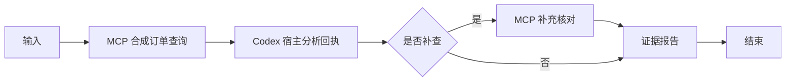

# 已安装插件完整链路实测

2026-11-18，macOS arm64、Node 24.19.0、npm 11.9.0、实际 Codex 0.169.0-alpha.11.1、已安装 FlowHub 2.0.0-alpha.2。

**结论：核心链路可以使用；能力发现仍有部分覆盖限制，插件缺少管理页面快捷入口。** 本轮没有修改或重新安装用户插件，没有升级生产服务或改动正式工作流。

## 测试路径

执行 `npm run check` 与 `npm run test:plugin:e2e`，均退出 0。完整脚本为 `scripts/accept-installed-plugin.mjs`。实际插件位置通过 `codex mcp get flowhub --json` 解析；检查安装目录内所有清单文件的 SHA-256，隔离安装的入口、运行时、CLI 和工具契约与原安装文件相同。完整性检查不代表签名认证。

业务操作由真实 Codex App Server 的 MCP 调用经过插件薄桥进入独立 daemon；没有直接调用内部 Engine/Registry 来编排、生成或运行测试。管理 API 仅用于实际产品已有的登录、上下文登记、绑定验证及读取绑定修订。个人配置与连接引用分别核对前后文件哈希相同；正式后台健康状态正常，所有新工作流写入隔离数据目录。

## 实际结果

| 环节 | 结果 |
| --- | --- |
| 插件加载 | 21 个固定工具、3 个 FlowHub Skill，经真实 Codex 加载 |
| 本机元数据 | 静态识别 10 个 MCP 服务条目、26 个插件、68 个 Skill；扫描为 PARTIAL，不代表这些服务全部已连接或可调用 |
| 工具发现 | 本地合成服务真实返回输入/输出 Schema；发现与导入不调用业务工具 |
| 中文说明 | 通过 host_scan 提交中文说明，中文检索命中同一能力 ID，保留原工具名 |
| 能力导入 | 独立验证后为 MOCK_VERIFIED、simulationOnly；没有将合成服务宣称为企业真实权限 |
| 工作流编排 | 7 节点、2 个互斥分支，真实保存并校验通过；同请求重放不重复写入，错误 CAS 被拒绝 |
| 确定性生成 | 生成并执行 7 个用例：4 个通过、3 个因缺 Fixture 未覆盖；整体 PARTIAL，正确显示缺口 |
| 宿主补充用例 | 生成 2 个包含实际图对应 Fixture 与断言的用例，2/2 通过、18/18 独立断言通过、分支 true/false 均覆盖 |
| Mock 隔离 | networkCalls=0、realSecretReads=0；独立记录本地合成工具业务调用次数，自测期间增量为 0 |
| 负向断言 | 工作流引擎 SUCCEEDED 时故意错误的期望仍使测试 FAILED，没有把执行完成当成测试通过 |
| 证据失效 | 改图后旧结果 stale=true，旧 suite 拒绝运行并返回 TEST_BASELINE_STALE；重新生成与运行恢复 SUCCEEDED |
| 发布与运行 | 仅在隔离测试环境发布 v1.0.0；两个分支各真实执行一次，经 WAITING_AGENT/advance 交接后均 SUCCEEDED |
| 报告 | artifact_read 读取 2 份实际 Markdown，分别 2159/1734 UTF-8 字节，包含实际证据索引 |

本轮合成服务实际业务调用共 4 次：独立绑定验证 1 次、补查分支 2 次、不补查分支 1 次。发现和 Mock 自测均未额外调用业务工具。详见 [完整回执](e2e-result.json)、[工作流快照](e2e-workflow.json)、[独立断言](e2e-selftest.json)、[补查报告](e2e-report-with-details.md)、[不补查报告](e2e-report-without-details.md)。

## 问题与限制

1. **App Server 版本适配未补齐**：安装包发现适配器固定 Schema 版本为 0.164.0-alpha.11.1，本机为 0.169.0-alpha.11.1。启用 App Server 发现时产生 APP_SERVER_PARTIAL，仍可通过宿主 CLI 与直接 MCP 工具目录完成本次闭环。此处是安全降级，不能改版本字符串或跳过校验来声称支持；需对照当前官方导出的 Schema 补适配并重验。
2. **Chrome 安装版本静态歧义**：用户插件缓存的 Chrome 存在多版本/别名，静态扫描返回 PLUGIN_VERSION_AMBIGUOUS，并保留 STATIC_RESOLUTION_PARTIAL。没有猜选某个目录，也没有替用户卸载或清理版本。
3. **管理页面没有快捷入口**：现有插件仅注册 MCP 和 Skill，没有嵌入页面或快捷按钮。本机管理地址为 [http://127.0.0.1:18473](http://127.0.0.1:18473)；后台本身可正常访问，本项为使用入口缺口，本轮未修复。

## 验证边界与保留项

- 真实 Codex 宿主、实际插件入口、数据持久化、官方 MCP 协议及本地合成服务均已调用；自然语言自主选择技能/生成效果、真实模型 Provider、企业服务和真实生产只读权限没有验证。宿主分析使用明确的合成结构化回执，没有额外发起模型轮次或付费 Provider 调用。
- 所有 Mock 和发布运行均使用隔离数据库、环境 test 和合成订单；未使用正式库或真实业务数据，未向隔离实例复制 OAuth 或已有模型 Key。用户 config.toml 与 flowhub/connection.json 前后哈希一致。
- Windows、其他架构及第二台实体电脑未验证。未执行浏览器逐按钮验收；本轮页面相关检查为后台健康与入口核对。
- 原 `.DS_Store` 和 `docs/evidence/v2/chat-audit-20261031/` 保留。没有 push、merge 或 Release。
- 原始 MCP 回执及隔离数据库保留在 `artifacts/latest-plugin-e2e.json` 指向的目录，`private/` 不提交；报告中的验收副本仅保留合成流程及汇总结果。
