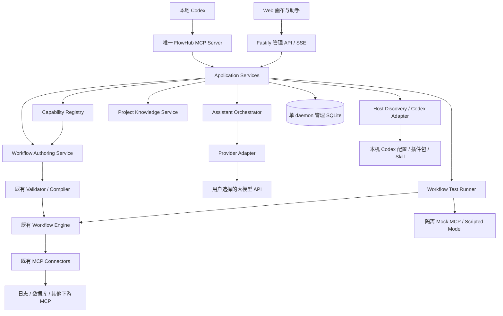
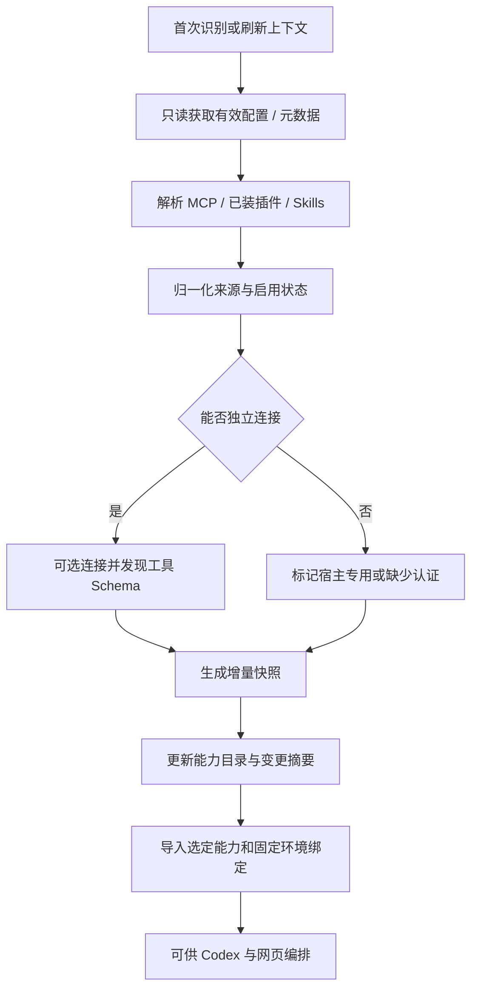
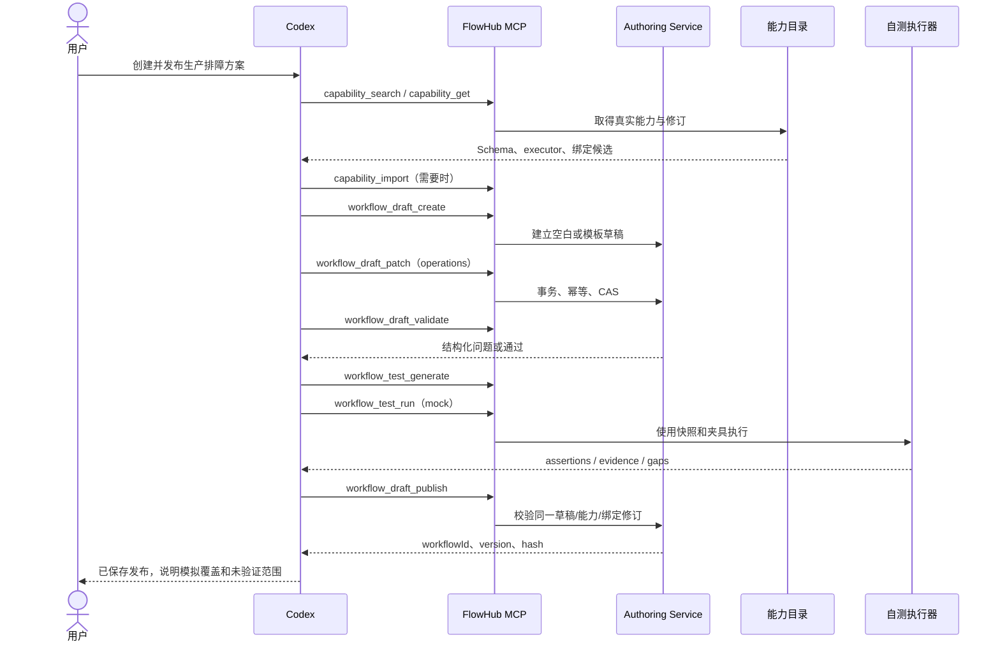
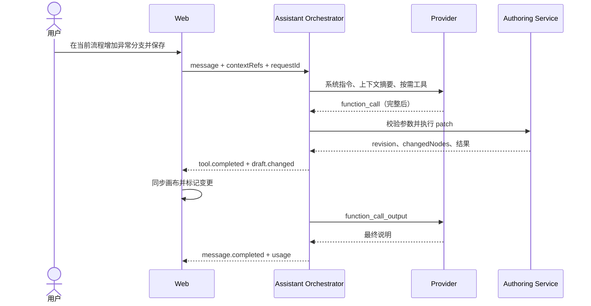
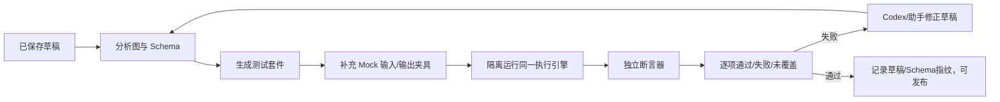
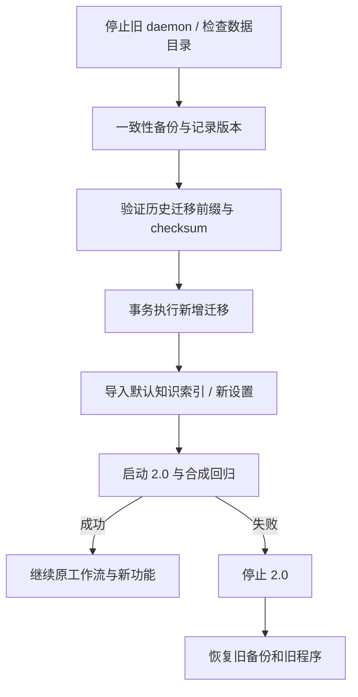
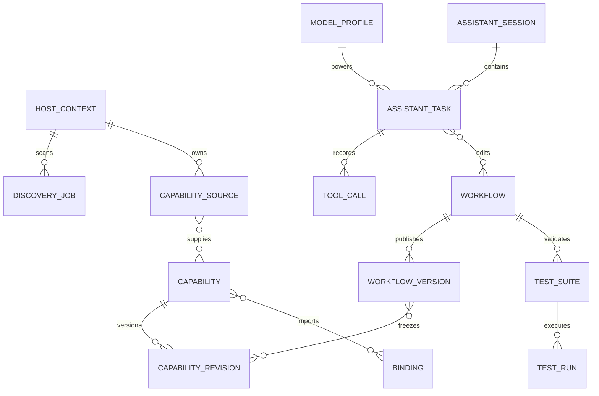
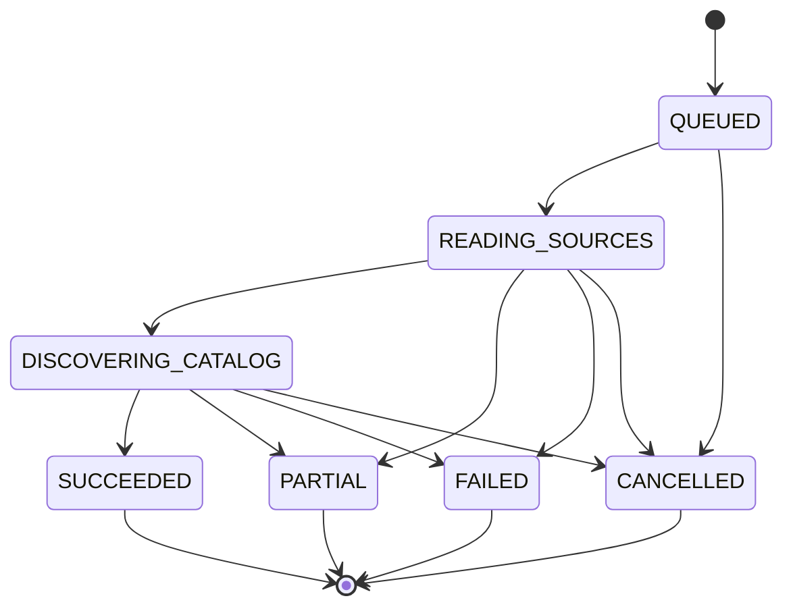
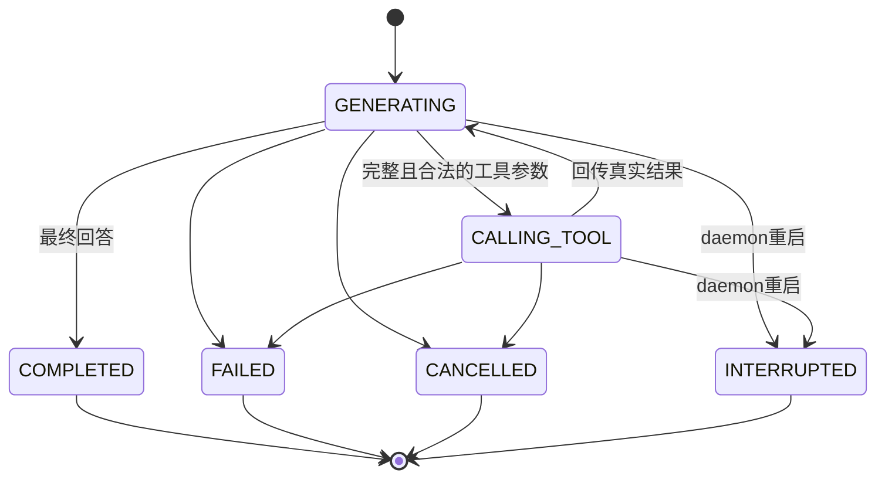

# MCP FlowHub 2.0 完整开发方案｜本地 Codex 升级版

**文档版本：2.0-design.1**  
**编制日期：2026-10-31**  
**源码核查基线：a3384379/MCP-FlowHub main@45eed03ee9f6f513a5c67e854d3d42e16afee636**

本方案是面向现有仓库的增量升级设计，不是已经实现的2.0软件。

核心目标：自动发现Codex的MCP/插件/Skills；通过唯一MCP让Codex自主编排；BYOK智能助手问答和改图。
保留已完成的个人工具精简，不重新加入人工审批和业务自动脱敏。

建议将完整设计包放在仓库 `docs/upgrade-v2/`，把第五章的总提示词交给本地Codex。
本合并版包含八份分章文档，便于连续阅读；JSON Schema、测试样例、离线原型与自检脚本见ZIP完整包。

## 目录

- [01_基线核查与产品边界](#chapter-01)
- [02_完整开发方案](#chapter-02)
- [03_接口与数据契约](#chapter-03)
- [04_测试与验收方案](#chapter-04)
- [05_本地Codex升级提示词](#chapter-05)
- [06_本地开发部署与回滚](#chapter-06)
- [07_UI交互规格](#chapter-07)
- [08_来源与架构决策](#chapter-08)


---

<a id="chapter-01"></a>

# 01｜基线核查与产品边界

**文档版本：2.0-design.1｜编制日期：2026-10-31｜目标：本地 Codex 增量升级**

## 1. 本次核查范围

仓库：`a3384379/MCP-FlowHub`。本次读取的主干为 `45eed03ee9f6f513a5c67e854d3d42e16afee636`，对应合并 `feat/lightweight-orchestration` 的提交。它已经不是前次审计的 `95dfea1`。开发开始时必须重新记录本地 HEAD、远端 main、工作树状态；如主干继续前进，做差异核对，而不是强制回退到本文件中的 SHA。[R01]

本次实际读取：README、AGENTS.md、package.json、docs/PLAN.md、交付验证记录、repository.ts、validate.ts 的相关部分、MCP Server 注册代码、仓库目录树，以及该提交的 Actions job 状态。也查阅了官方 Codex、MCP、模型工具调用和 SQLite 文档。[R02–R08][S01–S07]

**这是开发设计前的定向源码核查，不是新一轮完整代码审计。** 本次没有在本机安装项目依赖或复跑产品测试，没有读取用户本地 Codex 配置、公司 MCP 或真实数据库。下文所有 2.0 接口、数据表、性能数值均为待实现的设计或验收目标，不是已经存在的功能。

## 2. 已确认的现状及升级影响

| 现状 | 核查依据 | 2.0 处理 |
|---|---|---|
| 人工审批节点、运行审批接口及业务数据自动脱敏已移除 | README、PLAN、交付记录及校验器相关代码 | 不再重复开发“移除功能”；不重新引入审批/脱敏开关 |
| Web 启动 guided 运行可以指定受限宿主 owner | README、交付记录 | 复用现有归属选择，不把前轮 owner 缺陷直接认定为仍存在 |
| 一个 daemon 持有 SQLite，STDIO bridge 只转发 | AGENTS.md、目录和服务器注册 | 保留，扫描、AI、测试任务状态也统一由 daemon 管理 |
| 当前外部 MCP 固定七个工具 | MCP Server、README | 原七工具兼容；2.0 新增固定十四个工具，共二十一个，仍只有一个 MCP Server |
| 仅串行、互斥分支，不支持循环和并行图 | validate.ts | 2.0 主线保持此边界，不为 AI 需求同时重写调度引擎 |
| SQLite 迁移只接受 version=1，并用 DDL 生成校验和 | repository.ts | 先引入顺序迁移注册表；不可直接向旧 TABLES 加表后继续算 v1 校验和 |
| 前端 main.tsx 约 176 KB | 仓库树文件元数据 | 按功能模块渐进拆分，不能继续把所有 2.0 逻辑追加在同一个文件 |
| package.json 为 1.0.0-rc.1 | package.json | 开发版本可调整为 2.0.0-alpha.1，验证后再 RC；不自动发布 |

### 依赖基线

Node `24.19.0`，npm `11.9.0`；MCP client/server `2.4.0`、MCP node `2.1.2`；React `19.3.1`、React Flow `12.12.0`；Fastify `5.12.7`、better-sqlite3 `13.0.3`；TypeScript `7.0.2`、Vite `8.3.5`。这是**仓库锁定版本**，并非推荐追随最新版本。新增模型 SDK、TOML/YAML 解析器和布局库时锁版本、更新 lockfile 与依赖说明，不顺带大升级。[R03]

## 3. CI 基线不能沿用旧报告

已核查的主干 Actions run：`41160071532`。

- Ubuntu job：成功，包含 check、后台测试、UI、Linux 包与包完整性验证。
- Windows job：失败在 `npm test`；后续 UI、Windows 打包和安装器测试被跳过。
- 本次未进一步读取该 run 完整失败日志，所以不把 2026-10-30 的长短路径问题直接当成本次失败原因。

本地 Codex 的 S0 必须读取当前失败日志、复现并修复。可以并行准备 2.0 代码，但**发布验收不能以 Linux 通过代替 Windows 通过**。[R08]

仓库内交付记录中的 188 后台用例、23 浏览器用例是该文档作者记录的结果，不是本次重新执行的结果。[R07]

## 4. 用户已经确定的产品决策

1. 定位为个人开发者优先的 MCP 管理与可视化编排工具。
2. 自动获取当前本机 Codex 能发现的 MCP、插件与 Skills，并说明无法发现或无法调用的部分。
3. Codex 能通过唯一 FlowHub MCP 自行创建、修改、校验、测试和发布工作流。
4. 网页内置 BYOK 智能助手，能回答项目问题、创建和修改流程。
5. 不增加人工审批节点，不逐步要求人工批准，不自动改写业务数据做脱敏。
6. 保留环境绑定、参数正确性、凭据引用、正常认证、取消与恢复等基础能力。
7. 本轮由本地 Codex 升级现有仓库，不另起一个无关项目。

“无需审批”不等于“用户只说创建草稿，系统就自动执行生产查询”。行为应遵守用户目标：创建、发布、运行是三个独立动作，可以由一次明确请求连续完成，但不能把它们偷换。

## 5. 必须修正的上轮概念性方案

### 5.1 单个 MCP Server 与工具数量是两回事

2.0 不再限制只能有七个工具。限制改为：**每个 FlowHub 安装仍只有一个 MCP 接入；工具集合固定，不随工作流数量增长。** 原七工具名称和已有请求保持兼容；新增十四工具负责发现、编排和自测。同步修改 AGENTS.md、协议测试和 README，不能因旧约束拒绝实现新需求。

### 5.2 插件自动发现不依赖开发中 API

官方 App Server 页面明确将 `plugin/list`、`plugin/read` 标为开发中，提醒生产客户端暂不调用。本方案生产路径使用本地配置、已安装插件 Manifest/缓存和稳定 CLI 能力；这些 RPC 仅作为未来经过版本验证的扩展，不设为 2.0 必需条件。[S02]

### 5.3 API Key 不能获取 Codex 的全部宿主工具

FlowHub 可以自行连接的 MCP，与只有 Codex 登录会话才能使用的插件工具，是两类能力。网页助手使用模型 Key 不会自然获得 Codex 会话权限。能力目录必须标记 executor，不能把“能显示”当“能直接调用”。

### 5.4 模拟不等于真实接入验证

Mock 可以验证 Schema、数据流、分支、报告和异常路径；不能证明真实数据库账号只读、云平台可达或业务判断正确。报告里同时展示验证级别与覆盖缺口，不用一个绿色成功标记混淆。

## 6. 2.0 范围冻结

**必须交付**：本机发现、能力目录和导入、统一编排服务、二十一个固定 MCP 工具、AI 问答、AI 编排/改图、模型设置、自动用例生成与 Mock 自测、画布同步、升级迁移、端到端验证。

**后续增强**：自动从历史轨迹抽取流程、语义向量检索、更多模型原生协议、更多 Harness、复杂循环/并行、任意脚本执行、插件商店安装卸载。

原方案的“无限工作流”调整为“不按流程增加 MCP 配置，容量受本机资源约束”。避免不可验证的无限承诺。


---

<a id="chapter-02"></a>

# 02｜MCP FlowHub 2.0 完整开发方案

> 版本：2.0-design.1。适用于现有仓库的本地增量升级。先阅读 01 的实际基线，再按 05 的分阶段任务实施。接口精确定义见 03；验收见 04；界面见 07。

## 1. 产品目标

让用户把 Codex 已有 MCP 和插件能力直接带入 FlowHub，通过 Codex 或内置助手用自然语言创建并复用可视化链路。2.0 的成功标准不是“增加一个聊天框”，而是**从真实能力发现到可执行工作流的闭环**。

### 1.1 三个主要使用场景

**场景 A：首次接入。** 本机打开 FlowHub → 自动检测 Codex → 选择用户/项目上下文 → 显示已有 MCP、插件、Skills → 自动同步工具目录 → 导入可连接能力。用户不用重复手工抄写全部 MCP 配置。

**场景 B：Codex 创建流程。** 用户说“用已安装的阿里云日志和数据库 MCP 创建生产排查流程，并保存发布”。Codex 查询能力、绑定环境、生成节点、映射参数、校验、生成测试、修正后发布。全程仍只连接一个 FlowHub MCP，不需要 FlowHub 的模型 Key。

**场景 C：网页 AI 助手。** 用户配置模型 Key 后，询问“这个项目怎么用”“为什么节点参数不匹配”，或要求“给当前流程增加订单不存在分支”。助手读取项目文档/当前画布/真实 Schema，直接调用统一编排服务，变更实时出现在画布上，可撤销。

### 1.2 非目标

不做另一个通用 Dify；不做公司权限审批中心；不做业务自动脱敏平台；不读整台电脑；不自动安装所有发现的插件；不让模型修改 Codex 全局配置或执行任意 shell；不承诺网页 Key 可以操作所有宿主私有插件。

### 1.3 功能清单

| 编号 | 功能 | 2.0 范围 | 完成定义 |
|---|---|---|---|
| DISC-01 | Codex 环境识别 | P0 | 记录版本、运行位置、CODEX_HOME、cwd/Profile 上下文 |
| DISC-02 | MCP 配置发现 | P0 | 用户/可信项目配置合并，来源、启用和连接状态可追踪 |
| DISC-03 | 插件与 Skill 索引 | P0 | 安装状态与市场可用项区分；插件组件可展开 |
| DISC-04 | 能力导入 | P0 | 已有连接可复用；导入不复制凭据到普通表、不改变源配置 |
| CAP-01 | 统一能力目录 | P0 | Tool Schema、Skill 元信息、executor、来源修订可查询 |
| AUTH-01 | 编排服务 | P0 | create/get/patch/validate/publish 同一套业务规则 |
| AUTH-02 | Codex 编排工具 | P0 | 创建、修改、自动修错、生成用例、自测闭环 |
| ASST-01 | 项目问答 | P0 | 版本化知识引用，当前错误有上下文，资料不足明确说明 |
| ASST-02 | AI 编排 | P0 | 不是代码块，是真实持久化草稿和可视化节点 |
| ASST-03 | 模型配置 | P0 | OpenAI Responses + 兼容 Chat Completions 两类适配，流式和能力检测 |
| ASST-04 | 当前画布协作 | P0 | 节点选择、变更、修订冲突、撤销、SSE 同步 |
| TEST-01 | 自动用例和 Mock | P0 | 工具调用生成用例，独立执行器断言，不由模型自判全通过 |
| RUN-01 | 执行器衔接 | P0 | Codex、内置助手与确定性运行路径清楚，不冒充宿主执行 |
| OPS-01 | 迁移、打包、恢复 | P0 | 旧库不丢、旧版本不改、Windows 原生验证 |
| CAP-02 | 能力变化影响分析 | P1 | Schema/配置漂移定位引用，AI 可以修复草稿 |
| ASST-05 | 运行轨迹转流程 | P1 | 仅处理有权取得的轨迹，避免伪造调用记录 |

## 2. 总体架构



### 2.1 必须保持的架构不变量

- 只有 daemon 持有业务数据库和写入权；bridge 无数据库、无模型循环、无独立扫描器。
- Web、MCP、内置助手调用同一份 Application Services，不能把内部 HTTP API 再通过匿名网络调用一遍来绕过 owner。
- 三个入口共享同一套 authoring operation、校验器、revision、幂等命令账本和事件。
- 能力目录是索引，不是凭据容器；原始业务输出继续保留，连接认证数据只走 Vault/secretRef。
- 所有执行来自发布版本或隔离测试快照；编辑草稿不会自动改动正在运行的版本。
- 本地助手使用 Key 时才调用模型；没有 Key 仍可用发现、手工画布、Codex 编排、确定性 Mock。

### 2.2 建议目录结构

```text
apps/
  daemon/src/                 # 复用入口；注册应用服务和后台任务
  mcp-bridge/src/             # 保持薄桥
  web/src/
    app/                     # 路由、会话、基础布局
    features/discovery/      # 宿主扫描、导入、能力详情
    features/workflows/      # 画布、属性、修订与发布
    features/assistant/      # 会话、工具卡片、上下文、任务进度
    features/models/         # Provider 配置
    features/testing/        # 生成用例、执行结果
    shared/                  # API client、事件、设计组件
packages/
  host-discovery/            # Codex 适配、配置解析、插件/Skill读取
  capability-registry/       # identity/revision/index/import
  workflow-authoring/        # 语义 operations、事务、布局、发布
  assistant-core/            # 工具循环、上下文构建、任务状态
  llm-providers/             # Responses / Chat Completions / Scripted
  project-knowledge/         # 文档分块、索引、引用、版本
  workflow-testing/          # 用例生成、Fixture、Mock隔离、断言
  contracts/                 # 继续作为协议唯一来源
  workflow-core/             # 复用引擎，不重写
  persistence/               # 顺序迁移、扩展表、任务账本
```

前端拆分必须保持现有行为，每次移动一块同时保留对应 UI 测试。不要以架构重构为由先将可运行产品重写为空壳。

## 3. Codex 自动发现设计

### 3.1 发现上下文，而不是扫描一个固定目录

`HostContext` 标识：`hostId + executionLocation + codexHome + canonicalCwd + profile + codexVersion`。

`executionLocation` 至少区分 `windows_native / wsl / macos / linux`。Windows 进程看见的配置与 WSL 用户配置不能混为一套；用户可创建多个上下文。不得把 WSL 路径直接作为 Windows STDIO 可执行路径。

首次进入时识别本机可执行 Codex、版本、用户目录；没有找到时允许手动选路径和“仅导入配置”。已选上下文记住后自动扫描，用户不必每次选择。启动扫描只读取元信息，不默认执行下游业务查询。

### 3.2 三层适配路径

**首选：本机受支持的 CLI/配置能力。** 运行 `codex --version`、`codex mcp --help`，发现 `list` 的机器可读选项后使用。命令行参数以实际版本 help/Schema 为准，不能假定所有安装均支持 `--json`。CLI 不可读时退回真实 TOML 解析器，不用正则解析 TOML。[S01]

**补充：版本锁定的 App Server 只读适配。** 使用安装版本生成的 Schema 对接 `config/read`、`skills/list`、`mcpServerStatus/list` 等已经可用的方法。建立 FlowHub 自己的短生命周期会话，不能声称附着到正在运行的 Desktop/IDE 会话。该进程可能初始化已配置 MCP，要展示扫描模式并限制同时启动的连接数。未知方法、版本不匹配、超时则退回元数据扫描，不拖垮全局发现。[S02]

**插件：本地 Manifest/安装索引。** 识别已安装包与启用配置；`.codex-plugin/plugin.json`、`.mcp.json`、`.app.json`、Skill 目录通过对应版本适配器解析。对新式根 `plugin.json/mcp.json` 采用独立格式适配并在本机版本验证后启用，不能按文件名猜其内容。

官方将 `plugin/list`/`plugin/read` 标为开发中；2.0 生产代码不依赖它们。不自动安装插件、不执行 hooks，不将市场中的所有条目当“已安装”。[S02][S03]

### 3.3 工作流



### 3.4 源优先级和可信度

有效配置优先使用宿主自身解析结果；只有静态文件时保留每层来源、项目可信状态和覆盖关系。不能自行实现一个似是而非的 Profile 合并规则并称为“当前生效配置”。结果带 `resolutionQuality=host_effective|static_merged|partial`。

禁止把发现器自己的进程环境当作 Codex Desktop 的环境。只读取变量引用名，例如 `DB_MCP_TOKEN`；实际值未取得时标记 `credentials_required`。从配置中导入明文凭据时，经专用本地服务直接写 Vault，常规扫描结果、聊天上下文和配置差异不携带其值。

### 3.5 状态是多个维度，不是一个绿色点

- 安装：installed / available_only / unknown。
- 启用：enabled / disabled / unknown。
- 发现：metadata_only / schema_discovered / partial / failed。
- 调用位置：hub_direct / codex_host / informational。
- 连接：not_checked / ready / credentials_required / unreachable / unsupported。
- 来源覆盖：complete / partial；包含错误项而非把失败解释为零安装。

只在相关维度满足时显示“可由 FlowHub 执行”。`app/list` 的可用性元信息与 `app/installed` 的安装运行态也不能混淆。[S02]

### 3.6 去重和同步规则

能力身份基于 `hostContext + source identity + logical server id + tool name`。同名不同连接绝不合并。相同端点也可能对应不同身份、租户和环境，不能只用 URL 去重。

保留 `sourceFingerprint`、`capabilityRevision`、`inputSchemaHash`、`outputSchemaHash`、`discoveredAt`。显示重复候选并复用已有明确匹配的 connection；插件来源和用户配置来源作为多个 source refs 留存。

MVP 首次、启动和手动刷新；可选本机定时元数据刷新，不以扫描失败删除已存在数据。源消失标记 stale，工作流引用可追踪；不自动删除或修改发布快照。Windows 透明加密读取失败、目录权限拒绝、损坏 TOML 单项记录错误。

### 3.7 防止发现器自调用递归

扫描 Codex 时会发现 FlowHub 自己。根据 server name、endpoint、command 规范化路径和 instanceId 识别 `self`，显示但不作为下游可导入能力。禁止形成 FlowHub → FlowHub → 同一工作流递归。扫描/协议检测禁止触发模型推理回合，不能启动 `codex exec` 来“问自己装了什么”。

## 4. 统一能力目录

### 4.1 领域对象

`HostContext` → `DiscoverySnapshot` → `DiscoveredComponent` → `CapabilityRevision` → `ImportedConnection/Binding`。

Component 表达插件、MCP Server、Skill；Capability 表达可用于编排的 Tool 或 Skill。插件本身不是一个可执行节点；展开后选择它提供的能力。

### 4.2 能力模型核心字段

`capabilityId`、`kind(mcp_tool|skill)`、`name`、`description`、`sourceRefs`、`executor`、`availability`、`contextId`、`inputSchema`、`outputSchema`、`schemaHashes`、`revision`、`bindingCandidates`、`provenance`。

目录只存模型可读的能力定义和凭据引用。`capability_get` 默认返回摘要；Schema/Skill 内容按需取，避免一次向模型塞进上千个工具。

### 4.3 连接导入

一次 `capability_import` 可以复用/创建本地 connection 和 binding，返回真实 ID，不向模型要求猜随机主键。导入参数必须给出来源修订和目标环境，预设锁定资源参数；结果包括需补的认证变量、不可调用原因。

导入只完成配置和工具发现，**不隐式执行一条数据库查询来验证**。现有“绑定验证”保留为连接配置的一部分，优先使用实际连接身份/服务端能力说明；只能通过业务探测获取的证据，需要显式测试动作及获准范围，而非伪造 `BINDING_VERIFIED`。这不是运行审批节点。

### 4.4 原生结果适配

P0 需要可接真实 MCP，而不只接内置 Mock。保存原始 MCP result；统一外层 Envelope 提供 `content[]`、`structuredContent?`、`isError`、`provenance`，不强求第三方返回顶层 environment。[S04]

- 有 structuredContent：按其真实 outputSchema 做映射。
- 只有 text：保留全文；明确选择 `text` 或声明式 JSON 解析适配器，不自动假设所有文本都是 JSON。
- 图片/资源引用：保留类型和引用，缺乏对应模型能力时说明，不能改造成虚假文本。
- 环境来源于绑定和真实资源路由；第三方返回的环境信息可交叉核对，但不能靠自行追加一个 environment 字段证明隔离。
- 行数/时间范围等限额能映射到工具参数时在**调用前**生效；无法下推时报告 unsupported，不以返回后截断宣称限额已执行。

适配器只负责结构，不做业务脱敏、不修改正文。文本解析失败返回精确问题，允许在画布选择解析策略；不新增任意代码执行节点。

## 5. Codex 自主编排

### 5.1 固定入口

2.0 提供 21 个固定工具：原七执行工具 + 十四发现/编排/测试工具。列表和契约见 03。工作流是数据，不生成新 Server、不动态注册每条工作流为单独 Tool。

旧执行身份仍可只看到七工具；新个人编排身份可看到 21 工具。不是新增 MCP 配置，而是同一个服务按已有身份呈现已配置的能力。个人默认配置包含编排权限，不要求每次向管理员申请。

### 5.2 一个统一 Authoring Service



### 5.3 不以大段 JSON 作为唯一编辑接口

提供语义操作：add/remove/update_node、connect/disconnect、set_mapping、set_binding、set_input_schema、set_output_schema、set_condition、set_metadata、move_nodes。AI 不直接写数据库，不通过编辑磁盘 JSON 偷绕校验。

一个 batch 原子提交。中间过程可以是未完成草稿，但每个 operation 结构有效、不得产生无效引用；完整图校验在 validate/publish 执行。删除节点默认有依赖即返回问题，只有显式 cascade 才一并删除关联边和映射。不能悄悄改变其他节点含义。

布局与语义分开：`revision` 保护语义，`layoutRevision` 保护位置。AI 连接新节点时局部布局，不覆盖用户手工摆放的整张图。内置自动布局只改变位置，不重写执行顺序。

### 5.4 自动修错

校验返回 `code/nodeId/path/expected/actual/suggestedOperation`。模型修正后再次校验，最多三轮；无法修复保留草稿和具体问题。环境不明确、同名工具多个候选时返回最少必要选择，不猜生产环境。无匹配能力时保留“待配置”节点，不宣称可运行。

### 5.5 草稿、发布和实际执行

“创建流程”默认生成保存草稿；“创建并发布”自动发布；“创建、测试并运行”可在同一任务完成这些动作。发布是版本化业务动作，不是人工审批状态。所有工具都可以由 Codex/助手调用，不要求切回 Web 点确认。

发布必须绑定准确草稿 revision、能力修订、绑定修订、目标版本。长模型响应完成时若草稿已被用户修改，返回冲突；最多基于新版本生成局部新 patch，不能整图覆盖。发布操作与幂等结果写入同一事务。

### 5.6 owner 与新建工作流可执行性

创建新草稿时，将其归属到当前 host/workspace。若现有 client 有 workflowAllowlist，创建成功后可以按该身份预先配置的“允许编排”能力，原子登记其新建工作流的使用关系。不得要求模型改 allowlist；不得授予其他已有流程权限。浏览器 guided 运行继续选择具体执行身份。

同一运行 owner 不随 AI task 自动变化。需要从网页交给 Codex 时使用已有明确归属的运行，或先不创建运行、输出 Codex 启动指令；不临时切为全权限令牌。

## 6. 内置 AI 智能助手

### 6.1 用户入口

右侧可伸缩聊天栏 + 独立 AI 工作台，共享会话。支持“帮助”“编排”两种模式：帮助模式仅检索和解释；编排模式可以调用工作流编辑工具。模式是能力上下文，不是审批步骤。

支持自然语言创建、修改、解释、生成测试、定位失败、说明升级影响。工具执行产生可展开卡片：真实方法、目标工作流、结果摘要、修订和耗时。聊天文字不能代替实际成功回执。

### 6.2 Provider 适配

P0 两个明确协议：`openai_responses` 与 `openai_compatible_chat`。兼容服务必须选协议，不能把所有 Base URL 都追加 `/responses`。后续原生 Anthropic/Gemini 是独立适配器，不作为 2.0 最小交付前置。

`ModelProfile`：id、providerKind、baseUrl、model、secretRef、timeout、capabilities、limits、lastTestAt。请求路径由适配器拼接，处理已有 `/v1`，不重复追加。模型名称由用户或实际列表选取，不写死某个最新型号，不复制 Codex 登录 OAuth 作为 API Key。

连接测试分为可达/认证、最小文本调用、最小工具调用、流式能力。列模型失败并不代表不能使用明确模型名。只支持文本的模型可问答，编排入口显示“不支持工具调用”，不能伪装执行。

### 6.3 工具调用循环

OpenAI 工具调用由模型返回调用请求，应用执行并把结果继续发给模型；流式参数片段不能当作完整请求立即执行。[S05]



会话状态：IDLE → GENERATING → CALLING_TOOL → GENERATING → COMPLETED；另有 CANCELLED/FAILED/INTERRUPTED。网络断开不自动复制执行；工具调用按 `taskId+callId` 持久化。幂等调用重放返回已有结果；外部 MCP 结果不明时继承 OUTCOME_UNKNOWN，不盲重试。

预算建议：每任务 12 轮模型调用、24 次工具调用、3 轮校验修错、180 秒默认请求超时、可取消。作为可配置上限而非计费报价。多个编辑工具串行；只读搜索可并行。遇到反复相同参数失败停止并给可操作错误。

Responses 与 Chat Completions 的 call id、消息形态、usage、流式终止字段分开适配。不要把一个 provider 的原始协议 JSON 直接传给另一个。保存合法继续调用所需的 provider items；只展示回答、工具动作与简短说明，不收集或展示模型私有推理。

### 6.4 上下文管理

默认发送：项目版本、帮助索引摘要、当前选定流程结构、相关 Tool Schema。业务日志/数据库结果仅当用户选定运行或要求分析该运行时附加；UI 显示来源和大致大小，不默认把全部历史数据发到外部模型。

不做业务自动脱敏。长度超限时分页或明确截断，原始产物仍完整保留；截断必须返回范围、总长和获取下一段的方法。凭据配置不作为模型上下文；这是连接管理，不是业务脱敏。

每次读取 run/artifact 都按当前会话 owner 校验，知识检索服务不能变成绕过权限的旁路。提示中的 API Key 由专用设置输入，不进入聊天记录。

### 6.5 问答知识库

P0 采用本地版本化 Markdown 分块 + SQLite FTS5；不强制 Embedding/独立向量数据库。[S07]

知识源只包含打包的当前版本用户文档、错误码、工具定义和按需读取的当前配置。开发设计资料与真实实现文档分开命名，避免将“计划新增”答成“已经支持”。每个 chunk 有 sourcePath、heading、lineStart、lineEnd、contentHash、productVersion、availability=implemented/planned。

**中文检索必须单独设计。** 不能只使用默认 Unicode 分词就认为支持中文问答。建议预生成中英文 token 列：ASCII 标识符分词 + CJK bigram + 领域同义词（试运行/staging、生产/production、编排/workflow）进入 FTS；短查询加精确标题/错误码匹配。保持原始文档和引用行号不变。中文样本集验证召回，具体 tokenizer 实现通过基准比较选择。

检索返回有限片段和引用。无足够证据时回答未知/当前版本没有，而不是编造接口。连接问题应优先读取真实错误状态，再结合说明；不执行连接测试就不能说“已经修好”。

## 7. 执行器与 Skill 边界

### 7.1 三种执行位置

| executor | 可执行对象 | 谁调用 | 限制 |
|---|---|---|---|
| hub_direct | FlowHub 独立可连接的 MCP | 既有 connectors | 必须有连接、认证和绑定 |
| codex_host | 仅宿主可用的插件工具/Skill | 当前 Codex 对话 | FlowHub 不共享其会话；结果标 host_reported |
| assistant_local | 模型分析、内置模板、已支持的纯指令 Skill | BYOK assistant worker | 不执行任意 Skill 脚本，不模拟不存在的宿主工具 |

### 7.2 DSL 演进

保持 `flowhub.workflow/v1` 读取和原七工具兼容。新增 `flowhub.workflow/v2`，仍用 input/mcp_tool/agent_task/condition/report_template/end 六类节点。v2 给 agent_task 增加受限执行描述：`executorRef`、`kind=analysis|host_skill|host_tool`、`capabilityRef`、`capabilityRevision` 和明确 outputSchema。具体字段见 03。

不能在 v1 Schema 的 `additionalProperties:false` 下偷加新字段。新字段进入 v2 契约，旧发布快照维持原样。新运行如果不需要新语义可继续运行 v1。

`host_tool` 节点进入 WAITING_AGENT，checkpoint 包含已解析的宿主工具标识、固定参数、输出契约。Codex 实际调用自己可用的对应工具，再经 workflow_advance 回传；工具不在会话中时明确 HOST_CAPABILITY_UNAVAILABLE。FlowHub 只能证明收到宿主提交，不能独立证明远端工具真实执行。

网页助手创建含 host_tool 的流程完全允许，但运行前说明 `requiresCodex=true`。纯 Key 任务不尝试复制认证或调用未支持的宿主 RPC。原来的报告 Skill 也遵循此界限。[S06]

### 7.3 内置助手运行

P0 完成：确定性 auto 工作流直接运行；guided 的 analysis 节点可由已选模型 profile 执行，使用同一 checkpoint/outputSchema/advance 服务；报告使用内置模板或明确支持的纯指令 Skill。host-only 节点需要 Codex executor，不静默降级。

助手 worker 和 Codex 都不能同时消费同一 checkpoint；使用现有 revision + checkpoint token + claim lease。模型返回无效 JSON不消费 checkpoint；重试有次数上限。助手停止后运行保持可解释状态，可继续或取消，不能假报成功。

## 8. MCP 生成测试用例与自测闭环

这是 2.0 P0，不是“开发期间写几个单测”替代。

### 8.1 用户可见流程



### 8.2 用例来源

确定性生成器按 inputSchema、required、enum、范围、条件、绑定映射生成基准用例。Codex可以经workflow_test_generate的agent_proposed模式提交业务场景、合成夹具与断言，无需FlowHub模型Key；内置助手也可调用同一入口。它们必须通过 schema 和独立断言器验证；不能自己写一句“测试通过”当结果。

支持正常链路、条件两分支、无日志、空数据库、缺必填、错误类型、连接超时、工具报错、Schema 漂移、环境参数冲突、重复提交与取消。嵌套条件不强求穷举指数级全部路径，报告 branch coverage 和不可达分支原因。

### 8.3 测试运行隔离

`mode=mock` 默认不读真实 secret，不连接真实 MCP。通过 connector factory 注入模拟 transport；Mock 服务也可使用官方 MCP 协议走真实 tools/list/call。测试不复制生产 binding 为“已验证”，只生成 `simulationOnly` 执行上下文。

若需要协议级探测，`mode=contract` 只发现工具和检查 Schema；若需要真实调用，`mode=live` 必须在具体测试请求写明目标 binding 和有限范围。日常“帮我生成用例并自测”只走 mock。

空 fixture 不用猜：标 FIXTURE_MISSING。宿主工具无 Codex 环境用 scripted result 只能证明数据流，不能证明宿主执行。使用两个独立哨兵确保生产、试运行分开。

### 8.4 发布与测试关系

模拟通过是质量信息，不增加人工审批关卡。发布仍必须满足结构与绑定规则。UI 可提示“尚未模拟”，用户明确发布可由工具完成。模拟结果绑定 draftRevision + capabilityRevision + fixtureHash，修改后标过期，不继续显示绿色通过。

### 8.5 自动验收产品自身

经官方 MCP Client 调用 FlowHub 的 create/patch/validate/test/publish/start/status，完成自举测试；不能只直接调用 Engine 的内部方法。

至少一组测试验证增加 100 条工作流后 MCP Server 数仍为 1、工具集合仍为固定 21；另保留七工具旧身份兼容。具体测试矩阵见 04。

## 9. 数据持久化与迁移

### 9.1 设计表

复用现有 connections/bindings/workflows/versions/runs/artifacts/secrets/clients。新增逻辑表：host_contexts、discovery_jobs、capability_sources、capabilities、capability_revisions、authoring_commands、workflow_test_suites、workflow_test_runs、model_profiles、assistant_sessions、assistant_messages、assistant_tasks、assistant_tool_calls、assistant_events、knowledge_documents、knowledge_chunks、knowledge_fts。

可按现有 id/revision/body 模式存业务对象，对需要分页检索的 contextId/workflowId/status/updatedAt 建索引投影。大结果放 artifacts，不在聊天消息和 job 行中复制多份原文。版本/依赖边关系需要可查询索引，不能每次读出所有 JSON 再扫描。

### 9.2 迁移必须先解决旧校验和

冻结旧 v1 DDL 与 checksum。新 migration registry 按版本按序执行 v2、v3……，每次记录独立 checksum；旧脚本不追写。启动只接受完整已知迁移前缀，遇未来版本拒绝启动，不能“修复”成空库。

升级前一致性备份；失败回滚事务。运行进程与模型请求、网络扫描均不得放在长 SQLite 事务内。跨步骤任务使用 durable job 状态。数据库历史 approvals 表可只读留存，不复活功能，不因删除无用表改变历史校验和。



### 9.3 运行和存储策略

扫描结果只保留必要历史；会话/测试数据由现有保留策略扩展管理。管理员可以删除会话，删除时不能误删仍被发布版本引用的能力快照。备份包含新增业务表和必要元信息，不打包明文 Key；索引可以重建。

## 10. API 与任务通信

现有 `/api/v1` 执行 API 不整体废弃；新增 `/api/v2` 发现、编排、助手、模型和测试路由。MCP 不通过 HTTP URL 版本识别，靠工具契约版本及能力元信息。

扫描、助手和测试均返回 job/task id。Web 使用带 eventId 的 SSE 获取进度，断线按游标补读；断线本身不重发修改。服务重启后未完成模型任务记 INTERRUPTED，已完成工具调用保持结果；可续写说明，但不重放外部副作用。

现有 UI SSE 应扩展或共享事件基础设施，不新写三套不兼容重连逻辑。事件类型见 03。

## 11. UI 与交互原则

冰蓝与白色、精致层次、克制但有科技感。不是深色画布，也不是只给黑白线框。左侧能力与页面导航、中间画布、右侧节点属性/AI 同区切换；不同时挤出三个窄侧栏。

新增“Codex 发现”“AI 工作台”“模型设置”“自测”入口。原有工作流库、连接、运行记录保留。AI 变更高亮可自动淡出，显示已真实保存的 revision；一键撤销产生反向 operation，不回退整个数据库。

桌面 1440×900 主适配；1366×768 不遮挡底部提交按钮；窄屏侧栏抽屉化。表格和 Schema 可横向滚动，整体页面不溢出。完整页面状态、组件和离线演示见 07 与 ui/ HTML。

## 12. 分阶段实施

| 阶段 | 任务 | 可独立验收产物 |
|---|---|---|
| S0 | 主干核对、Windows 失败定位、旧 DDL 冻结、约束更新 | 基线报告、干净分支、迁移测试 |
| S1 | Authoring Service、契约、事务、revision、幂等 | Web/MCP 调用同一套草稿服务，旧功能无回归 |
| S2 | HostContext、CLI/配置/插件/Skills 发现、目录导入 | 不用 Key 自动识别本机能力，来源和可用性准确 |
| S3 | 新 MCP 工具、Codex 自主编排和工具级自测 | 从自然语言到实际可运行草稿/发布版 |
| S4 | Provider、知识检索、助手多轮工具循环 | 问答有引用、无 Key 可降级、模型调用可取消 |
| S5 | AI 画布同步、局部布局、执行器衔接 | 助手创建/改图/修错可见且保存，host-only边界明确 |
| S6 | 用例生成完善、系统回归、实机集成、文档 | 固定测试集结果、真实 Codex 最小闭环证据 |
| S7 | 打包、升级恢复、Windows 验收、发布候选 | 安装/重启/升级/回滚记录与 RC 包 |

顺序上先统一编排服务，再发现和 MCP，再 AI；不要先做漂亮聊天 UI 后补所有真实动作。S2/S3 交付后，即使 S4 模型 Key 暂缺，也已获得完整 Codex 自主编排收益。

不以固定天数承诺完成；每阶段独立提交、证据明确，通过当前阶段退出条件再进入下一阶段。局部外部限制不阻塞无关模块开发，但不能跳过发布门槛。

## 13. 性能和体验验收目标

以下为目标，需记录测试硬件、输入规模和测量方法：

- 200 个能力时，缓存目录搜索 P95 ≤300ms；1000 个能力时仍可分页，不一次加载完整 Schema。
- 100 节点草稿，纯服务端结构校验 P95 ≤1s；不包括 MCP 网络往返。
- 扫描元数据 500 个组件目标 ≤5s；外部连接单项超时独立，总并发默认 4，失败不阻塞已发现项展示。
- AI 首 token 延迟受提供商影响，UI 在请求后 300ms 内显示任务状态，不能承诺固定模型响应秒数。
- 一次合法 patch 的持久化事件到画布应用，正常本机条件 P95 ≤500ms。
- 断网时手工编辑、搜索缓存能力、原七工具可用；外部 AI 错误不影响 daemon 健康。
- 自然语言测试至少 30 场景，每种目标 Provider 记录模型版本、运行次数、成功率和失败原因；核心任务重复 3 次，禁止只挑成功样本。

## 14. 发布前完成定义

三个真实入口闭环：

1. 本机扫描 Codex → 显示实际工具/插件/Skills → 选择导入 → 成功保存绑定。
2. 本地 Codex → FlowHub MCP 创建并修改工作流 → 生成用例并 mock 自测 → 发布 → 运行 → 实际读取报告。
3. 网页助手 + 用户 Key → 项目答疑有来源 → 创建/修改当前流程 → 浏览器刷新后仍存在 → 执行器兼容时运行，宿主专用时准确说明。

以及四条不退步：仍为一个 MCP Server；不新增人工审批；业务数据不自动替换；旧工作流与历史数据保留。全部详细条件见 04。

## 15. 关键领域关系与任务状态补充

### 15.1 领域关系图



这是逻辑关系图，不要求创建与图中英文名称一一对应的重复表。既有Binding、Workflow、Version、Run等优先复用；多对多依赖可用索引投影实现。

### 15.2 扫描任务状态



某来源失败不使其他成功项消失。取消后保留已取得的快照并标本次coverage，不能把半批次当成完整同步覆盖旧目录。

### 15.3 助手任务状态



任务终态不等于工作流运行终态；例如助手已完成“创建草稿”但尚未启动任何工作流。UI必须分别展示AssistantTask、WorkflowTestRun和WorkflowRun的状态，不能混用一个success。


---

<a id="chapter-03"></a>

# 03｜接口、数据契约与实现约束

> 本文件是 2.0 拟实现的接口规范，不是当前已部署 API。`schemas/` 是选取的关键设计契约，可用于代码生成与设计自检；不能声称它已经覆盖全部生产协议。最终运行契约必须合并到仓库 contracts/ 并由后台、MCP 和前端共同引用。

## 1. 通用约定

- 标识符为 opaque string，不解析 ID 内部字段推断权限或环境。
- 时间 UTC ISO 8601；UI 本地显示并显示时区。范围统一半开区间 `[from,to)`。
- `revision`：对象语义修订，正整数；任何有效语义修改加一。布局单独 `layoutRevision`。
- `idempotencyKey`：同 owner/operation/key 下，同请求返回原结果；不同请求返回 `IDEMPOTENCY_CONFLICT`。
- 写操作参数通过 JSON Schema 2020-12 与业务校验。不能只依赖模型提供商 strict mode。
- 分页 cursor 绑定过滤条件和快照；单次 limit 默认 20、最大 100；工具 Schema 不放进列表响应。
- 任务返回 ACCEPTED 不等于 SUCCEEDED；状态必须由真实结果驱动。
- 既有七个运行工具请求/响应保持可用；v2 新字段均按版本或可选扩展处理，不删除旧客户端依赖字段。

统一业务结果：

```json
{"data":{"id":"opaque-id"},"requestId":"req_001"}
```

统一错误：

```json
{
  "error": {
    "code": "TYPE_MISMATCH",
    "message": "参数 orderNo 需要字符串，来源是数组",
    "retryable": false,
    "issues": [{"nodeId":"query_db","path":"/argumentsMappings/~1orderNo","expected":"string","actual":"array"}]
  },
  "requestId": "req_002"
}
```

MCP 用标准工具结果结构承载同一业务体，失败返回 `isError:true`。不要在 HTTP 200 的工具结果中只放一段错误文字而不提供 machine-readable code。

## 2. 唯一 MCP 的固定二十一个工具

### 2.1 原七工具

| 工具 | 行为 |
|---|---|
| workflow_search | 搜索发布版本；与能力目录搜索不同 |
| workflow_get | 读取发布版本、输入契约及执行限制 |
| workflow_start | 以准确 version 和 inputs 创建运行 |
| workflow_advance | 提交当前 WAITING_AGENT 的结构化结果 |
| workflow_status | 读取状态、当前 checkpoint、事件和产物摘要 |
| workflow_cancel | 取消指定 revision 的运行 |
| artifact_read | 分页读取实际产物内容 |

### 2.2 新增十四工具

| 工具 | 输入关键字段 | 输出 | 说明 |
|---|---|---|---|
| host_scan | contextId, depth(metadata/catalog), idempotencyKey | scanId,status | 只扫描已登记本机上下文，不接受任意目录/命令 |
| host_scan_status | scanId, cursor? | sources,issues,coverage,status | 支持部分成功；计数不是完整性证明 |
| capability_search | contextId?,query,kind?,executor?,environment?,cursor?,limit? | items,nextCursor | 默认仅摘要，不一次返回所有 Schema |
| capability_get | capabilityId,revision?,includeSchemas?,includeSkillContent? | 详细定义和版本 | 读 Skill 内容有长度/分页控制 |
| capability_import | capabilityId,expectedSourceRevision,target,environment,lockedArguments,idempotencyKey | connectionId?,bindingId?,hostReference?,status | target=hub_direct 或 codex_host；返回缺失项，不假验证 |
| workflow_draft_get | workflowId | workflow,revision,layoutRevision,capabilityRefs,issues | 获取当前草稿，不误读发布版本 |
| workflow_draft_create | workflowId?,name,environment,mode,template,contextId?,idempotencyKey | workflowId,revision | 空白或内置模板，模板中未绑定项保持未配置 |
| workflow_draft_patch | workflowId,expectedRevision,idempotencyKey,operations | newRevision,changedNodes,issues | 原子语义操作；每个 batch 最大 100 operations |
| workflow_draft_validate | workflowId,expectedRevision,level(structure/publish) | valid,issues,warnings,capabilitySnapshot | level=structure允许待绑定；publish完整检查 |
| workflow_draft_publish | workflowId,expectedRevision,version,expectedBindingRevisions,expectedCapabilityRevisions,idempotencyKey | version,contentHash,publishedAt | 不新增人工审批；可由明确用户任务自动完成 |
| workflow_test_generate | workflowId,expectedRevision,strategy,scenarioHints?,proposedCases?,baseSuiteId?,expectedSuiteRevision?,idempotencyKey | suiteId,caseCount,gaps | deterministic / agent_proposed / ai_assisted；前两种不需Key |
| workflow_test_run | suiteId,expectedSuiteRevision,mode,caseIds?,idempotencyKey | testRunId,status | mode=mock默认；真实范围参数单独定义 |
| workflow_test_status | testRunId,cursor? | summary,cases,evidence,gaps,nextCursor | 不由模型给自己判通过 |
| project_help_search | query,productVersion?,limit? | excerpts,citations | 只搜索产品说明与定义，不穿透读取任意文件 |

`workflow_draft_simulate` 不再另设一套执行接口：画布“模拟运行”与助手“自测”统一调用 `workflow_test_run(mode=mock)`。这是对上轮概念方案的收敛，避免重复工具和不同模拟语义。

`capability_import` 不能修改 Codex 源配置；目标只影响 FlowHub。连接 Key 不通过此工具参数传入，只使用已登记 secretRef 或变量引用。配置未完成时返回 `configuration_required`。

### 2.3 宿主工具发现指引

MCP server instructions 简短说明两条路径：执行已有方案 `search→get→start`；创建方案 `capability_search/get→draft_create/patch→validate→test→publish`。工具 description 明确“创建不等于运行”。列表随权限变化但不随工作流数量变化；已有七工具身份保持兼容，默认个人编排身份可见完整 21。

### 2.4 示例：创建生产问题排查

```json
{
  "workflowId":"prod-incident-v2",
  "name":"生产问题排查",
  "environment":"production",
  "mode":"guided",
  "template":"blank",
  "contextId":"ctx_demo_windows",
  "idempotencyKey":"demo-create-001"
}
```

```json
{
  "workflowId":"prod-incident-v2",
  "expectedRevision":1,
  "idempotencyKey":"demo-patch-001",
  "operations":[
    {"op":"set_binding","key":"logs","bindingId":"binding_demo_prod_logs"},
    {"op":"add_node","nodeId":"logs","nodeType":"mcp_tool","title":"查询生产日志",
     "capabilityRef":{"capabilityId":"cap_demo_aliyun_search","revision":1},
     "config":{"bindingKey":"logs","argumentsMappings":{"/orderNo":{"ref":{"source":"input","pointer":"/orderNo"}}}}},
    {"op":"disconnect","source":"input","target":"end","port":"next"},
    {"op":"connect","source":"input","target":"logs","port":"next"},
    {"op":"connect","source":"logs","target":"end","port":"next"}
  ]
}
```

以上 ID 均为合成示例。实际使用必须从 create/import/get 返回值取得；示例不证明真实阿里云工具名称或字段与之相同。

## 3. Authoring Operations

### 3.1 操作全集

| op | 字段 | 关键规则 |
|---|---|---|
| add_node | nodeId,nodeType,title,config,capabilityRef? | mcp_tool必须使用实际能力；服务器填充toolName/schemaHash |
| remove_node | nodeId,cascade | 默认不删除引用依赖；保护唯一 input/end |
| update_node | nodeId,changes | 不允许通过changes改节点ID或环境；config整支校验 |
| connect | source,target,port | port=next/true/false；禁止复制同一条边 |
| disconnect | source,target,port | 精确删除，找不到按幂等策略返回 unchanged |
| set_mapping | nodeId,section,destination,expression | section=argumentsMappings/inputMappings；JSON Pointer 类型校验 |
| set_binding | key,bindingId | 环境一致、固定资源不被映射覆盖 |
| set_input_schema | schema | 校验数据 Schema，限制外部引用/复杂度 |
| set_output_schema | nodeId,schema | 与该节点类型输出语义一致 |
| set_condition | nodeId,expression | 仅现有有限操作符，不执行 JS |
| set_metadata | changes | name/description/tags，不能直接改workflowId/environment |
| move_nodes | positions,expectedLayoutRevision | 独立布局CAS；不改变semantic revision |

`set_mapping.expression` 只接受字面量 `{value:...}` 或引用 `{ref:{source:input|node,nodeId?,pointer}}`。不引入模型生成的表达式字符串、eval 或自由 SQL。

### 3.2 草稿存储和编译

继续使用现有 workflows.draft，不维护第二份内容不一致的 AI graph。新增 capability 引用属于 v2 DSL；操作处理器把目录引用解析成实际 MCP tool config，保留两者一致关系。后端返回“可编辑草稿 + 所有未完成问题”。

`draftId` 不额外引入：本版一个 workflowId 对应一个当前草稿。运行的 snapshot 仍是发布版本。对话 task 只存workflowId与revision，不复制整份工作流到每条消息中。

一次 batch：读取对象 → 检查 revision → 克隆并应用operations → 结构与不变量检查 → 写草稿/命令账本/变更事件 → commit。网络发现、模型调用和自动布局计算在短事务外准备，提交时重新检查依赖修订。

### 3.3 语义撤销

保存每个 batch 的 before/after revision 与可逆 operation。用户撤销先检查当前状态；若后来其他人/AI修改了同字段，返回冲突或给反向 patch，不硬覆盖旧完整快照。AI 连续修改合并为一次可见动作组，但数据库仍记录每次实际事务。

## 4. v2 DSL 增量

- schemaVersion：`flowhub.workflow/v2`；v1 parser保留。
- 新增 workflow `executionRequirements`：需要的 executor、能力引用快照、是否存在宿主专用节点。
- mcp_tool config 保留bindingKey/toolName/toolSchemaHash/argumentsMappings，增加capabilityRef和可选resultAdapterRef。
- agent_task config 扩展kind=analysis|host_skill|host_tool，executorRef及可选capabilityRef；宿主节点定义输出Schema。
- 宿主工具的resolvedArguments由Hub按已保存映射生成；不能让Codex在结果中改变固定环境。
- Skill内容版本指纹在发布时冻结；运行说明确哪些脚本/工具依赖不可用。
- 不新增approval节点；不新增业务redaction配置。
- auto模式仍不包含需要宿主返回的节点；本地assistant执行的analysis仍走guided/checkpoint，不伪装成无模型的auto。

`workflow_start` 对v2可增可选 `executorRef`，但只允许选择发布版本列出的兼容执行器；未提供时遵循已有Codex owner语义。旧请求无需新增必填字段。

## 5. HTTP 管理 API

既有登录/会话/CSRF保留；本表新增路由使用现有middleware。不要为了助手新开匿名API。

| 方法与路径 | 用途 |
|---|---|
| GET/POST /api/v2/host-contexts | 列出/登记本机发现上下文 |
| PATCH /api/v2/host-contexts/:id | 修改显式根目录和默认Profile；CAS |
| POST /api/v2/host-scans | 启动扫描，body与host_scan同一DTO |
| GET /api/v2/host-scans/:id | 查询扫描任务 |
| GET /api/v2/capabilities | 分页搜索 |
| GET /api/v2/capabilities/:id | 能力详情/Schema/来源 |
| POST /api/v2/capabilities/:id/import | 导入配置 |
| POST /api/v2/workflows | 新草稿 |
| GET /api/v2/workflows/:id/draft | 读草稿 |
| POST /api/v2/workflows/:id/operations | 原子patch；If-Match与expectedRevision一致 |
| POST /api/v2/workflows/:id/validate | 校验 |
| POST /api/v2/workflows/:id/publish | 发布 |
| POST /api/v2/workflows/:id/test-suites | 生成测试 |
| GET/PUT /api/v2/test-suites/:id | 读取/编辑测试夹具与断言；CAS |
| POST /api/v2/test-suites/:id/runs | 运行测试 |
| GET /api/v2/test-runs/:id | 结果与覆盖 |
| GET/POST/PATCH /api/v2/model-profiles[/:id] | 模型配置；API不回显Key |
| POST /api/v2/model-profiles/:id/test | 文本/工具/流式探测 |
| GET /api/v2/help/search | 本地版本化帮助检索 |
| POST /api/v2/assistant/sessions | 创建会话 |
| GET /api/v2/assistant/sessions/:id/messages | 历史分页 |
| POST /api/v2/assistant/sessions/:id/messages | 新消息，返回taskId |
| GET /api/v2/assistant/tasks/:id | 状态和最终结果 |
| POST /api/v2/assistant/tasks/:id/cancel | 取消当前模型/工具循环 |
| GET /api/v2/events | SSE；按对象及afterEventId过滤 |

删除会话和ModelProfile通过额外DELETE路由实现；被活跃任务引用的Profile不得物理删除，先禁用。引用检查返回明确对象，不只返回500。

## 6. 能力契约

Capability DTO示例见 `examples/capability.demo.json` 与对应Schema。必须包括以下三个相互独立的事实：来源是否发现、工具定义是否验证、当前是否可执行。

`capabilityRevision` 只有语义内容变化时递增。单纯discoveredAt更新不引起工作流全部漂移。description变更与inputSchema变更可分别记录，只有执行相关变化使发布校验失效；历史快照不自动更新。

插件能力缺Schema时可显示但不能当成已完成mcp_tool配置。为host_only创建host_tool时也必须取得足够契约，否则保留草稿问题。

## 7. 测试套件契约

TestSuite：id、workflowId、draftRevision、suiteRevision、capabilityRevisions、fixtureHash、generatedBy、cases。

Case：id、name、inputs、mockResults、agentSubmissions、assertions、expectedValidationErrors。

MockResult：nodeId、capabilityId、responseMode(structured/text/error/timeout)、result。输出数据全部标注synthetic provenance；不把顶层业务environment硬编码成协议要求。

支持断言：terminal_state、node_state、tool_called、tool_not_called、argument_equals、output_equals、artifact_contains、error_code、tool_call_count。独立断言器从执行证据求值；`expected`与`actual`必须同时记录。

Codex可用 `workflow_test_generate(strategy=agent_proposed, proposedCases=[...])` 直接提交由其设计的场景、Fixture和断言，不要求FlowHub配置Key。修改已有套件时同时传baseSuiteId与expectedSuiteRevision；服务器生成新的套件修订，保留来源，重新计算fixtureHash。ai_assisted表示由内置Provider辅助生成，必须有已配置模型；deterministic与agent_proposed都不依赖该Key。

不使用“LLM judge觉得不错”替代这些确定性断言。模型判断可作为附加建议，单列非门禁结果。

默认mock模式禁止真实网络业务调用。`contract`模式只协商/列工具；`live`扩展需显式allowedBindingIds、inputScope和调用预算，不能静默回退到live。

## 8. 助手与事件契约

Message请求：

```json
{
  "text":"将当前生产排查流程增加订单不存在分支，并保存草稿",
  "mode":"compose",
  "modelProfileId":"model_demo",
  "context":{"workflowId":"prod-incident-v2","revision":8,"selectedNodeIds":["query_db"],"artifactRefs":[]},
  "requestedActions":["edit_draft"],
  "idempotencyKey":"demo-message-001"
}
```

requestedActions由用户意图确定，而非前端永远填“所有动作”。帮助模式不携带写工具；编辑请求可直接应用，不设置pending_approval。

事件Envelope：eventId、type、taskId?、workflowId?、revision?、timestamp、data。

事件：message.delta、tool.started、tool.completed、tool.failed、draft.changed、scan.progress、test.progress、task.completed、task.cancelled、task.failed、task.interrupted、usage.updated。

SSE使用JSON文本，不把HTML从模型直接注入页面。delta只用于显示，只有完整且验证过的tool arguments可执行。断线重连按eventId幂等应用；不能通过重复的draft.changed再次调用patch。

## 9. 数据迁移实现细节

### 9.1 v1冻结

将现有repositoryDdl/journalDdl冻结为V1常量或文件。校验现存数据库仍使用原checksum。禁止“新增table后重算v1并更新数据库checksum”。

### 9.2 v2迁移

新增表/索引使用migration 2；在迁移注册表中记录预期布局。`validateMigrations`、备份preflight、恢复检查、source packaging、测试fixture一起调整。初始化新库按v1→v2顺序建立，与旧库升级路径相同。

对运行数据不做无关迁移，不改变历史artifacts正文，不对旧报告再次计算不同内容hash。旧v1程序不能读v2库时，回滚必须同时恢复对应旧备份，不能只覆盖exe。

### 9.3 新增表的最低索引

- capabilities(context_id,kind,executor,status)、capability_sources(context_id,source_key)唯一。
- capability_revisions(capability_id,revision)唯一。
- discovery_jobs(context_id,created_at)、assistant_tasks(session_id,status,created_at)。
- assistant_tool_calls(task_id,provider_call_id)唯一，用于防重复执行。
- authoring_commands(owner,operation,idempotency_key)唯一。
- workflow_test_suites(workflow_id,draft_revision)、workflow_test_runs(suite_id,created_at)。
- knowledge_chunks(document_id,chunk_index)唯一，FTS关联chunk ID。

## 10. 必须处理的错误码

| 类别 | code | 产品行为 |
|---|---|---|
| 发现 | CODEX_NOT_FOUND / SOURCE_UNREADABLE / CONFIG_PARSE_ERROR | 提示具体来源，其他来源继续 |
| 能力 | HOST_ONLY / CREDENTIALS_REQUIRED / CAPABILITY_STALE / SELF_REFERENCE_DENIED | 保留索引，限制对应运行路径 |
| 编排 | REVISION_CONFLICT / TYPE_MISMATCH / MAPPING_INVALID / ENVIRONMENT_OVERRIDE_DENIED | 返回定位与修复建议，草稿不丢 |
| 模型 | MODEL_AUTH_FAILED / MODEL_RATE_LIMITED / MODEL_UNSUPPORTED_TOOLS / MODEL_TIMEOUT | 不循环刷重试，保留会话 |
| 助手 | TOOL_ARGUMENTS_INCOMPLETE / TASK_INTERRUPTED / BUDGET_EXCEEDED | 停止当前循环，不冒充成功 |
| 自测 | FIXTURE_MISSING / ASSERTION_FAILED / TEST_BASELINE_STALE | 区分失败、缺数据与过期 |
| 迁移 | MIGRATION_MISMATCH / FUTURE_SCHEMA_VERSION / RESTORE_REQUIRED | 停止写入，不清空或重建用户库 |

诊断错误不包含连接Key；业务输出不经过内容替换。不要借处理错误码恢复业务脱敏机制。


---

<a id="chapter-04"></a>

# 04｜测试与验收方案

## 1. 验证分层

**L1 契约/单元**：Schema、操作、配置解析、迁移、引用与错误定位。

**L2 协议/集成**：通过官方MCP Client，真实进程/HTTP Mock、同一引擎和持久库，验证完整编排链。

**L3 浏览器/产品**：Playwright点击真实React应用，包含网络延迟、冲突、重连、缺Key和错误状态。

**L4 真实宿主/真实模型**：实际本机Codex的发现与调用；用户选择的模型实测；企业服务接入是另外的授权验收。

本设计包中的Schema自检只验证文档样例，不属于L1–L4产品测试。所有下列用例当前状态都是**未执行**。

## 2. 测试环境

- 独立数据目录、端口和合成CODEX_HOME；禁止使用正式数据库。
- FakeCodex CLI生成受控help/list输出，配置层/插件缓存使用临时夹具。
- MCP Mock提供日志、数据库、text-only、结构化、错误、慢响应和Schema变化模式。
- ScriptedModelProvider模拟合法tool call、半截JSON、多调用、429、重试、取消。
- 确定性期望结果由断言器验证，真实模型评测独立记录。
- Windows、Linux和可用macOS分开记录。原生依赖及安装包不能跨系统冒充验证。

## 3. 产品测试矩阵

### 基线与迁移

| ID | 场景 | 输入/前置 | 必须观察到的结果 |
|---|---|---|---|
| BASE-01 | 旧v1库升级 | 使用真实v1结构合成库 | 新表建立；旧checksum、工作流快照和报告正文不变 |
| BASE-02 | 新库初始化 | 全新独立数据目录 | 按同一迁移链初始化，不跳过v1 |
| BASE-03 | 迁移事务失败 | 在新增表阶段注入异常 | 事务回滚；原库仍可由旧版恢复读取 |
| BASE-04 | 未来Schema版本 | history中加入未知未来版本 | 拒绝写入，不重建空库 |
| BASE-05 | 旧checksum不匹配 | 修改旧迁移记录 | 明确MIGRATION_MISMATCH，不自动修正checksum |
| BASE-06 | 备份预检 | 合法v2库与缺表v2库分别预检 | 合法可恢复；缺表拒绝且目标库不变 |
| BASE-07 | 旧审批历史 | 包含只读旧历史的合成库 | 不复活审批；历史可读且正常清理 |
| BASE-08 | 回滚演练 | 升级后停止并恢复旧程序及旧备份 | 旧实例恢复；不让旧程序直接写v2库 |

### 宿主与配置发现

| ID | 场景 | 输入/前置 | 必须观察到的结果 |
|---|---|---|---|
| DISC-01 | 本机Codex不存在 | 空PATH及空配置 | CODEX_NOT_FOUND，其他手工功能可用 |
| DISC-02 | 自定义CODEX_HOME | 非默认目录含合成MCP | 读取选中目录，不读错默认home |
| DISC-03 | 用户/项目覆盖 | 同名MCP不同配置层 | 正确解析有效配置并保存来源链 |
| DISC-04 | 可信项目差异 | 可信/非可信项目夹具 | 不能把未生效项目配置标有效 |
| DISC-05 | 不支持JSON选项 | 模拟旧CLI help | 不用未知参数，走受支持回退并标精度 |
| DISC-06 | Profile切换 | 两个Profile同名server | 上下文隔离，不能串用认证/工具 |
| DISC-07 | Windows与WSL | 分别创建native/WSL上下文 | 路径和进程环境不混用 |
| DISC-08 | 部分来源损坏 | 一个TOML损坏其他正常 | 返回partial和具体错误，不将总数置零 |

### 插件与Skills

| ID | 场景 | 输入/前置 | 必须观察到的结果 |
|---|---|---|---|
| PLUG-01 | 市场不是安装 | marketplace中有10项仅2项安装 | 安装清单只有2项；可用项单独标识 |
| PLUG-02 | 已装但禁用 | 本地包存在enabled=false | 显示已装禁用，不标可执行 |
| PLUG-03 | 插件多组件 | 一个插件2MCP和3Skill | 父子关系准确，没有重复工具项 |
| PLUG-04 | 宿主专用插件 | 无独立endpoint的能力 | codex_host，不伪造连接 |
| PLUG-05 | 未知Manifest版本 | 不受支持格式 | 标unsupported，不能猜字段并执行 |
| PLUG-06 | Skill脚本依赖 | Skill含外部脚本及hooks | 建立索引不执行脚本/hooks |
| PLUG-07 | 不稳定RPC | plugin/list方法不可用 | 生产扫描仍完成本地路径，不依赖该方法 |
| PLUG-08 | Skill内容变化 | 修改合成SKILL.md后刷新 | 指纹变化可追踪；旧发布快照不变 |

### 能力目录与导入

| ID | 场景 | 输入/前置 | 必须观察到的结果 |
|---|---|---|---|
| CAP-01 | 同名不同服务器 | 两个query工具不同connection | 不合并，搜索能区分来源 |
| CAP-02 | 同端点不同身份 | 同URL不同租户凭据 | 保留独立身份和绑定 |
| CAP-03 | 重复导入 | 同sourceRevision重复提交 | 幂等返回已有连接，不新增重复记录 |
| CAP-04 | 缺认证变量 | 引用不存在环境变量 | credentials_required；普通表无Key值 |
| CAP-05 | FlowHub自引用 | 扫描包含当前Hub | self可见但禁止递归导入 |
| CAP-06 | 来源消失 | 源删除后再次扫描 | 标stale，历史依赖不被删除 |
| CAP-07 | Schema漂移 | 工具入参改变类型 | 修订递增，相关草稿定位问题 |
| CAP-08 | 只更新扫描时间 | 相同工具重新扫描 | 语义revision不变，不使全部测试失效 |

### 编排服务

| ID | 场景 | 输入/前置 | 必须观察到的结果 |
|---|---|---|---|
| AUTHOR-01 | 创建空白流程 | 明确test环境和name | 返回真实workflowId/revision可读取 |
| AUTHOR-02 | 原子patch失败 | 一个batch前两操作合法第三非法 | 整个batch回滚，不留下半张图 |
| AUTHOR-03 | 重复幂等请求 | 相同key相同body重发 | 只产生一次revision变化 |
| AUTHOR-04 | 幂等冲突 | 相同key不同body | IDEMPOTENCY_CONFLICT，原数据不变 |
| AUTHOR-05 | 并发改同字段 | Web与AI持相同revision提交 | 仅一个成功，另一个明确冲突 |
| AUTHOR-06 | 删除有引用节点 | 下游仍引用该node | 默认拒绝；显式cascade按契约删除 |
| AUTHOR-07 | 布局与语义分离 | AI改参同时用户移动节点 | 不覆盖无关布局，不篡改执行语义 |
| AUTHOR-08 | 发布修订变化 | 校验后binding/capability变更 | CAS拒绝过期发布，旧版本不变 |

### 统一MCP工具

| ID | 场景 | 输入/前置 | 必须观察到的结果 |
|---|---|---|---|
| MCP-01 | 旧七工具兼容 | 已有execution身份和旧请求 | 旧调用不需新增必填字段 |
| MCP-02 | 完整工具集合 | 编排身份listTools | 准确21项，工具名无重复 |
| MCP-03 | 百条流程 | 创建100个合成工作流 | 仍一个Server；工具集合不随流程增长 |
| MCP-04 | 通过MCP全链路 | 真实SDK调用create到artifact_read | 数据库、版本、报告均有实际结果 |
| MCP-05 | 新流程归属 | 受限编排身份创建新workflow | 可用其新流程；不获得其他流程权限 |
| MCP-06 | 非法工具参数 | extra field与错类型请求 | 结构化错误，未执行写入 |
| MCP-07 | Schema按需取 | 先search再get所选工具 | search不返回所有完整Schema |
| MCP-08 | 宿主目录刷新 | 升级后新会话取工具 | 旧缓存与新目录区别明确，不伪报安装失败 |

### 模型Provider

| ID | 场景 | 输入/前置 | 必须观察到的结果 |
|---|---|---|---|
| LLM-01 | 无Key | 未配置任何ModelProfile | Codex/手工功能可用，内置推理明确未配置 |
| LLM-02 | 认证失败 | MockProvider返回401 | MODEL_AUTH_FAILED，无Key明文日志 |
| LLM-03 | 限流 | 返回429及Retry-After | 有界重试和可取消，不无限请求 |
| LLM-04 | 兼容协议 | 只支持Chat Completions的服务 | 调用正确协议路径，不强发Responses |
| LLM-05 | 不支持工具 | 仅文本模型 | 问答可用，编排显示不支持而非假执行 |
| LLM-06 | 流式半截参数 | args分多个delta到达 | 完整且验证前不执行任何写工具 |
| LLM-07 | 多工具结果关联 | 一轮返回多个callId | 逐一对应，写工具串行且结果不串线 |
| LLM-08 | usage缺失 | Provider不返回token计数 | 显示未知，不能当作免费或0花费 |

### 助手任务可靠性

| ID | 场景 | 输入/前置 | 必须观察到的结果 |
|---|---|---|---|
| ASST-01 | 真实改图 | 模型返回合法patch | 调用服务且持久化，不只返回JSON文本 |
| ASST-02 | 错参修复 | 第一次TYPE_MISMATCH第二次修正 | 按错误纠正，原checkpoint不被误消费 |
| ASST-03 | 反复错误 | 模型三次同类校验失败 | 停止并给未完成原因，保留草稿 |
| ASST-04 | 用户取消 | 正在生成与等待工具结果分别取消 | 停止后续动作，不盲重放已派发调用 |
| ASST-05 | SSE断连 | 工具成功后前端断网再连 | 恢复事件，不重复执行patch |
| ASST-06 | daemon重启 | 工具已落库模型还未结束 | task标INTERRUPTED，已有结果不丢不重做 |
| ASST-07 | 帮助模式 | 用户只问用法 | 不传写工具，不创建或执行流程 |
| ASST-08 | 发布意图 | 明确创建并发布与只保存对照 | 分别执行预期动作，不加人工审批 |

### 知识与上下文

| ID | 场景 | 输入/前置 | 必须观察到的结果 |
|---|---|---|---|
| KB-01 | 当前版本引用 | 问已实现功能 | 引用当前产品文档，不把计划文档当已实现 |
| KB-02 | 中文召回 | 查询“试运行数据库绑定” | 相关章节进入TopK，人工核查引用片段 |
| KB-03 | 英文错误码 | 查询TYPE_MISMATCH | 精确定位定义和修复说明 |
| KB-04 | 不存在功能 | 询问未支持的循环执行 | 明确未支持，不生成虚假按钮/接口 |
| KB-05 | 文档升级 | 修改帮助文档并重建索引 | hash与行号更新；旧引用可识别过期 |
| KB-06 | 大业务输出 | 选择超上下文预算的artifact | 分页/截断明确标注，原产物保持完整 |
| KB-07 | 不默认外发历史 | 普通帮助问答 | 没有自动附加全部运行数据或Key |
| KB-08 | 运行所有权 | 读取其他owner的run资料 | 沿用owner检查，不经检索旁路读取 |

### 界面与画布

| ID | 场景 | 输入/前置 | 必须观察到的结果 |
|---|---|---|---|
| UI-01 | 发现页面多态 | loading/partial/failed/empty | 文案准确，未知不显示0项已安装 |
| UI-02 | 工具加入画布 | 选择实际能力和binding | 生成真实节点，刷新后存在 |
| UI-03 | AI新增局部布局 | 原图用户手动排列 | 只布局新节点，不移动无关节点 |
| UI-04 | 未保存编辑冲突 | 输入中AI回包到达 | 保留两份值，不能覆盖用户焦点文本 |
| UI-05 | 变更撤销 | 撤销AI一次batch | 反向operation正确，发布历史不变 |
| UI-06 | 模型设置 | 保存Key然后重开页面 | 仅配置状态，不在localStorage/页面回显Key |
| UI-07 | 自测过期 | 通过后再修改草稿 | 原测试标stale，不继续全绿 |
| UI-08 | 桌面与窄屏 | 1440/1366/390宽测试 | 按钮可用、label可访问、无整页横溢出 |

### 产品级生成用例与自测

| ID | 场景 | 输入/前置 | 必须观察到的结果 |
|---|---|---|---|
| TEST-01 | 确定性生成 | 无Key根据Schema生成 | 正常/必填/类型/边界用例可运行 |
| TEST-02 | 模型生成补充 | Codex经MCP提交proposedCases与fixture | agent_proposed无Key可用；经契约检查，不直接信任通过结论 |
| TEST-03 | Mock无外部调用 | 用网络拦截器统计 | 零真实业务请求/零真实secret访问 |
| TEST-04 | 缺Fixture | 某节点没有mock输出 | FIXTURE_MISSING，不用空结果伪成功 |
| TEST-05 | 分支覆盖 | true/false两套fixture | 两个分支分别命中，有独立证据 |
| TEST-06 | 断言独立 | 模型声称成功但actual不符 | 独立assertion失败，expected/actual可见 |
| TEST-07 | 测试版本绑定 | suite对应revision2后来变3 | 提示TEST_BASELINE_STALE |
| TEST-08 | MCP生成自测 | 经workflow_test_*系列调用 | 返回suite/testRun与case证据，不只内部单测 |

### 执行业务与兼容

| ID | 场景 | 输入/前置 | 必须观察到的结果 |
|---|---|---|---|
| RUN-01 | 无审批数据库链 | 输入→数据库→结束 | 合法绑定直接执行，没有审批状态 |
| RUN-02 | 业务原值保留 | 邮箱/手机号/token文本合成结果 | 节点传递/产物/报告内容不自动替换 |
| RUN-03 | 生产试运行隔离 | 两套合成环境哨兵 | 每条流程只命中自己的binding |
| RUN-04 | text-only MCP | 合法文本结果无structuredContent | 保留content，声明适配后正确映射 |
| RUN-05 | 无environment字段 | 第三方合法返回对象 | 依据绑定路由处理，不拒绝所有结果 |
| RUN-06 | 限额前置 | binding10行、用户100行 | 调用前有效limit10或明确unsupported |
| RUN-07 | host-only节点 | 网页Key与Codex运行对照 | 网页准确说明需要宿主；Codex实际交接 |
| RUN-08 | 未知结果不重放 | 调用派发后连接丢失 | OUTCOME_UNKNOWN，无盲重复查询 |

### 打包部署与运维

| ID | 场景 | 输入/前置 | 必须观察到的结果 |
|---|---|---|---|
| PACK-01 | 离线包完整 | 新的packages/docs/contracts | 打包实际包含所有新增模块和帮助索引 |
| PACK-02 | 无全局Node运行 | 用包内runtime启动 | 健康和旧/新MCP工具可用 |
| PACK-03 | 原生Windows | Windows runner构建测试 | 独立记录，不用Linux替代 |
| PACK-04 | 配置读写权限拒绝 | 合成受限目录 | 明确错误，不变更系统策略 |
| PACK-05 | 端口冲突 | 18473已占用 | 使用开发端口，不杀其他服务 |
| PACK-06 | 包完整性变更 | 破坏新增模块文件 | 完整性检查发现，不伪通过 |
| PACK-07 | 卸载保留数据 | 隔离安装账号测试 | 仅受管程序文件删除，数据保留 |
| PACK-08 | 升级文档可操作 | 按本地教程新机执行 | 步骤和真实CLI一致，缺项明确 |

## 4. 核心端到端脚本

### E2E-01：Codex无Key创建流程

1. 启动隔离daemon和协议Mock，登记临时Codex上下文。
2. 经host_scan/status、capability_search/get读取能力；断言来源/Schema准确。
3. capability_import取得实际binding；draft_create/patch形成日志→分析→条件→数据库→报告。
4. draft_validate返回无错误；test_generate产生分支/空结果/异常用例。
5. test_run mock、test_status到终态；失败用例必须可定位。
6. 修复后发布同一revision，使用原七工具启动并推进。
7. artifact_read读取实际Markdown及证据，不以本地文件名代替内容。
8. 核对调用轨迹、发布hash、owner、固定环境；没有审批状态或业务内容替换。

### E2E-02：网页AI增量修改

预先保存流程→浏览器选节点→ScriptedProvider返回patch→服务落库→事件同步→刷新仍存在→撤销→并发修改产生冲突。另以真实目标模型至少复测一次，记录provider/model/version。

### E2E-03：升级与恢复

v1合成库包含旧工作流、报告和受限身份→备份→v2迁移→旧快照hash不变→新增能力/会话/测试→停止→恢复旧程序与旧备份→旧链路可运行。每一步保留证据，不能只检查程序能启动。

## 5. 三十个自然语言评测场景

见 examples/nl-evaluation.design.json。每场景记录：Provider/模型、日期、提示、工具轨迹、草稿差异、校验/自测结果、最终状态与失败原因。

评分维度：能力选择正确、环境正确、参数映射正确、真实保存、用户意图一致、错误说明准确。关键场景每模型至少重复三次。版本升级对比同一场景集，不把ScriptedProvider结果当成真实模型成功率。

通过条件：核心正向场景全部可在有界修错内完成；负向场景不会伪造工具/执行/数据；任何未支持宿主能力明确说明。成功率报告包含全部失败样本，不预设一个未经实测的百分比。

## 6. 发布完成定义

原有回归全通过；新增P0用例通过；三条主链有真实证据；数据升级回滚通过；Windows目标包原生验证。未配置真实模型、未连接真实Codex或未取得企业服务权限时，对应项只能写未验证。

交付格式：caseId、commit、OS、命令、exitCode、actual、expected、artifactPath、status。CI日志、截图、模型费用usage分别存，不混为单一“通过”声明。

## 7. 测试脚本集成建议

保留npm run check/npm test/npm run test:ui；增加test:discovery、test:authoring、test:assistant、test:selftest作为真实可运行脚本。代码提交前验证脚本存在，不在文档中先假设命令已经实现。

检查包命令沿用当前项目的package:local/test:package/verify:release；Windows安装器测试只在干净隔离账号运行。所有脚本失败退出非零，禁止continue-on-error把失败发布为成功候选。


---

<a id="chapter-05"></a>

# 05｜本地 Codex 升级提示词

## 使用方式

把整个设计包放在现有仓库的 `docs/upgrade-v2/`。不要覆盖现有根 `AGENTS.md`；先让 Codex 阅读，再把本次明确的新需求合并为增量约束。下面“总提示词”可直接复制到**本地 Codex**，不是云端任务。

本文件授权的是本地代码开发与合成测试；不意味着允许删除本地数据、推送发布、修改公司安全软件或查询生产业务。遇到真实 Key/真实 MCP 缺失，完成其余模块，用合成 Fixture 验证，并将实机项目标记待验证。

---

## A. 总提示词（直接复制）

```text
请在我当前打开的 MCP-FlowHub 本地仓库中完成 2.0 增量升级。不要另建一个替代产品，不要只给方案或生成静态演示。

仓库标识：a3384379/MCP-FlowHub。
请先查找并阅读 docs/upgrade-v2/ 下本设计包；如果目录不同，在当前仓库内查找“02_完整开发方案.md”和“03_接口与数据契约.md”，不要扫描整个用户盘。

一、目标
1. 自动发现本机 Codex 已配置的 MCP、已安装插件及 Skills，显示来源、Schema、启用/可用状态，能将适用能力导入 FlowHub。
2. Codex 通过同一个 FlowHub MCP 直接创建、修改、校验、生成测试、自测和发布可视化工作流。
3. 网页内置 BYOK 智能助手，能回答本项目问题并引用资料，能真正创建和修改流程，变更同步画布并持久化。

二、已经确定的产品边界
- 个人开发者优先，仍只有一个 FlowHub MCP Server，不按工作流生成 Server 或专属 Tool。
- 原七个执行工具保持兼容；增加设计中的十四工具，总集合二十一个。更新旧 AGENTS.md/README 中“只能七工具”的过时约束，这是此次正式需求变更。
- 不恢复人工审批节点、WAITING_APPROVAL、审批开关或逐步人工确认。
- 不恢复业务数据自动脱敏；业务日志、查询结果、Agent输入输出和报告保持原内容。
- 保留真实的连接凭据存储/secretRef、固定环境/资源、Schema、owner、幂等与取消机制。
- 明确“创建草稿”“发布”“执行”的用户意图；用户明确要求连续完成时可连续执行，不新增人工审批门槛。
- 没有模型 API Key 不影响 Codex 路径、手工画布、能力发现和确定性 Mock。

三、基线核查
设计核查基线是 main@45eed03ee9f6f513a5c67e854d3d42e16afee636，已经移除审批/业务脱敏。
这不是要求你强制 checkout 该 SHA：以我的本地最新工作区为准，记录差异。
先执行只读检查：pwd、git status --short、git branch --show-current、git log -1、git remote -v、node/npm版本、操作系统。
保留未提交修改；禁止 git reset --hard、git clean、强制覆盖、自动 stash、清空数据库。
确认仓库后建立适当开发分支；如有无关修改，避开它们或使用明确隔离的 worktree，不丢弃内容。
阅读现有 AGENTS.md 和源码，再记录本方案与实际代码的差异到 docs/V2_IMPLEMENTATION.md。

四、执行顺序
S0 基线与迁移准备。
S1 统一 Authoring Service 和契约。
S2 Codex 自动发现、能力目录与导入。
S3 固定 MCP 编排工具与生成测试/自测。
S4 Provider、知识问答和助手工具循环。
S5 AI画布同步与执行器衔接。
S6 回归、真实本机Codex集成和帮助文档。
S7 打包、原生Windows验收、升级与回滚。
按阶段独立提交本地代码。完成一阶段后继续后续可执行阶段，不反复让我确认相同需求。
若上下文不足，保存当前阶段、提交、测试与下一步到 docs/V2_IMPLEMENTATION.md，不能假装完成。

五、关键实现要求
1. 只有 daemon 写 SQLite；bridge继续只转发。
2. Web、MCP、内置助手共用同一 authoring/application service、DTO、revision和幂等实现。
3. 发现器不修改Codex源配置、不自动安装插件、不执行hooks。版本不支持的CLI选项不能硬调用。
4. Codex App Server适配从本机版本导出的Schema生成类型。生产路径不要依赖官方标为开发中的plugin/list、plugin/read。
5. 本地插件安装索引与manifest解析为基础；不能把marketplace里所有条目列成已安装。
6. 严格区分hub_direct、codex_host、informational。Key不能复用Codex OAuth，扫描结果不代表已取得所有宿主会话工具。
7. 扫描识别FlowHub自己并排除递归导入。
8. 原生MCP结果支持structuredContent与合法text内容；保留原始结果，不强迫所有下游提供私有environment字段。
9. 所有AI改图使用原子operations，处理revision冲突、幂等、撤销与局部布局；不能让模型直接写数据库。
10. 保留v1 DSL读取，为新增host_tool/执行器语义定义v2 DSL；不在旧additionalProperties:false下偷偷加字段。
11. Provider至少实现OpenAI Responses与OpenAI-compatible Chat Completions两个明确适配器，不能混淆协议。
12. 参数流式片段完成前不执行工具；按taskId+callId防止重复执行；取消和网络断线不能重复提交写操作。
13. 项目问答引用当前版本文档/错误定义；中文FTS检索必须有真实测试，不能只用默认分词宣称完成。
14. 生成测试是产品功能：通过MCP创建suite、注入Mock、调用同一引擎、独立断言、报告覆盖缺口；不是LLM自报通过。
15. 所有默认自测不访问真实MCP、不使用真实业务数据。缺fixture必须显示未覆盖，不能用空结果伪造成功。
16. 冻结SQLite旧v1 DDL/checksum，先构建可扩展顺序迁移；不能直接向旧TABLES数组加表后重算v1校验和。
17. 同步备份preflight/恢复校验、打包source快照、OpenAPI、测试fixture及版本文档。
18. 不把2.0新增代码全部塞进现有main.tsx，渐进拆出discovery、assistant、models、testing和workflow模块。

六、本地测试与环境
- 使用当前仓库锁定的Node/npm；不无故升级全局运行时或依赖。
- 使用独立 FLOWHUB_DATA_DIR 或明确 --data-dir，禁止开发测试指向我现有正式库。
- 端口冲突先报告并换独立开发端口，不杀其他进程。
- 本机没有真实MCP时使用设计包的合成配置和协议Mock，不阻止实现。
- 对当前Windows CI失败读取实际日志并定位，不能假定还是前轮错误，不能删测试绕过。
- 不改公司加密/DLP/VPN/代理安全策略；不使用关闭TLS或强制跳过策略的办法解决环境问题。
- 真正需要我输入Key或登录时保留功能并说明待验证项，不索要我把Key粘贴到聊天或提交仓库。

七、完成检查
运行现有 npm run check、npm test、npm run build、npm run test:ui。
新增测试脚本请明确在package.json中实现后再使用，如test:discovery、test:authoring、test:assistant、test:selftest。
通过官方MCP Client而不只调用内部类完成：发现→导入→创建→修改→校验→生成用例→Mock自测→发布→启动→推进→读取报告。
验证100条工作流不改变单Server及固定工具集合。
测试Key缺失/失效、模型不支持工具、半截JSON、429、取消、会话重启、Schema漂移、Web和AI同时编辑。
完成v1真实结构的合成库升级和回滚演练，旧发布快照hash不变。
本机不是Windows时不能宣称Windows通过；原生Windows结果单独记录。

八、交付
提供实际提交SHA、每阶段改动、实现路径、真实命令和退出码、测试证据、未验证项。
维护 docs/V2_IMPLEMENTATION.md、docs/V2_ACCEPTANCE.md、docs/V2_MIGRATION.md、docs/V2_USER_GUIDE.md。
最终不能只说“编译通过”：三条目标链路必须有真实持久化结果和工具回执。没有实际调用模型/真实宿主的部分明确写未验证。
不要自动push、merge或发布Release；先完成本地交付。

请从S0开始，先给出精确影响范围和实施顺序，然后直接开始修改与验证。
```

## B. 分阶段提示词

阶段执行时仍要阅读总提示词与当前实施记录。以下用于单独续做，不替代完整契约。

### S0｜稳定基线与数据迁移准备

```text
继续MCP FlowHub 2.0，执行S0。
核对当前HEAD与设计基线的差异，确认审批/业务脱敏已移除，不把旧缺陷直接当作现存。
读取当前Windows CI失败日志并给出真实原因；本地可复现则修复，无法原生验证则保留待验证标签。
冻结SQLite v1迁移DDL/checksum，将validateMigrations改为顺序迁移注册表，先不改变用户数据语义。
补新库、旧库、损坏checksum、缺表、未来版本、备份preflight、恢复与失败回滚测试。
合并AGENTS的2.0约束：原七工具兼容+新十四工具；更新当前计划。
不要访问我的正式数据库。输出基线测试和迁移测试证据并本地提交。
```

### S1｜统一编排服务

```text
执行S1：从现有管理API和引擎提取统一Authoring Service。
实现draft create/get、语义operation batch、CAS、幂等、局部布局、validate、immutable publish。
所有修改经同一服务，不能为AI复制一套规则。保留现有Web操作。
重点覆盖删除有引用节点、批次失败全回滚、同幂等key重复调用、修订冲突、发布前能力/绑定漂移。
结构无效的中间草稿可保存并有issues，但不能发布；不能恢复approval或redaction字段。
按03落实v2 DTO及Schema，示例自检不是产品测试，必须补真实代码测试。
```

### S2｜Codex发现与能力目录

```text
执行S2：实现HostContext、CLI机器可读发现、TOML兼容回退、本地已装插件manifest/skills扫描、能力目录和导入。
通过本机codex --help/版本验证支持选项；不要硬写不可用的plugin RPC。
Windows/WSL/macOS/Linux上下文分开。记录partial覆盖、错误项和宿主专用executor。
同名不同服务器不合并，扫描源缺失不自动删发布依赖，FlowHub自身不可递归导入。
连接认证只以引用进入目录；缺认证明确标记，不改变Codex源配置。
提供发现页面和真实schema详情，使用合成home/project/cache夹具覆盖完整用例。
```

### S3｜Codex自主编排与MCP自测

```text
执行S3：在唯一FlowHub MCP注册设计中新增十四工具；原七工具兼容。
更新instructions与tools/list协议测试。新个人编排身份支持完整工具，既有execution身份仍兼容。
实现MCP路径创建/修改/校验/发布，生成test suite、Mock运行、独立assertions和test status。Codex通过agent_proposed模式提交proposedCases及fixture，不能因FlowHub未配Key而阻断这条路径。
用官方MCP Client贯穿全流程，不能只内部调用Engine。
模拟必须隔离真实网络和secret，fixture缺失报告未覆盖。测试通过绑定草稿和能力修订，修改后标stale。
验证创建新workflow后当前编排身份能继续使用，但不能扩大到其他现有workflow。
```

### S4｜模型适配、问答、工具循环

```text
执行S4：实现Responses与兼容Chat Completions适配、ModelProfile、加密Key引用、连接/工具/流式能力探测。
实现ScriptedModelProvider，让无Key的自动测试可确定性运行。
项目帮助索引只用当前实现文档，中文分词/错误码/英文标识符混合检索，回答附引用。
构建持久化assistant task/tool ledger，完整参数后执行，多轮call结果回送，取消、超时、429、断流和重启可解释。
聊天上下文按选中工作流/运行传递，不把所有历史数据和凭据塞给模型，不恢复业务脱敏。
需要运行analysis节点时复用同一checkpoint/advance；host-only能力不由API Key伪造调用。
```

### S5｜AI画布与界面联动

```text
执行S5：参考07和离线UI演示实现正式React界面，不复制演示里的硬编码数据充当后端。
实现助手侧栏/工作台、来源和工具操作卡片、当前节点上下文、真实draft.changed同步、局部布局、撤销与冲突。
AI创建或修改后刷新页面仍存在；已有用户未保存修改不被AI回包覆盖。
实现能力发现、模型设置、自测面板的loading/empty/error/partial/离线状态。
保持冰蓝白色方向，1440/1366桌面与窄屏可用；没有审批按钮或业务脱敏开关。
补Playwright关键链路和截图，截图不是功能验证的替代。
```

### S6/S7｜验收与本地交付

```text
执行S6/S7：对照04的全部验收项逐项记录，未执行写未验证。
补30个自然语言场景的真实目标模型评测记录，不用Mock模型通过率冒充真实模型效果。
在可用本机Codex完成扫描、MCP编排、自测和报告最小闭环；没有真实企业MCP时只使用合成服务。
完成版本化打包、内置帮助索引、无Key模式、旧库升级、停机恢复和回滚文档。
Windows需原生验证，不用Linux结果代替；不运行安装器smoke覆盖我的现有安装/数据。
输出RC候选和证据，不自动push/merge/release。最终明确功能已实现与实机已验证的差别。
```

## C. 独立审计提示词

```text
对本地MCP FlowHub 2.0改动做独立审计。不要相信实施记录中的完成声明，逐项核实实际代码和测试。
重点检查：发现是否真实、marketplace/installed是否混淆、插件私有凭据是否错误复用、AI是否真正调用authoring服务、tool结果是否持久化、CAS与幂等是否覆盖断流、Mock是否可能接真实服务、中文问答引用是否存在、旧DDL校验和是否保持、打包是否包含新增模块、原七工具是否兼容。
给出可定位的问题清单：级别、文件/函数/行号、触发条件、影响、最小合成复现、修复建议与验收测试。
不要因为测试全部绿就默认没有问题，也不要为了安全治理重新建议加回人工审批和业务自动脱敏。
审计期间不修改代码，除非我另行要求；可创建独立合成复现脚本，不能访问真实企业数据。
```


---

<a id="chapter-06"></a>

# 06｜本地开发、实机接入与回滚

## 1. 本地开发不是在正式数据目录直接试

在当前仓库内开发源码，运行单独开发实例。正式数据目录是已有 `%LOCALAPPDATA%\MCP-FlowHub` 或 Linux XDG 目录，不能用于自动测试。macOS 的实际默认目录以当前项目cli帮助/源码为准，不套用Linux路径。

先记录：git状态、HEAD、OS/架构、node/npm、Codex实际可执行路径与版本。设计基线依赖见01。没有锁定运行时先报告，不擅自替换全局Node/npm，也不因为版本不符加`--force`跳过安装约束。

### Windows示例

```powershell
# 在项目根执行；此目录仅用于开发，不能是现有正式数据目录。
$DevData = Join-Path $env:LOCALAPPDATA 'MCP-FlowHub-v2-dev'
node --version
npm.cmd --version
git status --short
git log -1 --format=%H
npm.cmd ci
npm.cmd run build
npm.cmd start -- --data-dir "$DevData" --port 18474
```

PowerShell环境可能将`npm`解析为脚本，采用npm.cmd可避免这种命令解析差异；不要修改执行策略。命令输出与退出码必须检查。窗口需要保持运行；启动失败先看端口、路径和日志，不批量结束所有node进程。

### macOS / Linux示例

```bash
# 必须确认这是新的开发目录。
DEV_DATA="$HOME/.local/share/mcp-flowhub-v2-dev"
node --version
npm --version
git status --short
npm ci
npm run build
npm start -- --data-dir "$DEV_DATA" --port 18474
```

`npm run dev:web`只在需要前端热更新时使用；当前Vite proxy指向18473，开发daemon若用18474，需通过开发专用配置对齐，不把错误请求发给正式实例。

## 2. 本地Codex接入开发实例

先启动daemon，再在管理页创建开发用宿主身份。由接入设置生成真实路径的TOML，确认runtime、cli、data-dir、token-file均指向开发实例。

在当前Codex有效配置中仅新增或调整开发专用FlowHub入口。不要删除现有其他MCP；不要把token写进聊天、仓库或普通配置值。新版本工具注册完成后新建/刷新宿主会话，避免沿用缓存的七工具目录。

如已有正式flowhub和开发flowhub并存，测试时选明确的开发入口；“产品只需一个MCP”指单个正式安装，不禁止开发隔离实例，但不能让两个实例混用同一数据目录。

## 3. 本机发现验收步骤

1. 在FlowHub新建/选择上下文，确认Codex可执行文件、用户目录、cwd和Profile。
2. 先元数据扫描，核对至少一个用户MCP、一个插件及一个Skill（本机不存在的类别记不适用，不编造）。
3. 进入工具详情检查Schema，与宿主实际显示核对。
4. 确认FlowHub自身被标self而非下游工具。
5. 对合成/允许的测试MCP执行目录连接；不默认调用生产查询。
6. 导入一个测试连接并绑定test环境；刷新不重复导入。
7. 在源配置修改合成工具字段后刷新，验证差异可见且发布快照不被自动改写。

## 4. 三条端到端实测

### 4.1 无Key的Codex编排

对Codex说：

> 通过开发版FlowHub扫描当前上下文，使用合成日志和数据库能力创建“测试支付异常排查”流程。先查日志，根据结果选择是否查数据库，再输出Markdown报告。生成测试用例并进行Mock自测，修正失败项后保存发布。不要查询任何真实企业服务。

验收真实MCP调用记录、草稿revision、testRunId、发布版本与报告内容。缺少工具时应该明确指出，不用文字假装创建。

### 4.2 网页问答

配置模型Key后问：“当前版本如何连接Codex？我的这个连接为什么不可用？”核对回答引用的是当前帮助文件和实际错误状态，而非2.0设计文档中尚未实现的内容。Key只在设置中输入。

### 4.3 网页改图

选择一个草稿，问：“在数据库查询后增加订单不存在的分支，保留其他节点，保存但不执行。”检查画布变化、刷新后持久化、旧发布版不变、撤销不覆盖其他修改。选择host-only插件时检查requiresCodex提示，不假装API Key拥有宿主权限。

## 5. 公司云桌面使用

开发可以在本机执行，真实公司接入仍在获准的云桌面环境完成。源代码继续由Git管理，安装可以用云端或本机原生构建出的离线包。

核对Windows架构、程序允许目录、磁盘持久性、透明加密对Node/SQLite/配置读取的影响。若云桌面登录后用户目录会清空，应使用公司允许的持久位置并明确data-dir。不能通过绕过加密、DLP、杀毒、VPN或TLS校验解决。

本地运行不代表模型推理也离线：使用外部模型Key会把所选上下文发送到相应服务。根据公司允许的服务和数据范围配置，或仅使用无Key的本地功能/获准宿主。界面应显示使用哪个模型和上下文来源，但不新增每步审批。

## 6. 迁移与回滚

升级流程：停旧daemon → 一致性备份并核对路径 → 保存旧程序包和build-info → 启动新程序执行顺序迁移 → 验证旧工作流与历史 → 合成2.0流程 → 保留备份。

不要运行测试用的`test:installer:windows`去覆盖已安装产品；该脚本要求干净可丢弃账号。现场安装测试使用独立测试账号或获准的隔离环境。

回滚流程：停止2.0及bridge → 保留故障诊断 → 恢复与旧版本匹配的备份 → 恢复旧程序 → 检查迁移校验和/实例标识 → 验证旧流程。不要让旧程序直接打开新增迁移后的库，不能手动删schema_migrations行伪装降级。

备份预检和恢复命令以接入设置/当前cli帮助生成的路径为准；不提供一条覆盖未知用户库的通用删除命令。

## 7. 常见问题

| 现象 | 优先检查 | 不应采取的做法 |
|---|---|---|
| 找不到Codex | native/WSL区分、实际安装路径、进程PATH | 随便下载另一份覆盖安装 |
| 插件少于宿主界面 | 本地包与托管插件差异、上下文、启用状态、partial原因 | 将市场列表充当已安装列表 |
| 导入后没工具 | 认证/网络、工具目录同步、传输与协议 | 修改Schema伪造工具存在 |
| Codex仍只有七工具 | 接入身份、宿主目录缓存、是否连接开发实例 | 新增每个流程一个MCP |
| AI只聊天不改图 | 模型工具能力、tool loop、tool.completed、事务 | 把生成JSON显示到UI当完成 |
| 401/429 | Provider认证/额度/速率、独立计费设置 | 把Codex登录令牌复制当Key |
| 模型说完成但草稿没变 | requestId、workflowId、revision、实际回执 | 相信聊天文字替代检查 |
| MCP结果格式失败 | content/structuredContent适配、真实outputSchema | 要求所有MCP改成内置Mock格式 |
| 页面和AI互相覆盖 | CAS、草稿revision、layoutRevision、事件去重 | 关闭冲突检测 |
| SQLite迁移失败 | 冻结v1 checksum、真实迁移历史、备份 | 清库重建或改旧checksum |

## 8. 本地交付记录模板

```text
HEAD：
本地改动范围：
OS/架构：
Node/npm/Codex版本：
数据目录（非正式）：
原七工具回归：
新十四工具协议测试：
发现夹具测试：
实际本机发现：
Mock生成与自测：
网页ScriptedProvider测试：
真实模型问答/编排：
Windows原生验证：
升级与回滚演练：
未验证或阻塞项：
证据文件路径：
```


---

<a id="chapter-07"></a>

# 07｜UI 与交互规格

## 1. 视觉方向

沿用冰蓝、白色工作区，强调清晰的工具来源、节点关系和AI动作。建议token：背景`#F4F8FF`、面板`#FFFFFF`、主文字`#172B4D`、次文字`#60718C`、强调`#246BFD`、细边框`#DCE7F7`。状态不要只靠颜色，必须有文字。

卡片圆角16–20px，输入框10px，阴影仅用于浮层与画布节点。字号正文14px、标题24–28px、Schema代码13px；首要按钮高度40px。使用系统中文字体，不依赖在线字体/CDN。避免大面积黑色代码墙与过多渐变。

## 2. 信息架构

```text
工作流库
Codex 发现
MCP 能力目录
AI 工作台
运行记录
设置
  模型设置
  Codex 接入
  数据与备份
```

工作流详情内部：编排 / 测试 / 版本 / 运行。不要新增一个与工作流脱节的“AI生成结果”页面。助手创建的流程进入正常工作流库。

## 3. 页面一：Codex发现

顶部显示“本机上下文”：系统、Codex版本、cwd、Profile、最近扫描。右侧“重新扫描”和“连接并同步工具”。默认首次进入自动元数据扫描；再次进入用缓存并显示时间。

中间四个摘要：MCP数量、已装插件数量、Skills数量、需处理项数量。下方分类列表和筛选；摘要数字可以为未知，不用0代替读取失败。

每项展示名称、类型、来源、启用状态、调用位置和工具数量。展开插件显示组件，不把插件作为一条Tool。详情抽屉提供来源路径、Schema、变更、导入状态。

操作：导入、查看能力、重试失败来源。导入时选择固定环境和缺失参数；已具备上下文时自动填入，不能把production设为所有连接的默认值。宿主专用能力按钮文案是“用于Codex流程”，而非“已连接”。

状态：未找到Codex、尚未扫描、扫描中、部分完成、来源损坏、未授权目录、缺认证、完整成功。失败项不阻止其他结果可见。

## 4. 页面二：能力目录

左侧筛选：MCP Tool / Skill、来源、hub_direct/codex_host、环境。列表用名称、描述、可用性、引用工作流数；详情按需读取完整Schema。搜索支持中文目标、英文工具名、插件名和错误码。

“添加到当前画布”使用当前workflowId与revision，服务器处理capabilityRef，不由前端猜toolSchemaHash。工具暂缺认证可以加入草稿但标待配置，不能显示发布通过。

## 5. 页面三：AI画布

```text
┌ 工作流 / 固定环境 / 草稿版本 ── 保存 ─ 校验 ─ 自测 ─ 发布 ┐
│ 能力目录      │              流程画布          │ 属性 / AI │
│ 搜索          │ 输入 → 日志 → 分析 → 条件      │ 当前节点   │
│ 日志 MCP      │                    ├数据库┐   │ 参数映射   │
│ 数据库 MCP    │                    └─────┴报告│ 或         │
│ 报告 Skill    │                              │ 对话与动作 │
├───────────────┴──────────────────────────────┴───────────┤
│ 真实保存修订 / 校验问题 / 执行器要求 / 自测状态             │
└──────────────────────────────────────────────────────────┘
```

右侧属性和AI使用页签或可拖宽面板，不同时占据多个窄栏。选中节点时助手上下文chip显示该节点；取消选择不会把整库数据加进对话。

AI修改流程：收到tool.started显示动作中；tool.completed带新revision后应用差异；draft.changed复用同一patch result，不再发写请求。新增节点高亮，删除节点以可展开摘要说明。失败则保留原图并定位问题。

若本地有未保存输入：先生成local patch，基于同revision合并不冲突字段；冲突显示具体节点/字段和两份值，可选择保留哪份。这个编辑冲突处理不是运行审批；正常无冲突不打断用户。

常用按钮：撤销、重做、自动布局、查看DSL、复制/另存、校验问题定位。AI仅新增局部节点时不重排全图。发布不可变版本，草稿默认不覆盖旧发布版。

## 6. 页面四：AI工作台

左侧会话列表；中间对话；右侧上下文与操作结果，可收起。建议入口问题：“解释这个项目”“扫描并创建排障流程”“修复当前映射错误”。

消息展示回答正文和文档引用卡，不显示模型私有推理。工具卡片显示真实调用名称、对象、状态、耗时、返回revision；可点击跳画布。资料引用跳本地帮助页或对应配置详情。

有模式开关：帮助 / 编排。编排默认允许按用户请求直接保存，不设计“逐步批准AI动作”的按钮。用户要求只解释时只解释。

无Key：显示“可继续在Codex中使用FlowHub；配置模型后启用内置助手”，保留文档搜索入口。Key失效/额度不足/模型不支持工具分别给出状态，不能统一“网络错误”。

## 7. 页面五：模型设置

字段：名称、协议(Responses/兼容Chat Completions)、Base URL、Model、API Key专用输入、超时、预算。保存后只显示已配置/未配置，不显示Key。更换Key不自动清空其他字段。

测试结果分开：文本、工具调用、流式，各显示已通过/失败/不支持/未测试及时间。模型列表拉取失败时允许填写合法模型名，不因此阻止所有设置。

原型中的模型表单仅为演示，不能输入真实Key；正式前端由本机daemon保存至Vault，不用localStorage持久化Key。

## 8. 页面六：工作流自测

显示工作流revision和当前测试套件revision。按钮：“生成用例”“运行Mock”“编辑夹具”“查看调用轨迹”。每行用例含场景、状态、断言数量、耗时、证据。

结果区必须区分：通过、失败、缺fixture、未覆盖、测试基线过期。显示mock/contract/live级别。默认选Mock；切换不会自动执行真实调用。

失败项展示expected/actual、节点、参数来源；“让AI修复”携带具体错误和当前revision，生成局部patch。修复后旧结果标stale，需要重跑，不能继续显示全通过。

## 9. 响应式与可访问性

1440×900：导航220px，目录240px，助手360–440px，中间弹性。1366×768：目录可收起，助手默认360px。小于1100px：AI/属性使用抽屉；窄屏以节点列表代替强迫同时显示三栏。

所有表单有label，按钮有可读名称，状态区aria-live，Tab能选择节点；错误信息既标颜色也写文字。长Schema及代码块局部滚动。弹窗Esc关闭时不丢未应用输入，取消动作不误保存。

## 10. 随附原型的用途

`ui/FlowHub_2.0_交互参考.html`是离线单文件交互参考，可切换发现、画布、助手、模型、自测等页面，模拟导入和创建流程。

**全部为合成状态，不扫描本机、不调用模型、不访问MCP、不代表正式UI已经实现。** 不应把该文件复制进正式产品后就声明2.0完成。正式组件必须连接本设计定义的后端与测试。


---

<a id="chapter-08"></a>

# 08｜来源、核查边界与架构决策

核查日期：2026-10-31。链接可能随官方文档迁移而重定向；本机Codex适配以实际版本导出的Schema和help为最终实现依据。本文档只列支持设计的来源，不把计划方案表述成已发布产品能力。

## 1. 当前仓库依据

| 编号 | 来源 | 本次使用的事实 |
|---|---|---|
| R01 | https://github.com/a3384379/MCP-FlowHub/tree/45eed03ee9f6f513a5c67e854d3d42e16afee636 | 固定核查基线，不代表之后的最新提交 |
| R02 | https://github.com/a3384379/MCP-FlowHub/blob/45eed03ee9f6f513a5c67e854d3d42e16afee636/README.md | 产品定位、已移除功能、运行归属、基本启动 |
| R03 | https://github.com/a3384379/MCP-FlowHub/blob/45eed03ee9f6f513a5c67e854d3d42e16afee636/package.json | 依赖和命令基线 |
| R04 | https://github.com/a3384379/MCP-FlowHub/blob/45eed03ee9f6f513a5c67e854d3d42e16afee636/AGENTS.md | daemon/bridge职责、旧七工具约束 |
| R05 | https://github.com/a3384379/MCP-FlowHub/blob/45eed03ee9f6f513a5c67e854d3d42e16afee636/packages/persistence/src/repository.ts | v1 DDL校验和与硬编码迁移历史 |
| R06 | https://github.com/a3384379/MCP-FlowHub/blob/45eed03ee9f6f513a5c67e854d3d42e16afee636/packages/workflow-core/src/validate.ts | 串行/互斥分支与现有映射校验 |
| R07 | https://github.com/a3384379/MCP-FlowHub/blob/45eed03ee9f6f513a5c67e854d3d42e16afee636/docs/07_本次交付验证记录.md | 仓库作者记录的实现与测试，不是本次复跑 |
| R08 | https://github.com/a3384379/MCP-FlowHub/actions/runs/41160071532 | 同SHA的Linux成功、Windows失败于npm test |
| R09 | https://github.com/a3384379/MCP-FlowHub/blob/45eed03ee9f6f513a5c67e854d3d42e16afee636/packages/mcp-server/src/index.ts | MCP工具来自固定契约集合并共用handler |

## 2. 官方技术依据

**S01｜Codex MCP配置**

https://learn.chatgpt.com/docs/extend/mcp

支持本机STDIO/Streamable HTTP接入、用户与可信项目配置、CLI查看已配置服务器。对FlowHub而言，配置发现与独立可调用性必须分别确认。

**S02｜Codex App Server**

https://learn.chatgpt.com/docs/app-server

可按安装版本生成Schema；文档给出只读配置、Skills和MCP状态接口。plugin/list/read仍标开发中，因此本设计不将其用于生产发现主路径。FlowHub新建App Server会话不等于共享现有Desktop会话。

**S03｜插件封装**

https://developers.openai.com/plugins/build/plugins

插件包包含Manifest和不同组件，安装态、启用态和市场目录不同。具体文件布局应通过版本适配处理；支持多个格式不表示可任意执行插件hooks。

**S04｜MCP Tools规范**

https://modelcontextprotocol.io/specification/2026-07-28/server/tools

工具结果可以包含不同content类型与结构化内容。FlowHub适配层不应将自己的业务环境字段强加给所有第三方工具。

**S05｜模型Function Calling**

https://developers.openai.com/api/docs/guides/function-calling

模型提出工具调用，应用验证执行后回传结果；结构化工具定义并不替代应用业务校验。本方案将不同提供商协议封装成独立适配器。

**S06｜Skills概念**

https://developers.openai.com/plugins/concepts/skills

Skill是工作流指令与资源，不天然是一个可被任意MCP客户端远程执行的工具；需要匹配执行宿主与依赖。

**S07｜SQLite FTS5**

https://www.sqlite.org/fts5.html

支持全文索引与不同tokenizer。中文token策略、版本化引用和检索评分属于本项目需要实现并验证的设计。

## 3. 架构决策记录

| ADR | 决策 | 原因/代价 |
|---|---|---|
| ADR-201 | 一个MCP Server，固定21工具 | 保留用户核心体验，接受工具目录有限增长 |
| ADR-202 | 不恢复审批/业务自动脱敏 | 个人工具定位，保留数据完整性与自动执行 |
| ADR-203 | 编排服务先于AI界面 | 两个智能入口共享规则，减少伪完成 |
| ADR-204 | metadata发现+按需catalog连接 | 自动获取配置不意味着无副作用启动全部MCP |
| ADR-205 | 插件本地包适配优先 | 不依赖官方提醒尚未稳定的枚举方法 |
| ADR-206 | direct/host/assistant执行分离 | Key不能共享宿主认证，诚实显示不可执行能力 |
| ADR-207 | operation patch而非整图重写 | 防止AI覆盖用户编辑，需要CAS与局部合并 |
| ADR-208 | SQLite版本化迁移 | 现有v1硬编码，新增表必须可升级与恢复 |
| ADR-209 | 先FTS检索，后语义向量增强 | 轻量离线、少依赖，但必须测中文召回 |
| ADR-210 | Mock自测复用同引擎 | 验证实际编排逻辑，不由模型自己打分 |
| ADR-211 | 明确provider协议和功能能力 | “OpenAI兼容”不是全部特性保证 |
| ADR-212 | 默认不自动发布Release | 用户要求本地开发，交付与对外发布分离 |

## 4. 本设计仍需本地验证的事实

- 用户本地Codex版本、实际配置层、插件Manifest格式及可用App Server方法。
- 已安装插件中哪些只能通过宿主会话使用。
- 公司云桌面文件加密/持久盘/端点访问情况。
- 当前Windows CI失败的完整根因及修复后结果。
- 目标模型对工具Schema、流式与多轮调用的实际兼容性。
- 真实业务MCP的返回格式、查询限额参数、认证与环境路由。

以上不是停止开发的理由。先用对应合成夹具完成独立实现，再把真实条件作为单独验收项；不能把“未验证”标成“通过”。
