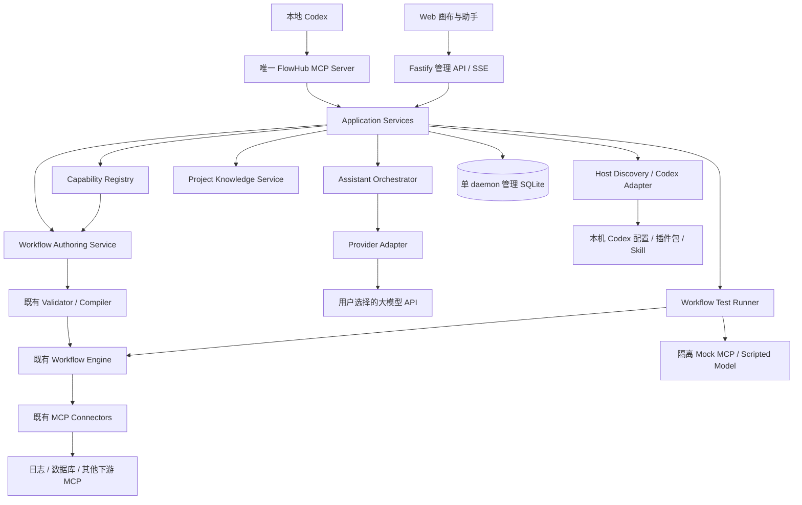
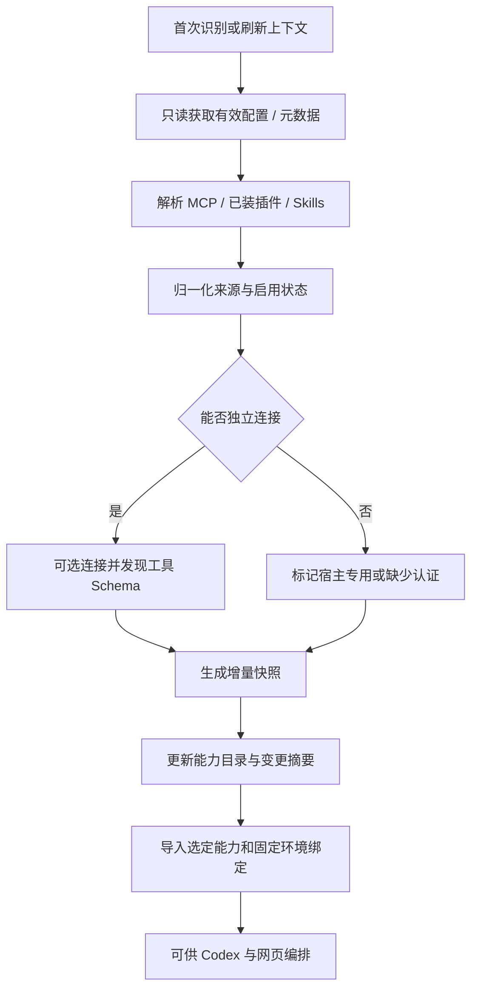
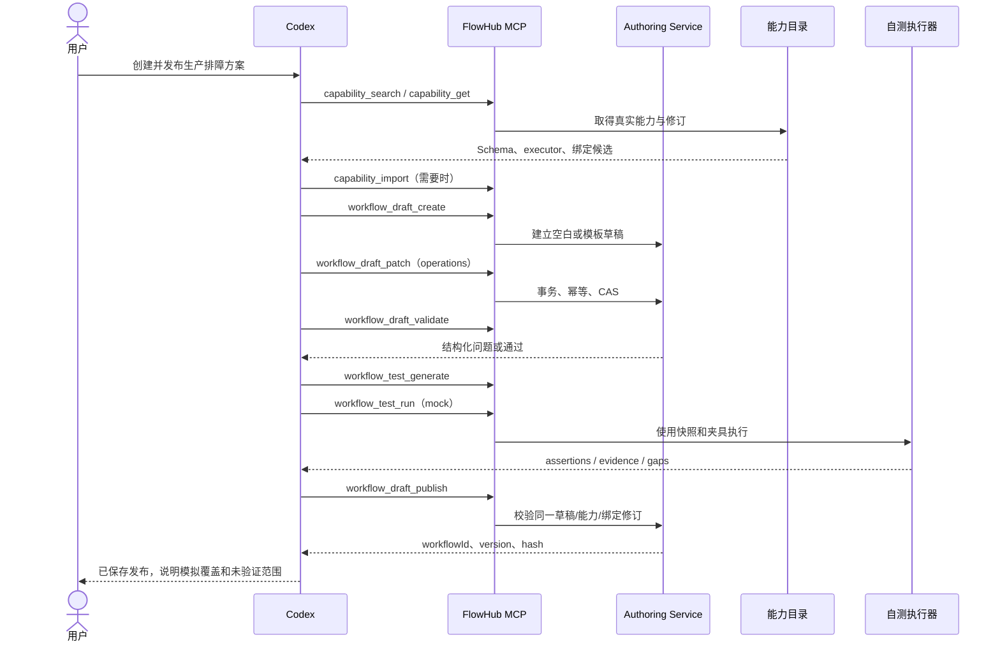
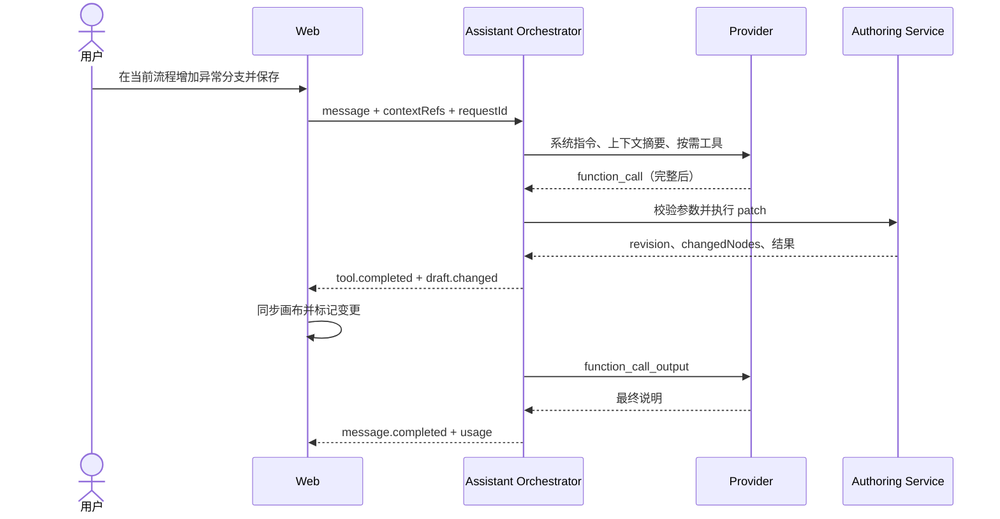
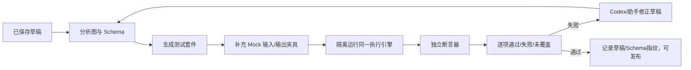
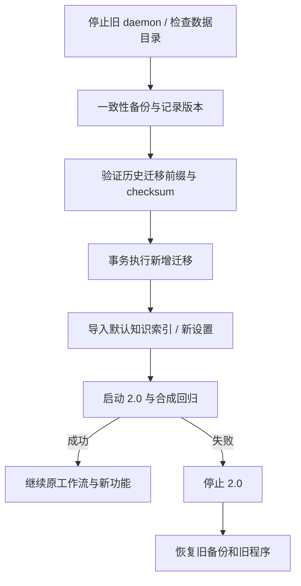
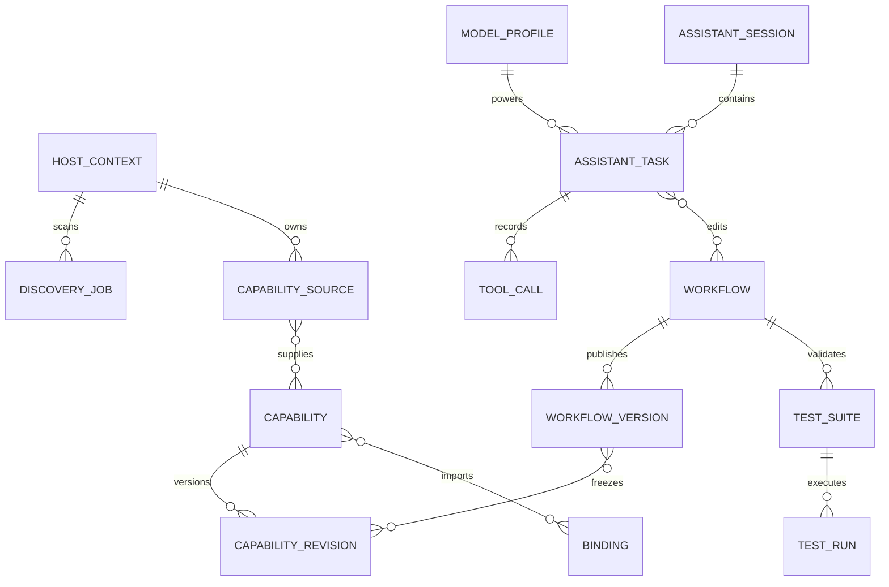
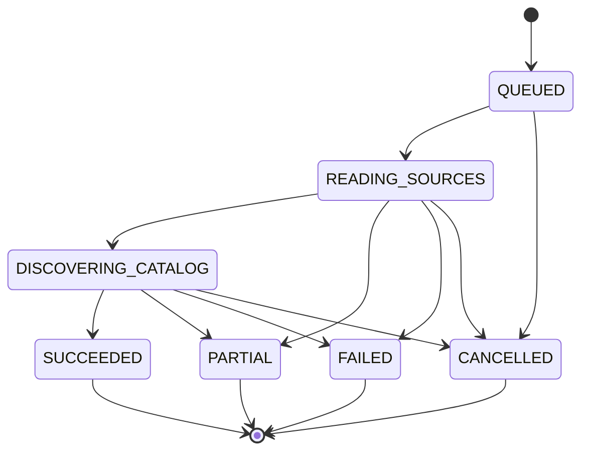
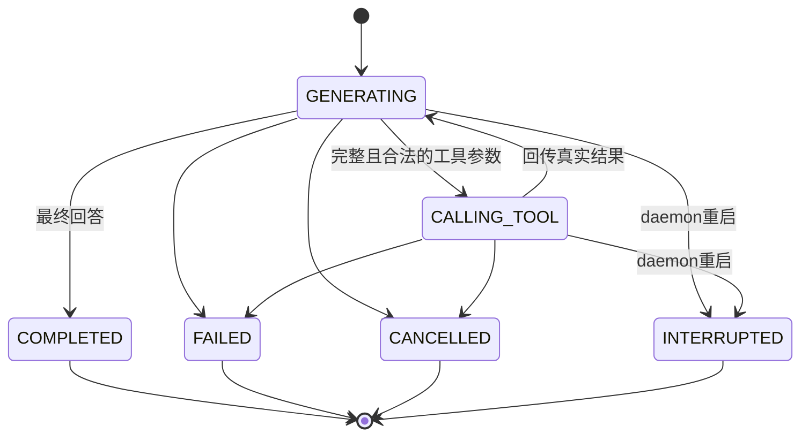

# 02｜MCP FlowHub 2.0 完整开发方案

> 版本：2.0-design.1。适用于现有仓库的本地增量升级。先阅读 01 的实际基线，再按 05 的分阶段任务实施。接口精确定义见 03；验收见 04；界面见 07。

## 1. 产品目标

让用户把 Codex 已有 MCP 和插件能力直接带入 FlowHub，通过 Codex 或内置助手用自然语言创建并复用可视化链路。2.0 的成功标准不是“增加一个聊天框”，而是**从真实能力发现到可执行工作流的闭环**。

### 1.1 三个主要使用场景

**场景 A：首次接入。** 本机打开 FlowHub → 自动检测 Codex → 选择用户/项目上下文 → 显示已有 MCP、插件、Skills → 自动同步工具目录 → 导入可连接能力。用户不用重复手工抄写全部 MCP 配置。

**场景 B：Codex 创建流程。** 用户说“用已安装的阿里云日志和数据库 MCP 创建生产排查流程，并保存发布”。Codex 查询能力、绑定环境、生成节点、映射参数、校验、生成测试、修正后发布。全程仍只连接一个 FlowHub MCP，不需要 FlowHub 的模型 Key。

**场景 C：网页 AI 助手。** 用户配置模型 Key 后，询问“这个项目怎么用”“为什么节点参数不匹配”，或要求“给当前流程增加订单不存在分支”。助手读取项目文档/当前画布/真实 Schema，直接调用统一编排服务，变更实时出现在画布上，可撤销。

### 1.2 非目标

不做另一个通用 Dify；不做公司权限审批中心；不做业务自动脱敏平台；不读整台电脑；不自动安装所有发现的插件；不让模型修改 Codex 全局配置或执行任意 shell；不承诺网页 Key 可以操作所有宿主私有插件。

### 1.3 功能清单

| 编号 | 功能 | 2.0 范围 | 完成定义 |
|---|---|---|---|
| DISC-01 | Codex 环境识别 | P0 | 记录版本、运行位置、CODEX_HOME、cwd/Profile 上下文 |
| DISC-02 | MCP 配置发现 | P0 | 用户/可信项目配置合并，来源、启用和连接状态可追踪 |
| DISC-03 | 插件与 Skill 索引 | P0 | 安装状态与市场可用项区分；插件组件可展开 |
| DISC-04 | 能力导入 | P0 | 已有连接可复用；导入不复制凭据到普通表、不改变源配置 |
| CAP-01 | 统一能力目录 | P0 | Tool Schema、Skill 元信息、executor、来源修订可查询 |
| AUTH-01 | 编排服务 | P0 | create/get/patch/validate/publish 同一套业务规则 |
| AUTH-02 | Codex 编排工具 | P0 | 创建、修改、自动修错、生成用例、自测闭环 |
| ASST-01 | 项目问答 | P0 | 版本化知识引用，当前错误有上下文，资料不足明确说明 |
| ASST-02 | AI 编排 | P0 | 不是代码块，是真实持久化草稿和可视化节点 |
| ASST-03 | 模型配置 | P0 | OpenAI Responses + 兼容 Chat Completions 两类适配，流式和能力检测 |
| ASST-04 | 当前画布协作 | P0 | 节点选择、变更、修订冲突、撤销、SSE 同步 |
| TEST-01 | 自动用例和 Mock | P0 | 工具调用生成用例，独立执行器断言，不由模型自判全通过 |
| RUN-01 | 执行器衔接 | P0 | Codex、内置助手与确定性运行路径清楚，不冒充宿主执行 |
| OPS-01 | 迁移、打包、恢复 | P0 | 旧库不丢、旧版本不改、Windows 原生验证 |
| CAP-02 | 能力变化影响分析 | P1 | Schema/配置漂移定位引用，AI 可以修复草稿 |
| ASST-05 | 运行轨迹转流程 | P1 | 仅处理有权取得的轨迹，避免伪造调用记录 |

## 2. 总体架构



### 2.1 必须保持的架构不变量

- 只有 daemon 持有业务数据库和写入权；bridge 无数据库、无模型循环、无独立扫描器。
- Web、MCP、内置助手调用同一份 Application Services，不能把内部 HTTP API 再通过匿名网络调用一遍来绕过 owner。
- 三个入口共享同一套 authoring operation、校验器、revision、幂等命令账本和事件。
- 能力目录是索引，不是凭据容器；原始业务输出继续保留，连接认证数据只走 Vault/secretRef。
- 所有执行来自发布版本或隔离测试快照；编辑草稿不会自动改动正在运行的版本。
- 本地助手使用 Key 时才调用模型；没有 Key 仍可用发现、手工画布、Codex 编排、确定性 Mock。

### 2.2 建议目录结构

```text
apps/
  daemon/src/                 # 复用入口；注册应用服务和后台任务
  mcp-bridge/src/             # 保持薄桥
  web/src/
    app/                     # 路由、会话、基础布局
    features/discovery/      # 宿主扫描、导入、能力详情
    features/workflows/      # 画布、属性、修订与发布
    features/assistant/      # 会话、工具卡片、上下文、任务进度
    features/models/         # Provider 配置
    features/testing/        # 生成用例、执行结果
    shared/                  # API client、事件、设计组件
packages/
  host-discovery/            # Codex 适配、配置解析、插件/Skill读取
  capability-registry/       # identity/revision/index/import
  workflow-authoring/        # 语义 operations、事务、布局、发布
  assistant-core/            # 工具循环、上下文构建、任务状态
  llm-providers/             # Responses / Chat Completions / Scripted
  project-knowledge/         # 文档分块、索引、引用、版本
  workflow-testing/          # 用例生成、Fixture、Mock隔离、断言
  contracts/                 # 继续作为协议唯一来源
  workflow-core/             # 复用引擎，不重写
  persistence/               # 顺序迁移、扩展表、任务账本
```

前端拆分必须保持现有行为，每次移动一块同时保留对应 UI 测试。不要以架构重构为由先将可运行产品重写为空壳。

## 3. Codex 自动发现设计

### 3.1 发现上下文，而不是扫描一个固定目录

`HostContext` 标识：`hostId + executionLocation + codexHome + canonicalCwd + profile + codexVersion`。

`executionLocation` 至少区分 `windows_native / wsl / macos / linux`。Windows 进程看见的配置与 WSL 用户配置不能混为一套；用户可创建多个上下文。不得把 WSL 路径直接作为 Windows STDIO 可执行路径。

首次进入时识别本机可执行 Codex、版本、用户目录；没有找到时允许手动选路径和“仅导入配置”。已选上下文记住后自动扫描，用户不必每次选择。启动扫描只读取元信息，不默认执行下游业务查询。

### 3.2 三层适配路径

**首选：本机受支持的 CLI/配置能力。** 运行 `codex --version`、`codex mcp --help`，发现 `list` 的机器可读选项后使用。命令行参数以实际版本 help/Schema 为准，不能假定所有安装均支持 `--json`。CLI 不可读时退回真实 TOML 解析器，不用正则解析 TOML。[S01]

**补充：版本锁定的 App Server 只读适配。** 使用安装版本生成的 Schema 对接 `config/read`、`skills/list`、`mcpServerStatus/list` 等已经可用的方法。建立 FlowHub 自己的短生命周期会话，不能声称附着到正在运行的 Desktop/IDE 会话。该进程可能初始化已配置 MCP，要展示扫描模式并限制同时启动的连接数。未知方法、版本不匹配、超时则退回元数据扫描，不拖垮全局发现。[S02]

**插件：本地 Manifest/安装索引。** 识别已安装包与启用配置；`.codex-plugin/plugin.json`、`.mcp.json`、`.app.json`、Skill 目录通过对应版本适配器解析。对新式根 `plugin.json/mcp.json` 采用独立格式适配并在本机版本验证后启用，不能按文件名猜其内容。

官方将 `plugin/list`/`plugin/read` 标为开发中；2.0 生产代码不依赖它们。不自动安装插件、不执行 hooks，不将市场中的所有条目当“已安装”。[S02][S03]

### 3.3 工作流



### 3.4 源优先级和可信度

有效配置优先使用宿主自身解析结果；只有静态文件时保留每层来源、项目可信状态和覆盖关系。不能自行实现一个似是而非的 Profile 合并规则并称为“当前生效配置”。结果带 `resolutionQuality=host_effective|static_merged|partial`。

禁止把发现器自己的进程环境当作 Codex Desktop 的环境。只读取变量引用名，例如 `DB_MCP_TOKEN`；实际值未取得时标记 `credentials_required`。从配置中导入明文凭据时，经专用本地服务直接写 Vault，常规扫描结果、聊天上下文和配置差异不携带其值。

### 3.5 状态是多个维度，不是一个绿色点

- 安装：installed / available_only / unknown。
- 启用：enabled / disabled / unknown。
- 发现：metadata_only / schema_discovered / partial / failed。
- 调用位置：hub_direct / codex_host / informational。
- 连接：not_checked / ready / credentials_required / unreachable / unsupported。
- 来源覆盖：complete / partial；包含错误项而非把失败解释为零安装。

只在相关维度满足时显示“可由 FlowHub 执行”。`app/list` 的可用性元信息与 `app/installed` 的安装运行态也不能混淆。[S02]

### 3.6 去重和同步规则

能力身份基于 `hostContext + source identity + logical server id + tool name`。同名不同连接绝不合并。相同端点也可能对应不同身份、租户和环境，不能只用 URL 去重。

保留 `sourceFingerprint`、`capabilityRevision`、`inputSchemaHash`、`outputSchemaHash`、`discoveredAt`。显示重复候选并复用已有明确匹配的 connection；插件来源和用户配置来源作为多个 source refs 留存。

MVP 首次、启动和手动刷新；可选本机定时元数据刷新，不以扫描失败删除已存在数据。源消失标记 stale，工作流引用可追踪；不自动删除或修改发布快照。Windows 透明加密读取失败、目录权限拒绝、损坏 TOML 单项记录错误。

### 3.7 防止发现器自调用递归

扫描 Codex 时会发现 FlowHub 自己。根据 server name、endpoint、command 规范化路径和 instanceId 识别 `self`，显示但不作为下游可导入能力。禁止形成 FlowHub → FlowHub → 同一工作流递归。扫描/协议检测禁止触发模型推理回合，不能启动 `codex exec` 来“问自己装了什么”。

## 4. 统一能力目录

### 4.1 领域对象

`HostContext` → `DiscoverySnapshot` → `DiscoveredComponent` → `CapabilityRevision` → `ImportedConnection/Binding`。

Component 表达插件、MCP Server、Skill；Capability 表达可用于编排的 Tool 或 Skill。插件本身不是一个可执行节点；展开后选择它提供的能力。

### 4.2 能力模型核心字段

`capabilityId`、`kind(mcp_tool|skill)`、`name`、`description`、`sourceRefs`、`executor`、`availability`、`contextId`、`inputSchema`、`outputSchema`、`schemaHashes`、`revision`、`bindingCandidates`、`provenance`。

目录只存模型可读的能力定义和凭据引用。`capability_get` 默认返回摘要；Schema/Skill 内容按需取，避免一次向模型塞进上千个工具。

### 4.3 连接导入

一次 `capability_import` 可以复用/创建本地 connection 和 binding，返回真实 ID，不向模型要求猜随机主键。导入参数必须给出来源修订和目标环境，预设锁定资源参数；结果包括需补的认证变量、不可调用原因。

导入只完成配置和工具发现，**不隐式执行一条数据库查询来验证**。现有“绑定验证”保留为连接配置的一部分，优先使用实际连接身份/服务端能力说明；只能通过业务探测获取的证据，需要显式测试动作及获准范围，而非伪造 `BINDING_VERIFIED`。这不是运行审批节点。

### 4.4 原生结果适配

P0 需要可接真实 MCP，而不只接内置 Mock。保存原始 MCP result；统一外层 Envelope 提供 `content[]`、`structuredContent?`、`isError`、`provenance`，不强求第三方返回顶层 environment。[S04]

- 有 structuredContent：按其真实 outputSchema 做映射。
- 只有 text：保留全文；明确选择 `text` 或声明式 JSON 解析适配器，不自动假设所有文本都是 JSON。
- 图片/资源引用：保留类型和引用，缺乏对应模型能力时说明，不能改造成虚假文本。
- 环境来源于绑定和真实资源路由；第三方返回的环境信息可交叉核对，但不能靠自行追加一个 environment 字段证明隔离。
- 行数/时间范围等限额能映射到工具参数时在**调用前**生效；无法下推时报告 unsupported，不以返回后截断宣称限额已执行。

适配器只负责结构，不做业务脱敏、不修改正文。文本解析失败返回精确问题，允许在画布选择解析策略；不新增任意代码执行节点。

## 5. Codex 自主编排

### 5.1 固定入口

2.0 提供 21 个固定工具：原七执行工具 + 十四发现/编排/测试工具。列表和契约见 03。工作流是数据，不生成新 Server、不动态注册每条工作流为单独 Tool。

旧执行身份仍可只看到七工具；新个人编排身份可看到 21 工具。不是新增 MCP 配置，而是同一个服务按已有身份呈现已配置的能力。个人默认配置包含编排权限，不要求每次向管理员申请。

### 5.2 一个统一 Authoring Service



### 5.3 不以大段 JSON 作为唯一编辑接口

提供语义操作：add/remove/update_node、connect/disconnect、set_mapping、set_binding、set_input_schema、set_output_schema、set_condition、set_metadata、move_nodes。AI 不直接写数据库，不通过编辑磁盘 JSON 偷绕校验。

一个 batch 原子提交。中间过程可以是未完成草稿，但每个 operation 结构有效、不得产生无效引用；完整图校验在 validate/publish 执行。删除节点默认有依赖即返回问题，只有显式 cascade 才一并删除关联边和映射。不能悄悄改变其他节点含义。

布局与语义分开：`revision` 保护语义，`layoutRevision` 保护位置。AI 连接新节点时局部布局，不覆盖用户手工摆放的整张图。内置自动布局只改变位置，不重写执行顺序。

### 5.4 自动修错

校验返回 `code/nodeId/path/expected/actual/suggestedOperation`。模型修正后再次校验，最多三轮；无法修复保留草稿和具体问题。环境不明确、同名工具多个候选时返回最少必要选择，不猜生产环境。无匹配能力时保留“待配置”节点，不宣称可运行。

### 5.5 草稿、发布和实际执行

“创建流程”默认生成保存草稿；“创建并发布”自动发布；“创建、测试并运行”可在同一任务完成这些动作。发布是版本化业务动作，不是人工审批状态。所有工具都可以由 Codex/助手调用，不要求切回 Web 点确认。

发布必须绑定准确草稿 revision、能力修订、绑定修订、目标版本。长模型响应完成时若草稿已被用户修改，返回冲突；最多基于新版本生成局部新 patch，不能整图覆盖。发布操作与幂等结果写入同一事务。

### 5.6 owner 与新建工作流可执行性

创建新草稿时，将其归属到当前 host/workspace。若现有 client 有 workflowAllowlist，创建成功后可以按该身份预先配置的“允许编排”能力，原子登记其新建工作流的使用关系。不得要求模型改 allowlist；不得授予其他已有流程权限。浏览器 guided 运行继续选择具体执行身份。

同一运行 owner 不随 AI task 自动变化。需要从网页交给 Codex 时使用已有明确归属的运行，或先不创建运行、输出 Codex 启动指令；不临时切为全权限令牌。

## 6. 内置 AI 智能助手

### 6.1 用户入口

右侧可伸缩聊天栏 + 独立 AI 工作台，共享会话。支持“帮助”“编排”两种模式：帮助模式仅检索和解释；编排模式可以调用工作流编辑工具。模式是能力上下文，不是审批步骤。

支持自然语言创建、修改、解释、生成测试、定位失败、说明升级影响。工具执行产生可展开卡片：真实方法、目标工作流、结果摘要、修订和耗时。聊天文字不能代替实际成功回执。

### 6.2 Provider 适配

P0 两个明确协议：`openai_responses` 与 `openai_compatible_chat`。兼容服务必须选协议，不能把所有 Base URL 都追加 `/responses`。后续原生 Anthropic/Gemini 是独立适配器，不作为 2.0 最小交付前置。

`ModelProfile`：id、providerKind、baseUrl、model、secretRef、timeout、capabilities、limits、lastTestAt。请求路径由适配器拼接，处理已有 `/v1`，不重复追加。模型名称由用户或实际列表选取，不写死某个最新型号，不复制 Codex 登录 OAuth 作为 API Key。

连接测试分为可达/认证、最小文本调用、最小工具调用、流式能力。列模型失败并不代表不能使用明确模型名。只支持文本的模型可问答，编排入口显示“不支持工具调用”，不能伪装执行。

### 6.3 工具调用循环

OpenAI 工具调用由模型返回调用请求，应用执行并把结果继续发给模型；流式参数片段不能当作完整请求立即执行。[S05]



会话状态：IDLE → GENERATING → CALLING_TOOL → GENERATING → COMPLETED；另有 CANCELLED/FAILED/INTERRUPTED。网络断开不自动复制执行；工具调用按 `taskId+callId` 持久化。幂等调用重放返回已有结果；外部 MCP 结果不明时继承 OUTCOME_UNKNOWN，不盲重试。

预算建议：每任务 12 轮模型调用、24 次工具调用、3 轮校验修错、180 秒默认请求超时、可取消。作为可配置上限而非计费报价。多个编辑工具串行；只读搜索可并行。遇到反复相同参数失败停止并给可操作错误。

Responses 与 Chat Completions 的 call id、消息形态、usage、流式终止字段分开适配。不要把一个 provider 的原始协议 JSON 直接传给另一个。保存合法继续调用所需的 provider items；只展示回答、工具动作与简短说明，不收集或展示模型私有推理。

### 6.4 上下文管理

默认发送：项目版本、帮助索引摘要、当前选定流程结构、相关 Tool Schema。业务日志/数据库结果仅当用户选定运行或要求分析该运行时附加；UI 显示来源和大致大小，不默认把全部历史数据发到外部模型。

不做业务自动脱敏。长度超限时分页或明确截断，原始产物仍完整保留；截断必须返回范围、总长和获取下一段的方法。凭据配置不作为模型上下文；这是连接管理，不是业务脱敏。

每次读取 run/artifact 都按当前会话 owner 校验，知识检索服务不能变成绕过权限的旁路。提示中的 API Key 由专用设置输入，不进入聊天记录。

### 6.5 问答知识库

P0 采用本地版本化 Markdown 分块 + SQLite FTS5；不强制 Embedding/独立向量数据库。[S07]

知识源只包含打包的当前版本用户文档、错误码、工具定义和按需读取的当前配置。开发设计资料与真实实现文档分开命名，避免将“计划新增”答成“已经支持”。每个 chunk 有 sourcePath、heading、lineStart、lineEnd、contentHash、productVersion、availability=implemented/planned。

**中文检索必须单独设计。** 不能只使用默认 Unicode 分词就认为支持中文问答。建议预生成中英文 token 列：ASCII 标识符分词 + CJK bigram + 领域同义词（试运行/staging、生产/production、编排/workflow）进入 FTS；短查询加精确标题/错误码匹配。保持原始文档和引用行号不变。中文样本集验证召回，具体 tokenizer 实现通过基准比较选择。

检索返回有限片段和引用。无足够证据时回答未知/当前版本没有，而不是编造接口。连接问题应优先读取真实错误状态，再结合说明；不执行连接测试就不能说“已经修好”。

## 7. 执行器与 Skill 边界

### 7.1 三种执行位置

| executor | 可执行对象 | 谁调用 | 限制 |
|---|---|---|---|
| hub_direct | FlowHub 独立可连接的 MCP | 既有 connectors | 必须有连接、认证和绑定 |
| codex_host | 仅宿主可用的插件工具/Skill | 当前 Codex 对话 | FlowHub 不共享其会话；结果标 host_reported |
| assistant_local | 模型分析、内置模板、已支持的纯指令 Skill | BYOK assistant worker | 不执行任意 Skill 脚本，不模拟不存在的宿主工具 |

### 7.2 DSL 演进

保持 `flowhub.workflow/v1` 读取和原七工具兼容。新增 `flowhub.workflow/v2`，仍用 input/mcp_tool/agent_task/condition/report_template/end 六类节点。v2 给 agent_task 增加受限执行描述：`executorRef`、`kind=analysis|host_skill|host_tool`、`capabilityRef`、`capabilityRevision` 和明确 outputSchema。具体字段见 03。

不能在 v1 Schema 的 `additionalProperties:false` 下偷加新字段。新字段进入 v2 契约，旧发布快照维持原样。新运行如果不需要新语义可继续运行 v1。

`host_tool` 节点进入 WAITING_AGENT，checkpoint 包含已解析的宿主工具标识、固定参数、输出契约。Codex 实际调用自己可用的对应工具，再经 workflow_advance 回传；工具不在会话中时明确 HOST_CAPABILITY_UNAVAILABLE。FlowHub 只能证明收到宿主提交，不能独立证明远端工具真实执行。

网页助手创建含 host_tool 的流程完全允许，但运行前说明 `requiresCodex=true`。纯 Key 任务不尝试复制认证或调用未支持的宿主 RPC。原来的报告 Skill 也遵循此界限。[S06]

### 7.3 内置助手运行

P0 完成：确定性 auto 工作流直接运行；guided 的 analysis 节点可由已选模型 profile 执行，使用同一 checkpoint/outputSchema/advance 服务；报告使用内置模板或明确支持的纯指令 Skill。host-only 节点需要 Codex executor，不静默降级。

助手 worker 和 Codex 都不能同时消费同一 checkpoint；使用现有 revision + checkpoint token + claim lease。模型返回无效 JSON不消费 checkpoint；重试有次数上限。助手停止后运行保持可解释状态，可继续或取消，不能假报成功。

## 8. MCP 生成测试用例与自测闭环

这是 2.0 P0，不是“开发期间写几个单测”替代。

### 8.1 用户可见流程



### 8.2 用例来源

确定性生成器按 inputSchema、required、enum、范围、条件、绑定映射生成基准用例。Codex可以经workflow_test_generate的agent_proposed模式提交业务场景、合成夹具与断言，无需FlowHub模型Key；内置助手也可调用同一入口。它们必须通过 schema 和独立断言器验证；不能自己写一句“测试通过”当结果。

支持正常链路、条件两分支、无日志、空数据库、缺必填、错误类型、连接超时、工具报错、Schema 漂移、环境参数冲突、重复提交与取消。嵌套条件不强求穷举指数级全部路径，报告 branch coverage 和不可达分支原因。

### 8.3 测试运行隔离

`mode=mock` 默认不读真实 secret，不连接真实 MCP。通过 connector factory 注入模拟 transport；Mock 服务也可使用官方 MCP 协议走真实 tools/list/call。测试不复制生产 binding 为“已验证”，只生成 `simulationOnly` 执行上下文。

若需要协议级探测，`mode=contract` 只发现工具和检查 Schema；若需要真实调用，`mode=live` 必须在具体测试请求写明目标 binding 和有限范围。日常“帮我生成用例并自测”只走 mock。

空 fixture 不用猜：标 FIXTURE_MISSING。宿主工具无 Codex 环境用 scripted result 只能证明数据流，不能证明宿主执行。使用两个独立哨兵确保生产、试运行分开。

### 8.4 发布与测试关系

模拟通过是质量信息，不增加人工审批关卡。发布仍必须满足结构与绑定规则。UI 可提示“尚未模拟”，用户明确发布可由工具完成。模拟结果绑定 draftRevision + capabilityRevision + fixtureHash，修改后标过期，不继续显示绿色通过。

### 8.5 自动验收产品自身

经官方 MCP Client 调用 FlowHub 的 create/patch/validate/test/publish/start/status，完成自举测试；不能只直接调用 Engine 的内部方法。

至少一组测试验证增加 100 条工作流后 MCP Server 数仍为 1、工具集合仍为固定 21；另保留七工具旧身份兼容。具体测试矩阵见 04。

## 9. 数据持久化与迁移

### 9.1 设计表

复用现有 connections/bindings/workflows/versions/runs/artifacts/secrets/clients。新增逻辑表：host_contexts、discovery_jobs、capability_sources、capabilities、capability_revisions、authoring_commands、workflow_test_suites、workflow_test_runs、model_profiles、assistant_sessions、assistant_messages、assistant_tasks、assistant_tool_calls、assistant_events、knowledge_documents、knowledge_chunks、knowledge_fts。

可按现有 id/revision/body 模式存业务对象，对需要分页检索的 contextId/workflowId/status/updatedAt 建索引投影。大结果放 artifacts，不在聊天消息和 job 行中复制多份原文。版本/依赖边关系需要可查询索引，不能每次读出所有 JSON 再扫描。

### 9.2 迁移必须先解决旧校验和

冻结旧 v1 DDL 与 checksum。新 migration registry 按版本按序执行 v2、v3……，每次记录独立 checksum；旧脚本不追写。启动只接受完整已知迁移前缀，遇未来版本拒绝启动，不能“修复”成空库。

升级前一致性备份；失败回滚事务。运行进程与模型请求、网络扫描均不得放在长 SQLite 事务内。跨步骤任务使用 durable job 状态。数据库历史 approvals 表可只读留存，不复活功能，不因删除无用表改变历史校验和。



### 9.3 运行和存储策略

扫描结果只保留必要历史；会话/测试数据由现有保留策略扩展管理。管理员可以删除会话，删除时不能误删仍被发布版本引用的能力快照。备份包含新增业务表和必要元信息，不打包明文 Key；索引可以重建。

## 10. API 与任务通信

现有 `/api/v1` 执行 API 不整体废弃；新增 `/api/v2` 发现、编排、助手、模型和测试路由。MCP 不通过 HTTP URL 版本识别，靠工具契约版本及能力元信息。

扫描、助手和测试均返回 job/task id。Web 使用带 eventId 的 SSE 获取进度，断线按游标补读；断线本身不重发修改。服务重启后未完成模型任务记 INTERRUPTED，已完成工具调用保持结果；可续写说明，但不重放外部副作用。

现有 UI SSE 应扩展或共享事件基础设施，不新写三套不兼容重连逻辑。事件类型见 03。

## 11. UI 与交互原则

冰蓝与白色、精致层次、克制但有科技感。不是深色画布，也不是只给黑白线框。左侧能力与页面导航、中间画布、右侧节点属性/AI 同区切换；不同时挤出三个窄侧栏。

新增“Codex 发现”“AI 工作台”“模型设置”“自测”入口。原有工作流库、连接、运行记录保留。AI 变更高亮可自动淡出，显示已真实保存的 revision；一键撤销产生反向 operation，不回退整个数据库。

桌面 1440×900 主适配；1366×768 不遮挡底部提交按钮；窄屏侧栏抽屉化。表格和 Schema 可横向滚动，整体页面不溢出。完整页面状态、组件和离线演示见 07 与 ui/ HTML。

## 12. 分阶段实施

| 阶段 | 任务 | 可独立验收产物 |
|---|---|---|
| S0 | 主干核对、Windows 失败定位、旧 DDL 冻结、约束更新 | 基线报告、干净分支、迁移测试 |
| S1 | Authoring Service、契约、事务、revision、幂等 | Web/MCP 调用同一套草稿服务，旧功能无回归 |
| S2 | HostContext、CLI/配置/插件/Skills 发现、目录导入 | 不用 Key 自动识别本机能力，来源和可用性准确 |
| S3 | 新 MCP 工具、Codex 自主编排和工具级自测 | 从自然语言到实际可运行草稿/发布版 |
| S4 | Provider、知识检索、助手多轮工具循环 | 问答有引用、无 Key 可降级、模型调用可取消 |
| S5 | AI 画布同步、局部布局、执行器衔接 | 助手创建/改图/修错可见且保存，host-only边界明确 |
| S6 | 用例生成完善、系统回归、实机集成、文档 | 固定测试集结果、真实 Codex 最小闭环证据 |
| S7 | 打包、升级恢复、Windows 验收、发布候选 | 安装/重启/升级/回滚记录与 RC 包 |

顺序上先统一编排服务，再发现和 MCP，再 AI；不要先做漂亮聊天 UI 后补所有真实动作。S2/S3 交付后，即使 S4 模型 Key 暂缺，也已获得完整 Codex 自主编排收益。

不以固定天数承诺完成；每阶段独立提交、证据明确，通过当前阶段退出条件再进入下一阶段。局部外部限制不阻塞无关模块开发，但不能跳过发布门槛。

## 13. 性能和体验验收目标

以下为目标，需记录测试硬件、输入规模和测量方法：

- 200 个能力时，缓存目录搜索 P95 ≤300ms；1000 个能力时仍可分页，不一次加载完整 Schema。
- 100 节点草稿，纯服务端结构校验 P95 ≤1s；不包括 MCP 网络往返。
- 扫描元数据 500 个组件目标 ≤5s；外部连接单项超时独立，总并发默认 4，失败不阻塞已发现项展示。
- AI 首 token 延迟受提供商影响，UI 在请求后 300ms 内显示任务状态，不能承诺固定模型响应秒数。
- 一次合法 patch 的持久化事件到画布应用，正常本机条件 P95 ≤500ms。
- 断网时手工编辑、搜索缓存能力、原七工具可用；外部 AI 错误不影响 daemon 健康。
- 自然语言测试至少 30 场景，每种目标 Provider 记录模型版本、运行次数、成功率和失败原因；核心任务重复 3 次，禁止只挑成功样本。

## 14. 发布前完成定义

三个真实入口闭环：

1. 本机扫描 Codex → 显示实际工具/插件/Skills → 选择导入 → 成功保存绑定。
2. 本地 Codex → FlowHub MCP 创建并修改工作流 → 生成用例并 mock 自测 → 发布 → 运行 → 实际读取报告。
3. 网页助手 + 用户 Key → 项目答疑有来源 → 创建/修改当前流程 → 浏览器刷新后仍存在 → 执行器兼容时运行，宿主专用时准确说明。

以及四条不退步：仍为一个 MCP Server；不新增人工审批；业务数据不自动替换；旧工作流与历史数据保留。全部详细条件见 04。

## 15. 关键领域关系与任务状态补充

### 15.1 领域关系图



这是逻辑关系图，不要求创建与图中英文名称一一对应的重复表。既有Binding、Workflow、Version、Run等优先复用；多对多依赖可用索引投影实现。

### 15.2 扫描任务状态



某来源失败不使其他成功项消失。取消后保留已取得的快照并标本次coverage，不能把半批次当成完整同步覆盖旧目录。

### 15.3 助手任务状态



任务终态不等于工作流运行终态；例如助手已完成“创建草稿”但尚未启动任何工作流。UI必须分别展示AssistantTask、WorkflowTestRun和WorkflowRun的状态，不能混用一个success。
